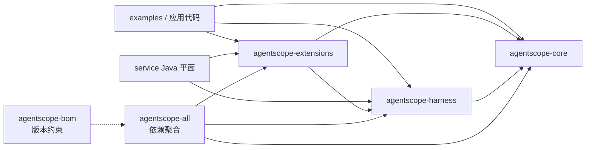
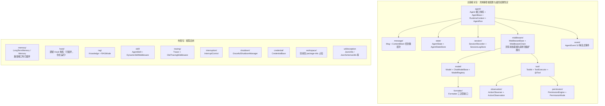

# 第 1 章 模块全景与依赖拓扑（核心）

> 本章回答三个问题：仓库里有哪些模块、它们之间怎么依赖、agentscope-core 内部的包怎么分工。
> 源码基线：官方 main `dcb131a3f257f06e2b7ddcd3dacfe75d31d04028`，`2.1.0-SNAPSHOT`，核对日期 2026-10-26。源码入口见 [基线与核对记录](SOURCE_BASELINE.md)。

## 1.1 七个 Maven 模块

根 `pom.xml`（`io.agentscope:agentscope-parent`）聚合 7 个模块；`<revision>` 当前是 **`2.1.0-SNAPSHOT`**，Java 基线是 17。这里描述固定提交上的源码，不以某个已发布版本替代 main。

| 模块 | 职责 | 内部依赖 |
|---|---|---|
| `agentscope-core` | Agent/ReAct、消息、状态、原生会话日志、模型抽象、工具、Middleware、事件、权限与动作观测。具体模型厂商实现位于 extensions | 无生产作用域的仓库内模块依赖；依赖 Reactor、Jackson、MCP SDK、HTTP、JSON Schema、OpenTelemetry 等第三方库 |
| `agentscope-harness` | 组合 ReActAgent，提供 AgentSession、上下文构建、工作区、文件系统、沙箱、子 Agent、记忆压缩、Plan Mode 与验证服务 | 生产作用域内部依赖仅 core；测试另依赖 core 的测试产物与 extensions-agui |
| `agentscope-extensions` | 模型、存储、RAG、长期记忆、渠道、协议、沙箱、评测与 Spring Boot Starter；22 个一级 Maven 模块，67 个 jar（66 个允许发布）；详细统计及口径见第 8 章 | 根据能力依赖 core 或 harness |
| `agentscope-service` | Agent 管控平台：Java 的 gateway / dataplane / scheduler / common，Go 的 `service-controlplane` 控制面，以及 Dashboard 前端；平台执行基于 Harness 的 Managed Agents | Java 平面按各自 POM 依赖 harness、extensions 与 Spring；不是 core 的运行前提 |
| `agentscope-examples` | `documentation`、`jev`，以及 paw / chat / dataagent / codingagent 四个应用模块 | 按示例 POM 引入 core / harness / extensions 或聚合依赖 |
| `agentscope-dependencies-bom` | 管理第三方依赖版本 | Maven dependencyManagement，不是执行时调用层 |
| `agentscope-distribution` | `agentscope-all` 依赖聚合与面向应用的 `agentscope-bom` | 分别聚合依赖和管理版本；BOM 不会自行把依赖放进 classpath |

依赖拓扑（箭头表示"依赖于"）：



图中 extensions 的箭头表示该组中存在这种依赖，并不表示每个扩展都依赖 harness。虚线表示版本管理，不是运行时调用。

**设计要点**：依赖方向严格单向，core 对 harness、extensions 一无所知。core 通过三类接缝把控制权交出去：
1. **SPI**（`ServiceLoader`）：如 `model/spi/ModelProvider`，让 `ModelRegistry` 能解析 `"dashscope:qwen-plus"` 这样的字符串 id；
2. **接口注入**：如 `AgentStateStore`、`LongTermMemory`、`Knowledge`，应用把实现塞进 Builder；
3. **Middleware/Tool**：harness 主要通过 `MiddlewareBase`、`AgentTool` 和会话接口组合能力；`AgentSession` 另负责会话操作编排，不应把全部能力都概括成中间件（第 7 章详述）。

## 1.2 agentscope-core 的 22 个包地图

包根：`agentscope-core/src/main/java/io/agentscope/core/`。顶层有 `ReActAgent.java`（6741 行）与 `Version.java`；共有 **22 个直接子包**。相较旧指南，必须补入 `session` 与 `observation`。`Version` 从构建生成的资源读取版本号。

下图按"主执行链路"把包分为核心与外围两圈，节点上的类是各包的代表类：



逐包速查表（各包细节在后续章节展开，此处建立索引）：

| 包 | 代表类（路径相对 `agentscope-core/src/main/java/io/agentscope/core/`） | 职责 | 详见 |
|---|---|---|---|
| （顶层） | `ReActAgent.java` | ReAct 循环唯一实现 | 第 3 章 |
| `agent` | `Agent.java`、`AgentBase.java`、`RuntimeContext.java`、`ExecutionIdentity.java`、`AgentRun.java`、`RunControl.java`、`accumulator/ReasoningContext.java` | Agent 接口体系、调用生命周期、每次调用的身份上下文、单次运行句柄、运行期控制与 ExecutionIdentity、流式分片累加 | 第 2、3 章 |
| `message` | `Msg.java`、`ContentBlock.java`、`GenerateReason.java` | 消息与内容块数据模型、循环终止原因 | 第 2 章 |
| `state` | `AgentState.java`、`AgentStateStore.java`、`JsonFileAgentStateStore.java` | 2.0 状态载体与持久化 | 第 2 章 |
| `session` | `SessionLog.java`、`SessionLogStore.java`、`SessionRecorder.java`、`SessionRecovery.java`、`AtomicSessionStorage.java` | 原生会话日志、checkpoint、执行恢复与具备原子能力的存储接口 | 第 2、3 章 |
| `observation` | `ActionObservation.java`、`ActionObserver.java`、`ActionObservations.java` | 对工具动作生成观测记录，并通过配置的 observer 交给外部保存或验证 | 第 4、7 章 |
| `model` | `Model.java`、`ChatModelBase.java`、`ModelRegistry.java`、`transport/HttpTransport.java` | 模型抽象、SSE 流式传输、字符串 id 解析 | 第 5 章 |
| `formatter` | `Formatter.java`、`AbstractBaseFormatter.java` | AgentScope 消息 ↔ 厂商协议互转 | 第 5 章 |
| `tool` | `Toolkit.java`、`ToolExecutor.java`、`Tool.java`（注解）、`ToolSchemaGenerator.java` | 工具注册、Schema 生成、反射执行、MCP | 第 4 章 |
| `middleware` | `MiddlewareBase.java`、`MiddlewareChain.java` | 五个变换切点与状态就绪、模型请求准备回调 | 第 6 章 |
| `event` | `AgentEvent.java`、`AgentEventType.java`、`AgentEventEmitter.java` | 细粒度流式事件（32 种，包含 TOOL_PROGRESS） | 第 6 章 |
| `permission` | `PermissionEngine.java`、`PermissionMode.java`、`PermissionContextState.java` | 工具权限（HITL 的基础） | 第 3 章 |
| `hook` | `Hook.java`、`LegacyHookDispatcher.java` | 1.x 钩子体系，`@Deprecated(forRemoval)` 但 2.0 仍在循环内触发 | 第 6 章 |
| `memory` | `LongTermMemory.java`、`Memory.java`（均已废弃但仍保留） | 兼容的长期记忆扩展点；会话上下文已迁往 `AgentState.getContext()` | 第 2 章 |
| `interruption` | `InterruptControl.java` | 会话级安全中断 | 第 3 章 |
| `shutdown` | `GracefulShutdownManager.java` | 优雅停机（按 requestId 追踪） | 第 3 章 |
| `tracing` | `Tracer.java`、`TracerRegistry.java`、`OtelTracingMiddleware.java` | 可观测性 | 第 6 章 |
| `rag` | `Knowledge.java`、`RAGMode.java` | RAG 扩展点 | 第 8 章 |
| `skill` | `AgentSkill.java`、`DynamicSkillMiddleware.java`、`repository/AgentSkillRepository.java` | Markdown 技能体系（部分类已废弃，repository 与 middleware 仍活跃） | 第 7、8 章 |
| `credential` | `CredentialBase.java` | 模型凭证与 ModelCard 列举 | 第 8 章 |
| `workspace` | `package-info.java` | 占位包，workspace 能力实际在 harness 实现 | 第 7 章 |
| `util` | `JsonUtils.java`、`JsonSchemaUtils.java`、`MessageUtils.java`、`ExceptionUtils.java` | JSON 编解码、Schema 生成、消息工具、异常链判定（如 `containsInterruptedException`，第 3 章 3.6 用到） | 各章穿插 |
| `exception` | `CompositeAgentException.java` | 框架异常类型（多异常聚合） | 各章穿插 |

## 1.3 推荐的源码阅读切入点

按"从数据到行为"的顺序：

1. `message/Msg.java`、`message/ContentBlock.java`、`state/AgentState.java`：先理解消息和可恢复状态。
2. `session/SessionRecorder.java`、`SessionLog.java`、`SessionStateAccess.java`：区分完整事件日志与当前模型上下文。
3. `agent/AgentBase.java`：从 `runLifecycle` 追到 `runInContext`、`runLifecycleBody`、`executeCallBody`，理解串行准入和 `usingWhen` 资源释放。
4. `ReActAgent.java`：从 `buildAgentStream`、`acquireCallExecution` 进入内部类 `CallExecution`，再读 `reasoning` / `acting` / `saveStateToSession`。
5. `tool/Toolkit.java` → `tool/ToolExecutor.java`：工具视图、拦截、参数校验、权限与执行结果分别在哪一层完成。
6. `model/ChatModelBase.java` → 选一个具体模型扩展：格式转换、HTTP 传输、分片合并与请求准备。
7. `agentscope-harness/.../agent/HarnessAgent.java` 与 `agent/session/AgentSession.java`：分别看构建期装配和会话操作入口。

具体方法的固定提交链接见 [基线与核对记录](SOURCE_BASELINE.md)，避免把其他版本的行号套到当前源码。

## 1.4 当前 main 的关键变化导航

本表列出相对旧指南需要重点重读的部分；每项以当前实现为准，不根据发布说明猜测 API。

| 章 | 当前应关注的行为 | 源码入口 |
|---|---|---|
| 第 2 章 | Native Session 与 legacy StateStore 并存；事件日志、投影、checkpoint、恢复和 execution lease 有不同职责 | `session/SessionRecorder`、`SessionProjection`、`SessionRecovery`、`AtomicSessionStorage` |
| 第 3 章 | 运行身份贯穿事件流；异步获取/释放会话资源；失败保存安全状态；服务端工具参与结束判定 | `ReActAgent#buildAgentStream`、`acquireCallExecution`、`saveStateAfterCallFailure`、`CallExecution#isFinished` |
| 第 4 章 | 单工具与批工具复用执行基础设施；参数须为完整合法 JSON；支持工具拦截器与进度事件 | `Toolkit#callTool`、`ToolExecutor`、`ToolCallInterceptor`、`ToolProgressEvent` |
| 第 5 章 | 模型调用前统一准备请求；Responses API 与 provider 服务端工具；流式工具参数和 metadata 保真 | `ModelRequestPreparer`、`ToolCallsAccumulator`、各 provider 的 formatter / parser |
| 第 6 章 | 五个变换切点之外还有状态就绪回调、请求准备扩展；事件类型增加到 32 个 | `MiddlewareBase`、`AgentEventType` |
| 第 7 章 | `AgentSession` 取代旧会话树/转录主路径；结构化上下文预算、按子 Agent 配置压缩、动作观测与确定性验证 | `agent/session`、`agent/context`、`agent/observation`、`agent/verification` |
| 第 8 章 | 模型、评测、starter 与渠道模块继续增加；平台与 extension 发布范围分开计数 | 各聚合 `pom.xml` 与 `agentscope-service` |

## 1.5 customer_work 实战：一个生产项目如何声明依赖

本节保留 customer_work `17007e4a` 的历史应用快照（依赖 `2.0.3`），用于展示应用如何组合框架；不代表它已迁移到本文的 `2.1.0-SNAPSHOT`。根 `pom.xml` 用 BOM 统一版本：

```xml
<dependency>
    <groupId>io.agentscope</groupId>
    <artifactId>agentscope-bom</artifactId>
    <version>${agentscope.version}</version>
    <type>pom</type>
    <scope>import</scope>
</dependency>
```

依赖集中声明在 `customer-work-starter/pom.xml`，共 20 个 artifact，按用途分组：

| 用途 | artifactId |
|---|---|
| 主干（core 经 harness 传递） | `agentscope-harness` |
| 模型五厂商 | `agentscope-extensions-model-{dashscope,openai,anthropic,gemini,ollama}` |
| 会话状态后端 | `agentscope-extensions-redis`、`agentscope-extensions-mysql` |
| 长期记忆 | `agentscope-extensions-mem0`、`agentscope-extensions-reme`、`agentscope-extensions-memory-bailian` |
| RAG | `agentscope-extensions-rag-{simple,dify,bailian}` |
| 调度 | `agentscope-extensions-scheduler-common`、`agentscope-extensions-scheduler-xxl-job` |
| 协议/网关/观测 | `agentscope-extensions-agui`、`agentscope-extensions-higress`、`agentscope-extensions-studio`、`agentscope-extensions-nacos-prompt` |

两个值得注意的工程决策（`customer-work-starter/pom.xml` 注释中明确记录）：

1. **模型实现必须逐个显式声明**——2.0.0 GA 起模型实现从 core 拆到 `io.agentscope.extensions.model.{provider}`，RC4 升 GA 时如果只依赖 core 会发现所有 `XxxChatModel` 类消失（这是该项目踩过的真实坑，见第 10 章）。
2. **`customer-channel` 额外依赖官方 Web 端 starter**（`agentscope-admin-spring-boot-starter`、`agentscope-chat-completions-web-starter`、`agentscope-agui-spring-boot-starter`），说明"扩展生态"里的 starter 与"业务基础设施"可以分模块各取所需。
