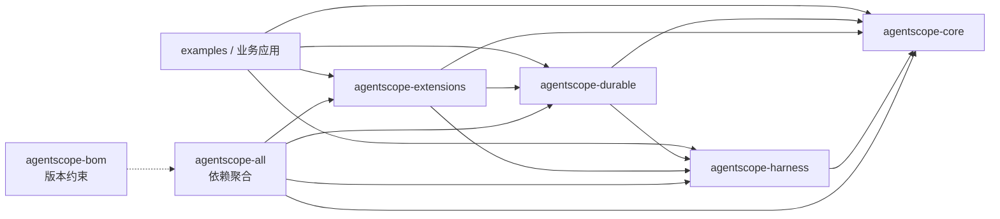
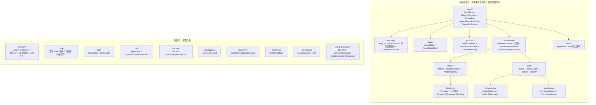

# 第 1 章 模块全景与依赖拓扑（核心）

> 本章回答三个问题：仓库里有哪些顶层模块、Core / Harness / Durable 三层边界怎么切分、`agentscope-core` 内部的 22 个包怎么分工。
> 源码基线：官方 main `80926f92df182d258118456ae458043af0d7e807`，`2.1.0-SNAPSHOT`，核对日期 2026-11-27。源码入口见 [基线与核对记录](SOURCE_BASELINE.md)。

## 1.1 七个顶层 Maven 模块与三层运行时边界

根 `pom.xml`（`io.agentscope:agentscope-parent`）聚合 **7 个模块**；`<revision>` 当前是 **`2.1.0-SNAPSHOT`**，Java 基线是 17。相较 `v2.1.0-BETA1` 及更早快照，原 `agentscope-service` 管控平台与 `agentscope-extensions-controlplane` 已于 `#4154` 移除，顶层正式确立 **`agentscope-durable`** 作为可嵌入的持久执行框架。

| 模块 | 职责 | 内部依赖 |
|---|---|---|
| `agentscope-core` | Agent/ReAct 循环、消息、状态、原生 `ThreadJournal` 日志（`core/journal/`）、模型抽象、工具与按需检索、Middleware（8 切点）、请求级授权（`CapabilitySurface`）与权限引擎、动作观测 | 无生产作用域的仓库内模块依赖；依赖 Reactor、Jackson、MCP SDK（`2.2.0`）、HTTP、JSON Schema、OpenTelemetry（`1.68.0`）等 |
| `agentscope-harness` | 组合 `ReActAgent`，提供上下文预算构建（`HarnessContextBuilder`）、工作区、文件系统、沙箱、子 Agent、记忆整理、压缩、Plan Mode、`WorkspaceThreadJournalStore` 与确定性验证服务 | 生产作用域内部依赖仅 `core`；测试另依赖 `core` 测试产物与 `extensions-agui` |
| `agentscope-durable` | 跨客户端断连、进程重启与节点替换的**长程持久执行层**：`durable-runtime`（状态机、租约与事件重放）、`durable-worker`（Hands 执行账本与可靠投递）、`durable-adapters`（`harness-agentscope`、`claude`、`agui`）。父 POM 默认 `maven.deploy.skip=true`，发布由显式流程触发 | `durable-runtime` 与 `durable-worker` 保持框架中立；`durable-adapter-harness-agentscope` 依赖 `core` 与 `harness` |
| `agentscope-extensions` | 模型、存储、RAG、长期记忆、渠道、协议、沙箱、**6 个 Durable 基础设施适配（`-durable-*`）**、评测与 Spring Boot Starter；**27 个一级 Maven 模块，72 个 jar（71 个允许发布）**；详细口径见第 8 章 | 按能力分别依赖 `core`、`harness` 或 `durable` |
| `agentscope-examples` | 聚合 **7 个模块**：`documentation`、`jev`、`durable`（含单体与 Brain-Hands 示例），以及 `paw` / `chat` / `dataagent` / `codingagent` 四个应用 | 按示例 POM 引入 `core` / `harness` / `durable` / `extensions` |
| `agentscope-dependencies-bom` | 集中管理第三方依赖版本（Jackson `2.21.1`、Spring Boot `4.0.4`、Reactor `2025.0.2`、MCP `2.2.0`、OpenAI Java `4.109.0`、Anthropic `2.72.0` 等） | Maven `dependencyManagement`，不是运行时调用层 |
| `agentscope-distribution` | `agentscope-all`（artifactId `agentscope`，通过 `<optional>true</optional>` 聚合可选依赖）与面向业务工程导入的 `agentscope-bom`（已纳入 Durable 及 `-durable-*` 坐标） | 分别管理聚合依赖与版本对齐；导入 BOM 不会自动把 jar 塞进 classpath |

模块依赖拓扑（实线箭头表示“依赖于”，虚线表示 BOM 版本约束）：



图中 `extensions` 指向 `durable` 与 `harness` 的箭头代表该组内存在对应子模块依赖（例如 `agentscope-extensions-durable-jdbc` 依赖 `durable-runtime`，`agentscope-extensions-agui` 可对接 `core` 或 `durable`），并不表示每个模型或存储扩展都依赖上层。

**核心架构取舍：三层职责不越界，单向依赖不回调**。
1. **`Core` 管“一轮原生调用（Run）怎么跑”**：只认识输入消息、`AgentState`、`ThreadJournal`、模型流与工具调用，不知道工作区目录树，也不知道跨进程任务队列。
2. **`Harness` 管“给模型喂什么上下文、在什么环境里执行工具”**：通过组合 `ReActAgent` + 一组有序 `MiddlewareBase` + `ModelRequestPreparer` + 工作区/沙箱工具把编码与通用智能体工程化。
3. **`Durable` 管“任务（Turn）如何在断连、重启、跨主机与长耗时工具之间存活”**：不重写 ReAct 循环，而是通过 `core` 预留的四类窄接缝接入：
   - **SPI（`ServiceLoader`）**：如 `model/spi/ModelProvider`，让 `ModelRegistry` 解析 `"dashscope:qwen-plus"` 或 `"prod@openai:gpt-4o"`；
   - **存储与观测接口注入**：如 `ThreadJournalStore`、`AgentStateStore`、`ActionObserver`、`CapabilityResolver`；
   - **Middleware / RequestPreparer / Tool**：Harness 与业务横切治理的主通道；
   - **执行宿主协作契约（2.1 新增）**：`AgentExecutionHost`（在 `REASONING / MODEL / ACTING / FINALIZATION` 四个恢复边界注入控制信号、处理 `steer/pause`）与 `ModelInvocation`（将模型推理投递到外部队列或租约 Worker）。

## 1.2 agentscope-core 的 22 个包地图

包根：`agentscope-core/src/main/java/io/agentscope/core/`。顶层仅有 `ReActAgent.java`（7676 行）与 `Version.java`；直接子目录共 **22 个子包**。相较 `v2.1.0-BETA1` 之前的快照，原 `core/session/` 已整体演进并重命名为 **`core/journal/`**（格式版本 `FORMAT_VERSION = 2`），职责收束为纯粹的“按 Thread 原子追加日志、投影与显式恢复”，把会话级任务队列与 `steer` 交互交还给上层 `agentscope-durable`。

下图按“主执行链路”把 22 个包分为核心与外围两圈：



逐包速查表（路径相对 `agentscope-core/src/main/java/io/agentscope/core/`）：

| 包 | 代表类 | 职责 | 详见 |
|---|---|---|---|
| （顶层） | `ReActAgent.java`、`Version.java` | ReAct 循环实现与构建期版本号读取 | 第 3 章 |
| `agent` | `Agent.java`、`AgentBase.java`、`RuntimeContext.java`、`ThreadKey.java`、`ExecutionIdentity.java`、`AgentRun.java`、`AgentExecutionHost.java`、`CapabilitySurface.java`、`accumulator/ReasoningContext.java` | 调用生命周期、四级身份、单次运行句柄、宿主恢复边界、请求级能力授权面与流式分片累加 | 第 2、3 章 |
| `message` | `Msg.java`、`ContentBlock.java`、`DocumentBlock.java`、`GenerateReason.java`、`ToolErrorMetadata.java` | 消息与 10 种内容块模型、13 种终止/暂停原因、工具错误分类元数据 | 第 2 章 |
| `state` | `AgentState.java`、`AgentStateStore.java`、`JsonFileAgentStateStore.java` | 可恢复状态载体与键值/版本化持久化接口 | 第 2 章 |
| `journal` | `ThreadJournal.java`、`ThreadJournalStore.java`、`InvocationRecorder.java`、`JournalProjection.java`、`ThreadRecovery.java`、`AtomicJournalStorage.java`、`RecordedModels.java` | 原生 Thread 事件日志、checkpoint、2.0 状态基线自动导入、模型延迟续跑与未决副作用对账恢复 | 第 2、3 章 |
| `observation` | `ActionObservation.java`、`ActionObserver.java`、`ActionObservations.java` | 为工具调用（含权限拒绝与未授权拒绝）生成结构化动作观测记录 | 第 4、7 章 |
| `model` | `Model.java`、`ChatModelBase.java`、`ModelRegistry.java`、`transport/HttpTransport.java` | 模型流式抽象、按请求 `modelId` 与 `contextId@modelId` 解析、SSE 传输 | 第 5 章 |
| `formatter` | `Formatter.java`、`AbstractBaseFormatter.java`、`DocumentReferenceRenderer.java` | AgentScope 消息 ↔ 厂商协议互转及多模态文档引用降级渲染 | 第 5 章 |
| `tool` | `Toolkit.java`、`ToolExecutor.java`、`Tool.java`、`search/ToolSearchMiddleware.java`、`mcp/McpClientManager.java` | 工具注册、Schema 生成、按需工具搜索（`tool_search`）、并发分区执行与 MCP 2.2 接入 | 第 4 章 |
| `middleware` | `MiddlewareBase.java`、`MiddlewareChain.java`、`ActivePointsResolver.java`、`ModelRequestPreparer.java` | 4 个洋葱切点 + 1 个管道切点 + 3 个生命周期通知/收尾切点，以及最终模型请求编译器契约 | 第 6 章 |
| `event` | `AgentEvent.java`、`AgentEventType.java`、`AgentEventEmitter.java` | 32 种细粒度不可变流式事件与父子 Agent 转发通道 | 第 6 章 |
| `permission` | `PermissionEngine.java`、`PermissionMode.java`、`PermissionContextState.java` | 工具级规则评估与 HITL 人工确认状态机 | 第 3 章 |
| `hook` | `Hook.java`、`LegacyHookDispatcher.java` | 1.x 钩子体系，`@Deprecated(forRemoval = true)` 但循环内仍兼容触发 | 第 6 章 |
| `memory` | `LongTermMemory.java`、`Memory.java`（均已废弃） | 1.x 兼容扩展点；会话历史早已迁入 `AgentState.getContext()` | 第 2 章 |
| `interruption` | `InterruptControl.java` | 单次执行级协作式中断信号 | 第 3 章 |
| `shutdown` | `GracefulShutdownManager.java` | 进程优雅停机与按 `requestId` 在途追踪 | 第 3 章 |
| `tracing` | `Tracer.java`、`TracerRegistry.java`、`OtelTracingMiddleware.java` | OpenTelemetry GenAI 语义埋点与旧 Tracer 兼容桥 | 第 6 章 |
| `rag` | `Knowledge.java`、`RAGMode.java` | RAG 检索扩展点 | 第 8 章 |
| `skill` | `AgentSkill.java`、`DynamicSkillMiddleware.java`、`repository/AgentSkillRepository.java` | Markdown 技能模型与仓库抽象（Harness 提供完整运行时治理） | 第 7、8 章 |
| `credential` | `CredentialBase.java` | 模型凭证与 `ModelCard` 列举 | 第 8 章 |
| `workspace` | `package-info.java` | 占位包，工作区实现位于 `agentscope-harness` | 第 7 章 |
| `util` / `exception` | `JsonUtils.java`、`JsonSchemaUtils.java`、`MessageUtils.java`、`ExceptionUtils.java`、`CompositeAgentException.java` | JSON 编解码、Schema 生成、消息配对工具与多异常聚合 | 各章穿插 |

## 1.3 推荐的源码阅读切入点

按“从数据结构到单次循环，再到工程外壳与跨进程恢复”的顺序最省力：

1. `message/Msg.java`、`message/ContentBlock.java`、`state/AgentState.java`：先看清不可变消息与可变恢复状态的分工。
2. `agent/ThreadKey.java`、`journal/InvocationRecorder.java`、`journal/JournalProjection.java`：理解 `Session → Thread → Turn → Run` 四级坐标，以及 `ThreadJournal` 如何与 2.0 `AgentStateStore` 自动导入和镜像。
3. `agent/AgentBase.java`：顺着 `runLifecycle → runInContext → runLifecycleBody → executeCallBody`，看清按 Thread 串行门闩、`usingWhen` 资源边界与取消写保护。
4. `ReActAgent.java`：从 `buildAgentStream`、`acquireCallExecution`、`beforeAgentExecution` 进入内部类 `CallExecution`，读透 `reasoning`、`acting`、`CapabilitySurface` 裁剪与 `saveStateToSession`。
5. `tool/Toolkit.java`、`tool/ToolExecutor.java`、`tool/search/ToolSearchMiddleware.java`：掌握工具三层视图（服务端授权面、外部请求工具、按需工具检索）与并发分区执行。
6. `model/ChatModelBase.java`、`model/ModelRegistry.java`：看清流式超时重试边界、`contextId@modelId` 解析与多模态文档生命周期。
7. `agentscope-harness/.../agent/HarnessAgent.java`（`Builder#build`）：理解上下文预算、工作区、沙箱、压缩和子 Agent 如何拼装进同一个 `ReActAgent`。
8. `agentscope-durable/.../DurableRuntime.java` 与 `AgentScopeAdapter.java`：最后看跨重启/多副本下 Turn 租约调度、队列化模型与 Brain–Hands 工具解耦如何闭环。

## 1.4 当前 main 的关键演进导航

下表汇总相对早期 2.0 / 2.1-BETA1 需要重点关注的源码变化：

| 章 | 当前主干的核心机制 | 关键源码入口 |
|---|---|---|
| 第 2 章 | `ContentBlock` 增至 10 种（含 `DocumentBlock`）；`GenerateReason` 增至 13 种（含 `HOST_PAUSED`）；`core/journal/` 取代 `core/session/`，支持空 `main` 线程自动导入 2.0 `agent_state` 并双向镜像；Builder 权限规则首次激活生效且 `ConfirmResult` 规则持久化 | `DocumentBlock`、`InvocationRecorder#importBaseline`、`ReActAgent#activateSlotForContext`、`ThreadRecovery#reconcile` |
| 第 3 章 | `CapabilityResolver` 请求级授权面在权限门前无感裁剪；`AgentExecutionHost` 提供四处可恢复暂停边界；`streamEvents` 原生支持结构化输出；HITL 提示发出前先持久化 `ASKING` 状态；取消时保持会话门闩直至异步落盘结束 | `CapabilitySurface`、`AgentExecutionHost`、`ReActAgent#streamEvents`、`ReActAgent#releaseCallExecution` |
| 第 4 章 | 新增 `ToolSearchMiddleware` 按需工具发现；`@Tool` 新增 `evictable / prunable / timeoutManaged / system` 并支持直接返回 `ContentBlock`；重复注册工具快速失败；MCP SDK 升级至 `2.2.0` | `ToolSearchMiddleware`、`Toolkit`、`ToolExecutor`、`McpClientManager` |
| 第 5 章 | `RuntimeContext.modelId` 支持按请求切模型；`ModelRegistry` 统一 `contextId@provider:model` 语法与并发单飞创建；全链路打通 `DocumentBlock` / `FileIdSource` | `ModelRegistry`、`ReActAgent#resolveModelAtEntry`、`DocumentReferenceRenderer` |
| 第 6 章 | `MiddlewareBase` 扩展至 8 个切点（新增 `ON_AGENT_EVENT` 同步观测与 `ON_AGENT_FINISH` 异步收尾）；`ActivePointsResolver` 自动推断未声明中间件的实现方法；`ContextConventionsMiddleware` 使用 `MAX_VALUE - 1000` 排在最外层 | `MiddlewareBase`、`ActivePointsResolver`、`ContextConventionsMiddleware` |
| 第 7 章 | `harness/agent/journal/`（`WorkspaceThreadJournalStore` + SQLite/Local/Store 三套存储）取代原 `AgentSession`；新增 `RepeatedFailureGuard`、`HarnessToolBindings`、`WorkspaceMessageBus` 原子双文件队列与压缩溯源 | `HarnessAgent.Builder#build`、`WorkspaceThreadJournalStore`、`CompactionMiddleware` |
| 第 8 章 | 新增 **`agentscope-durable`** 及 6 个 `-durable-{jdbc,http,sandbox,rocketmq,objects,mcp}` 扩展（取代原 `agentscope-service`），实现嵌入式 SQLite/PostgreSQL 持久执行、队列化模型与 Brain–Queue–Hands | `DurableRuntime`、`AgentScopeAdapter`、`AgentScopeExecutionHost`、`RocketMqWorker` |

## 1.5 customer_work 实战：一个生产项目如何声明依赖

本节保留 customer_work `17007e4a` 的历史应用快照（依赖 `2.0.3`），用于展示应用如何组合框架；不代表它已迁移到本文的 `2.1.0-SNAPSHOT`。根 `pom.xml` 用 BOM 统一版本：

```xml
<dependency>
    <groupId>io.agentscope</groupId>
    <artifactId>agentscope-bom</artifactId>
    <version>${agentscope.version}</version>
    <type>pom</type>
    <scope>import</scope>
</dependency>
```

依赖集中声明在 `customer-work-starter/pom.xml`，共 20 个 artifact，按用途分组：

| 用途 | artifactId |
|---|---|
| 主干（core 经 harness 传递） | `agentscope-harness` |
| 模型五厂商 | `agentscope-extensions-model-{dashscope,openai,anthropic,gemini,ollama}` |
| 会话状态后端 | `agentscope-extensions-redis`、`agentscope-extensions-mysql` |
| 长期记忆 | `agentscope-extensions-mem0`、`agentscope-extensions-reme`、`agentscope-extensions-memory-bailian` |
| RAG | `agentscope-extensions-rag-{simple,dify,bailian}` |
| 调度 | `agentscope-extensions-scheduler-common`、`agentscope-extensions-scheduler-xxl-job` |
| 协议/网关/观测 | `agentscope-extensions-agui`、`agentscope-extensions-higress`、`agentscope-extensions-studio`、`agentscope-extensions-nacos-prompt` |

两个值得注意的工程决策（`customer-work-starter/pom.xml` 注释中明确记录）：

1. **模型实现必须逐个显式声明**——2.0.0 GA 起模型实现从 core 拆到 `io.agentscope.extensions.model.{provider}`，RC4 升 GA 时如果只依赖 core 会发现所有 `XxxChatModel` 类消失（这是该项目踩过的真实坑，见第 10 章）。
2. **`customer-channel` 额外依赖官方 Web 端 starter**（`agentscope-admin-spring-boot-starter`、`agentscope-chat-completions-web-starter`、`agentscope-agui-spring-boot-starter`），说明“扩展生态”里的 starter 与“业务基础设施”可以分模块各取所需。若新项目需要跨重启任务恢复与长耗时工具解耦，在当前 `2.1.0-SNAPSHOT` BOM 下可按需叠加 `agentscope-durable-adapter-harness-agentscope` 与 `agentscope-extensions-durable-jdbc`（详见第 8 章 8.3）。
