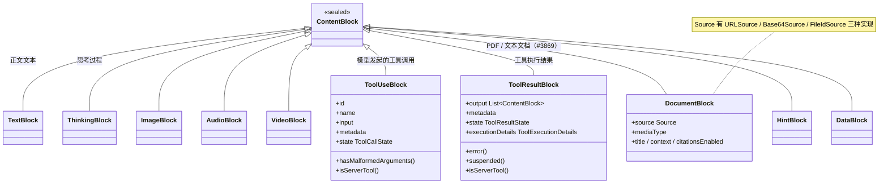
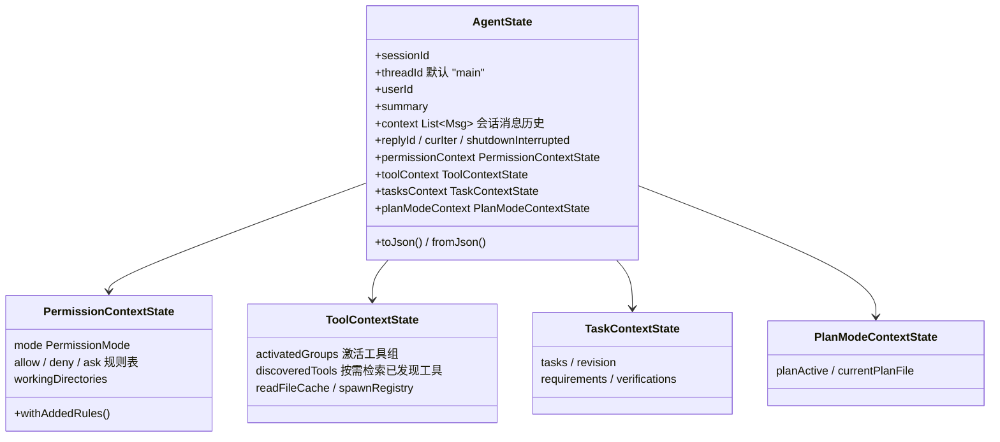
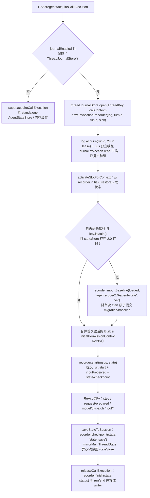
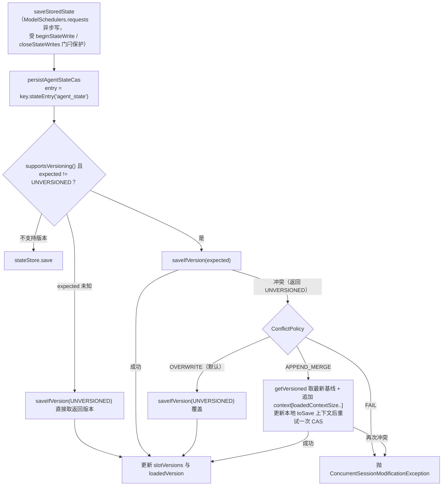

# 第 2 章 消息与状态模型（核心）

> 数据模型是理解一切执行与恢复行为的前提。本章讲四样东西：消息（`Msg` / `ContentBlock`）、可恢复状态（`AgentState`）、双轨持久化（原生 `ThreadJournal` 与 `AgentStateStore`），以及单次调用的上下文坐标（`RuntimeContext` / `ThreadKey`）。
> 路径前缀：`agentscope-core/src/main/java/io/agentscope/core/`
> 源码基线：上游 main `80926f92df182d258118456ae458043af0d7e807`（`2.1.0-SNAPSHOT`）。正文描述该提交的当前行为；历史版本差异单独标明。

固定提交源码入口：[ToolUseBlock](https://github.com/agentscope-ai/agentscope-java/blob/80926f92df182d258118456ae458043af0d7e807/agentscope-core/src/main/java/io/agentscope/core/message/ToolUseBlock.java#L48)、[ToolResultBlock](https://github.com/agentscope-ai/agentscope-java/blob/80926f92df182d258118456ae458043af0d7e807/agentscope-core/src/main/java/io/agentscope/core/message/ToolResultBlock.java#L66)、[TaskContextState](https://github.com/agentscope-ai/agentscope-java/blob/80926f92df182d258118456ae458043af0d7e807/agentscope-core/src/main/java/io/agentscope/core/state/TaskContextState.java#L34)、[InvocationRecorder](https://github.com/agentscope-ai/agentscope-java/blob/80926f92df182d258118456ae458043af0d7e807/agentscope-core/src/main/java/io/agentscope/core/journal/InvocationRecorder.java#L116)、[ThreadRecovery](https://github.com/agentscope-ai/agentscope-java/blob/80926f92df182d258118456ae458043af0d7e807/agentscope-core/src/main/java/io/agentscope/core/journal/ThreadRecovery.java#L31)、[状态权威与加载](https://github.com/agentscope-ai/agentscope-java/blob/80926f92df182d258118456ae458043af0d7e807/agentscope-core/src/main/java/io/agentscope/core/ReActAgent.java#L858)。

## 2.1 Msg：一切内容的载体

`message/Msg.java`：

```text
Msg = id + name + role(MsgRole) + List<ContentBlock> + metadata(Map) + timestamp + usage(ChatUsage)
```

要点：

- **七个字段全部 `final`，改一处就得新开一条**。`withContent` / `withMetadata` / `withGenerateReason` 都是 `new Msg(...)` 返回新对象，`id` 沿用；`equals` / `hashCode` 按消息值语义逐元素比较（`#3842`，已回合 `2.0.5`）。同一条消息会同时被会话上下文、事件流、日志与存储层引用，一个 Agent 实例又要并发服务多个会话，不可变消息避免了跨线程/跨订阅篡改。
- **“不可变”有一个缺口：`metadata`**。`content` 在构造函数里经 `stream().toList()` 变成不可变列表，但 `metadata` 是新建的 `HashMap`，`getMetadata()` 直接把它返回出去。框架内部在 `getChatUsage()` 发现 `_chat_usage` 是反序列化得到的 `Map` 时会原地转成 `ChatUsage` 写回。因此业务代码追加标记请一律走 `withMetadata`，不要在拿到的 `Map` 上直接 `put`。
- **角色决定能装哪些内容块**。构造函数末尾调用 `validateRoleContent`：`USER` 允许携带文本、`DataBlock`、图片/音频/视频块以及新增的 **`DocumentBlock`**（`#3869`）；`SYSTEM` 只能带文本块；`ASSISTANT` 与 `TOOL` 不限制。违反直接抛 `IllegalArgumentException`。
- **一条消息可以同时携带多种内容块**：一条助手消息可能既有 `ThinkingBlock`、`TextBlock` 又有多个 `ToolUseBlock`——这是理解 ReAct 循环结束判据的关键（第 3 章 `isFinished`：普通路径判“无工具调用且有非空白 `TextBlock`”，服务端工具全部带有配对结果时也可结束；只有思考没有正文的回复不算结束，会注入空回复提醒再要一次）。
- **metadata 上的两组约定 key**：
  - `Msg` 中的 `agentscope_*` 常量：`METADATA_GENERATE_REASON`（终态原因）、`METADATA_CONFIRM_RESULTS`（HITL 确认结果回传）、`METADATA_CONFIRM_REQUEST_REPLY_ID` / `METADATA_EXTERNAL_EXECUTION_REQUEST_REPLY_ID`（暂停与恢复的回复关联 id）、`METADATA_SYNTHETIC` / `METADATA_REMINDER_KIND`（框架或中间件合成的瞬态提醒消息）。
  - `message/MessageMetadataKeys.java` 中的下划线常量：`_chat_usage`、`_structured_output`、`_cache_control`、`_bypass_multiagent_history_merge`、结构化输出提醒标记、`_summary_failed`、`_tool_return_direct` 与 `_output_limit_reached`。
- 便捷子类：`UserMessage` / `AssistantMessage` / `SystemMessage` / `ToolResultMessage`，角色固定，反序列化时 Jackson 按 `@JsonTypeInfo(property = "role")` 选择子类。

**厂商推理签名为什么必须原样带回**。带深度思考的模型会在响应里附带加密推理链或签名，并要求下一轮原封不动回传：

| 字段 | 存放位置 | 来源 |
|---|---|---|
| `reasoning_details` / `encrypted_content` | `ThinkingBlock.metadata`（`METADATA_REASONING_DETAILS` / `openai.reasoning.encrypted_content`） | OpenAI 兼容接口 / Responses API / OpenRouter / Gemini |
| `thought_signature` | `ToolUseBlock.metadata["thoughtSignature"]`（`METADATA_THOUGHT_SIGNATURE`） | Gemini 3：每个 `functionCall` 都要带回 |

> **历史差异（对照 v2.0.3）**：2.0.3 在流式拼接 `ThinkingAccumulator` 时会丢弃或覆盖列表型 metadata，且经 JSON 落盘再读回后 `byte[]` / 强类型对象退化为 Base64 字符串或 `LinkedHashMap`，导致 Gemini 3 报 `400 INVALID_ARGUMENT`。`2.0.5` 与当前 `main` 均已通过 `ThinkingAccumulator#mergeMetadata` 与双形态兼容解析修复（`#3038`、`#3128`、`#2910`）。

## 2.2 ContentBlock：10 子类密封多态层次与 GenerateReason

`message/ContentBlock.java` 是 **sealed class**，当前 `permits` 列表包含 **10 个子类**（新增 `DocumentBlock`），配合 Jackson `@JsonTypeInfo(property = "type")` 做多态序列化：



10 个子类按职责分四组：**给人与模型读的文本/推理**（`TextBlock`、`ThinkingBlock`、`HintBlock`）、**多模态与文档**（`ImageBlock`、`AudioBlock`、`VideoBlock`、`DocumentBlock` 及通用 `DataBlock`；其中 `Source` 新增了面向百炼 `qwen-long` / OpenAI Files 等文件句柄的 **`FileIdSource`**）、**工具往来**（`ToolUseBlock`、`ToolResultBlock`）。密封类意味着每加一种块，所有厂商 Formatter 都要显式决定原生映射还是降级渲染（例如 `DocumentBlock` 在不支持原生文档块的模型上由 `DocumentReferenceRenderer` 降级为结构化引用文本，见第 5 章）。

工具往来上的**三个状态与错误载体**：

- **`ToolCallState`**（挂在 `ToolUseBlock` 上，5 值）：`PENDING` / `ASKING` / `ALLOWED` / `SUBMITTED` / `FINISHED`。新解析出来为 `PENDING`；触发人工确认时改为 `ASKING` 并先落盘再发事件（`#3699`）；获批后升为 `ALLOWED`。
- **`ToolResultState`**（挂在 `ToolResultBlock` 上，6 值）：`SUCCESS` / `ERROR` / `INTERRUPTED` / `DENIED` / `RUNNING` / `SUSPENDED`。
- **结构化工具错误元数据（`ToolErrorKind` + `ToolErrorMetadata`）**：`ToolResultBlock.metadata` 通过约定键 `agentscope_error_kind`（12 种枚举值，如 `NOT_FOUND`、`INVALID_ARGUMENT`、`TIMEOUT`、`PERMISSION_DENIED`、`EXECUTION_FAILED` 等）、`agentscope_error_scope` 与 `agentscope_retriable` 暴露机器可读的失败分类，配合 `ToolExecutionDetails(kind, outcome, exitCode, outputTruncated)` 供上层重试器、RepeatedFailureGuard 与观测系统精确判断，不再靠正则猜错误文本。

**`GenerateReason`（`message/GenerateReason.java`）当前共 13 个枚举值**（较早期 2.1 快照新增 `HOST_PAUSED`），对应循环的全部出口：

| 组 | 枚举值 | 出口含义与调用方动作 |
|---|---|---|
| **正常结束** | `MODEL_STOP` | 模型自然收尾，任务完成（注意：`Msg#getGenerateReason()` 缺失该 metadata 时也默认回退为 `MODEL_STOP`） |
| | `STRUCTURED_OUTPUT` | 结构化输出完成（`generate_response` 或原生 schema 路径成功） |
| | `MAX_ITERATIONS` | 达到 `maxIters` 进入 `summarizing()` 收尾（总结自身失败时另带 `_summary_failed=true`） |
| | `TOOL_RETURN_DIRECT` | `@Tool(returnDirect = true)` 工具成功执行后直接作为最终回复返回 |
| **被要求停** | `REASONING_STOP_REQUESTED` / `ACTING_STOP_REQUESTED` | 遗留 Hook 在推理后或行动后调用 `stopAgent()` |
| | `MIDDLEWARE_STOP_REQUESTED` | Middleware 发出 `RequestStopEvent`；可无参再次 `call()` 从 pending 工具续跑 |
| | `ALL_TOOLS_DENIED` | 最近一轮工具全部被拒，且监听 `AllToolsDeniedEvent` 的中间件要求停止 |
| | `INTERRUPTED` | 用户协作式中断（`handleInterrupt` 补齐悬空工具错误结果后落盘返回） |
| **暂停待续** | `PERMISSION_ASKING` | 工具等待人工确认；需携带 `Msg.METADATA_CONFIRM_RESULTS` 再次调用恢复 |
| | `TOOL_SUSPENDED` | `externalTool` 或抛出 `ToolSuspendException` 的工具挂起；需携带 `ToolResultBlock` 恢复 |
| | **`HOST_PAUSED`（2.1 新增）** | 执行宿主（`AgentExecutionHost`，如 `DurableRuntime` 的显式 `pause`、外部工具交接或队列化模型派发）在可恢复边界抛出 `AgentExecutionHost.Paused` 主动挂起本次 Run；由宿主在等待条件满足后发起新 Run 续跑 |
| **循环内部** | `TOOL_CALLS` | 模型返回本地工具调用，循环内部继续进入 `acting`，正常不会出现在终态消息上 |

## 2.3 AgentState：可恢复状态载体

`state/AgentState.java` 是每个会话线程的可变运行状态容器（"Mutable per-agent runtime state"）：



关键演进点：

- **新增 `threadId` 维度**：配合 `ThreadKey(userId, agentId, sessionId, threadId)` 支撑同一会话下的多分支/多线程对话。反序列化 2.0 历史 JSON 时，若 `threadId` 为空或缺失自动归一为 `"main"`，保持向后兼容。
- **`ToolContextState` 新增 `discoveredTools`**：保存 `ToolSearchMiddleware`（第 4 章 4.6）在当前线程中已检索发现的工具名，防止上下文压缩裁掉早期 `tool_search` 消息后工具重新消失。
- **`PermissionContextState#withAddedRules`（`#3377`）**：用户确认时勾选“总是允许”附带的 `PermissionRule`，现在不仅写入内存中的 `PermissionEngine`，还会同步写回 `state.setPermissionContext(...)` 随状态落盘，跨调用和跨实例不再丢失。

## 2.4 双轨持久化：原生 ThreadJournal 与 AgentStateStore

当前 `agentscope-core` 同时支持两套持久化机制，但**同一线程在运行期只有一个状态权威**：

1. **原生 `ThreadJournal`（`core/journal/`，格式版本 `FORMAT_VERSION = 2`）**：取代了早期 2.1 快照中的 `core/session/`（原 `SessionLog` / `SessionRecorder` / `SessionHistoryMode` 已移除）。只要 `ReActAgent.Builder#journalEnabled` 为 `true`（默认开启）且注入了非空的 `ThreadJournalStore`（裸 `ReActAgent` 默认不注入，`HarnessAgent` 默认注入 `WorkspaceThreadJournalStore`，`Durable` 注入 `BackendThreadJournal`），就以 **Thread 事件日志**为唯一权威。
2. **Standalone `AgentStateStore`（`core/state/`）**：未配置 `ThreadJournalStore`（或显式 `journalEnabled(false)`）时，退回按 `(userId, sessionId, entryKey)` 读写的键值快照存储；主线程 `entryKey` 为 `"agent_state"`，非 `main` 线程使用 `"thread.<agentId>.<threadId>.agent_state"` 隔离（`ThreadKey#stateEntry`）。

### 原生 ThreadJournal：日志即权威 + 2.0 状态自动导入与主线程镜像

`ThreadJournal` 的核心设计不是“给 `agent_state` 旁路记一份审计日志”，而是以 CAS 原子分段日志承载执行事实与恢复点：



四条关键机制值得细看：

1. **零停机平滑升级：2.0 `agent_state` 自动导入与主线程双向镜像**。如果一个既有应用从 2.0 升级到开启 `ThreadJournal` 的 `HarnessAgent`，首次打开空的 `main` 线程时，`activateSlotForContext`（`ReActAgent.java:867-876`）会检查 `stateStore` 中是否已有 `agent_state`；若有，调用 `recorder.importBaseline(...)` 生成 `migration/baseline` 事件，与 `run/start` 同批次原子提交（崩溃不会留下半成品导入）。反过来，每次 `saveStateToSession` 在提交完 journal checkpoint 后，还会调用 `mirrorMainThreadState` 把 `main` 线程状态回写到 `stateStore`，保证外部依赖 2.0 存储格式的管理端或只读视图继续可用。
2. **Builder 权限规则首次激活生效（`#3361`，修复早期版本大坑）**。早期版本中只要会话落过一次盘，代码里在 Builder 上新加的 `permissionContext`（例如上线一条紧急 `deny` 规则）就会被存档里的旧状态永久忽略。现在 `activateSlotForContext`（`ReActAgent.java:905-913`）维护 `permissionContextAppliedSlots`：**当前 Agent 实例第一次激活某个槽位时，若 Builder 配置了非空 `initialPermissionContext`，会用它覆盖持久化存档中的权限上下文**；同一实例后续调用则保留运行期通过 `setPermissionMode`、`replacePermissionContext` 或用户确认追加的规则。
3. **严格的租约、幂等与未决副作用保护**。`AtomicThreadJournal` 基于窄接口 `AtomicJournalStorage`（仅需 `read`、`readAll` 批量回放、`compareAndSet` 乐观原子写）管理 `head.json` 与分段文件。`InvocationRecorder` 拒绝复用已出现的 `runId`；心跳续租运行在独立的 `JournalSchedulers.leases()` 线程池上，绝不被慢模型或慢 IO 卡死。如果上次崩溃发生在“工具已派发（`tool/requested`）但结果未提交”之间，`JournalProjection#uncertainToolCalls` 非空，下次启动会直接抛出 `JournalException` 阻止盲目重跑，必须由运维或上层宿主调用 `ThreadRecovery.reconcile(log, outcomes, reason)` 显式补齐真实结果并写入 `recovery/applied` 后才能继续。
4. **队列化模型调用的跨进程续跑标记（`#4218`）**。`state/checkpoint` 事件现支持记录 `pendingModelCallId` 与 `modelAnswerId`：当模型请求已交由外部队列/Worker 执行而当前进程退出时，新接管的进程通过 `InvocationRecorder#verifyModelContinuation` 与 `modelAnswer(state)` 精确衔接，不会丢失或重复计费已完成的大模型回复。

主动管理状态时也要区分两条轨道：`inspectAgentState` 只读检视；`updateAgentState(ctx, reason, mutation)` 在 `ThreadJournal` 模式下通过 `ThreadStateAccess.update` 获取临时 writer 租约（若有活跃 Run 或未决工具直接拒绝）并追加新 checkpoint；`clearStateCache` 仅清理当前 JVM 内存中的 `stateCache / permissionEngineCache / slotVersions / permissionContextAppliedSlots`，不删持久化数据。

### Standalone AgentStateStore 实现矩阵与 2.5 乐观并发

未启用 `ThreadJournal` 时，`AgentStateStore` 独立承担持久化。当前仓库内的全部实现（原 `service-common` 的 `JpaAgentStateStore` 已随 `agentscope-service` 移除）：

| 实现 | 所在模块 | 存储形态与关键升级点 | 支持 CAS 版本 |
|---|---|---|---|
| `InMemoryAgentStateStore` | `core`（`state/`） | 两层 `ConcurrentHashMap`，直接存对象引用，重启即丢 | 支持 |
| `JsonFileAgentStateStore` | `core`（`state/`） | 本地 `<dir>/<user>/<session>/agent_state.json`，`.tmp` 原子替换 | **不支持** |
| `RedisAgentStateStore` / `Jedis*` / `Redisson*` | `extensions-redis` | Lua 脚本原子比较 `:ver` 并写值；新增可选 `KeyLayoutVersion.V1`（`#3129`），用 `{userId/sessionId}` hash tag 保证 Redis Cluster 多键落在同一 slot（默认仍为 V0） | 支持 |
| `JdbcAgentStateStore` | `extensions-jdbc` | 零硬编码 SQL，方言 SPI 自动识别 MySQL / PostgreSQL / H2 / SQLite；PostgreSQL/H2 新表 `item_key` 扩至 `VARCHAR(2048)`（`#3464`），MySQL 新表固定 `utf8mb4_bin` 区分大小写（`#3288`） | 支持 |
| `MysqlAgentStateStore` / `PostgresAgentStateStore` | `extensions-mysql` / `-postgresql` | 早期专用实现，仍保留兼容；同模块的 `*DistributedStore` 已 `@Deprecated`，推荐迁往 `-jdbc` | 支持 |
| `MongoAgentStateStore` | `extensions-mongodb` | 单会话单文档，以 `versions.<key>` 为条件做原子更新 | 支持 |
| `OssAgentStateStore` / `CosAgentStateStore` | `extensions-oss` / `-cos` | 对象存储快照，last-writer-wins | **不支持** |

## 2.5 Standalone 模式的 CAS 冲突策略

跨副本并发写同一个 standalone 会话时，`ReActAgent#persistAgentStateCas`（`ReActAgent.java:735`）根据加载时记录的 `loadedVersion` 执行 `saveIfVersion`，冲突时按 `ConflictPolicy` 分流：



注意 `#3924` 在取消路径上补齐的闭环：异步落盘一旦开始（`scope.beginStateWrite()`），即使订阅方立刻取消流，`releaseCallExecution("cancelled")` 也会通过 `scope::closeStateWrites` 按住同会话串行门闩，直到这次在途写入落定后才放下一个请求进来，彻底消除了“已取消请求晚到的写覆盖新请求”的竞态。

## 2.6 RuntimeContext 与 ThreadKey：单次调用的四级身份与动态参数

`agent/RuntimeContext.java` 生命周期仅限单次调用，绝不序列化进 `AgentState`：

| 维度 | RuntimeContext | AgentState |
|---|---|---|
| 生命周期 | 单次调用（per-call） | 跨调用持久化（per-thread） |
| 身份坐标 | `userId` / `sessionId` / `threadId` / `turnId` / `runId` | `userId` / `sessionId` / `threadId` |
| 动态控制项 | **按次 `modelId`（`#2097`）**、`ToolRequestConfig`、`CapabilitySurface`、`AgentExecutionHost`、`InvocationRecorder`、业务类型化属性 | 会话历史、权限上下文、激活/已发现工具、任务清单、Plan Mode |

三个工程要点：

1. **四级坐标各司其职**：`ThreadKey(userId, agentId, sessionId, threadId)` 决定存储路径、串行门闩（同一 Session 的不同 `threadId` 可并行跑！）和状态缓存槽位；`turnId` 代表一次用户逻辑任务（跨暂停/恢复不变）；`runId` 代表一次底层执行尝试（每次恢复必须换新 `runId`）。
2. **按次切换模型不污染状态（`#2097`）**：`RuntimeContext.builder().modelId("anthropic:claude-sonnet-5-5").build()` 只让当前这次调用切到指定模型（包括结构化输出能力探测也按本次模型实时判断），不会改动 Agent 默认模型或会话存档。
3. **中间件与工具读状态一律走 `ctx.getAgentState()`**（或 `RuntimeContext.resolveAgentState(ctx, agent)`），不要调实例级的 `agent.getAgentState()`。

## 2.7 customer_work 实战

> 本节保留 customer_work `17007e4a`（2026-10-02、依赖框架 `2.0.3`）的历史应用快照，用于对照真实业务接入方式，不表示该应用已迁移至 `2.1.0-SNAPSHOT`。

- **会话状态三后端切换**：`SessionConfig.java` 按 `customer-work.session.mode` 在 `InMemoryAgentStateStore`、`JedisAgentStateStore`、`MysqlAgentStateStore` 间切换。若将该应用升级至 `2.0.5` 或当前 `main`：一方面 `2.0.3` 上默认 `ConflictPolicy.OVERWRITE` 抛异常的缺陷已修复；另一方面若切换为 `HarnessAgent` 默认开启的 `ThreadJournal`，原有 `stateStore` 中的 `agent_state` 会在主线程首次激活时自动导入日志基线（2.4）。
- **两个历史坑的当前状态**：① `MysqlAgentStateStore` 单参/双参构造硬编码库名 `"agentscope"` 在当前 `main` 依然如此，新项目直接用 `JdbcAgentStateStore` 即可由 `DataSource` 决定库名（注意 `2.0.5+` 新建表使用 `utf8mb4_bin`，老表需手工迁移排序规则）。② `SandboxSafeAgentStateStore` 转义 `/` 的适配在 `2.0.3+` 已不再需要，但已落库的历史转义 key 升级时仍需兼容读取。
- **瞬态注入与租户隔离**：`KnowledgeInjectionMiddleware` 使用 `Msg.METADATA_SYNTHETIC` 仅在当轮推理注入 RAG 片段而不写回 `AgentState.context`；`CustomerServiceAgentFactory#resolveTenant` 将 `tenantA:conv-1` 拆为 `(userId, sessionId)`，一套坐标同时串起状态隔离、会话门闩与长期记忆命名空间。
