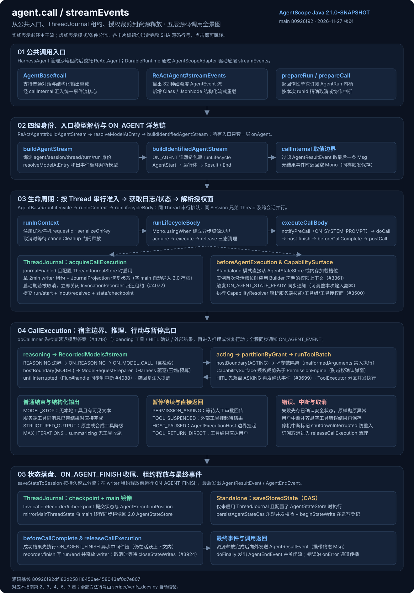
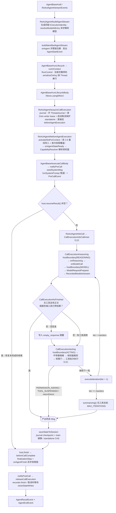
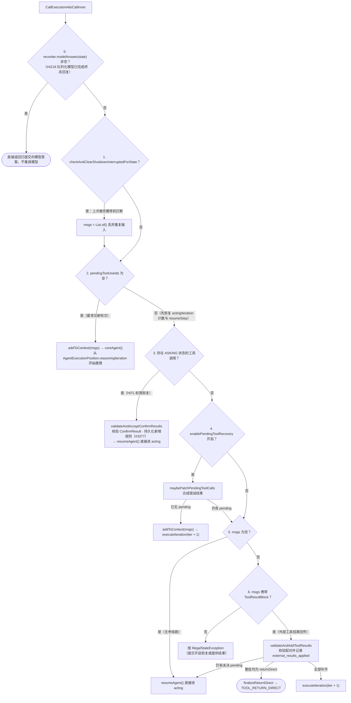
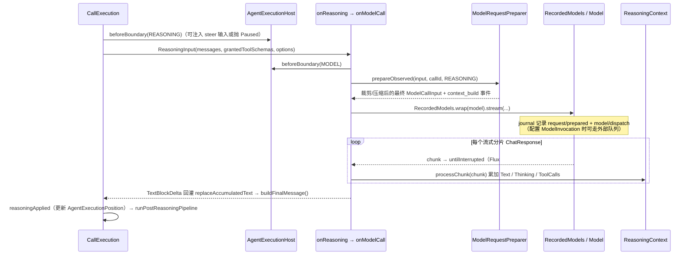
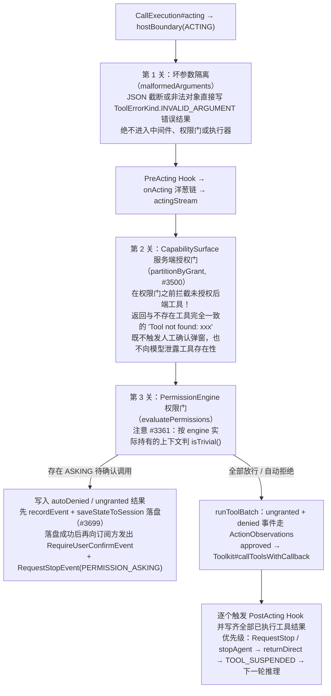

# 第 3 章 ReAct 主循环（核心的核心）

> 文件：`agentscope-core/src/main/java/io/agentscope/core/ReActAgent.java`（7676 行）与 `agent/AgentBase.java`（1238 行）。
> 源码基线：上游 main `80926f92df182d258118456ae458043af0d7e807`（`2.1.0-SNAPSHOT`）。正文描述该提交的当前行为；历史版本差异单独说明。

先看一张五层结构的全景图（各层细节在本章对应小节展开，点击 SVG 内节点可直达固定 SHA 源码行）：



固定提交源码入口：[资源生命周期](https://github.com/agentscope-ai/agentscope-java/blob/80926f92df182d258118456ae458043af0d7e807/agentscope-core/src/main/java/io/agentscope/core/agent/AgentBase.java#L397)、[统一事件入口](https://github.com/agentscope-ai/agentscope-java/blob/80926f92df182d258118456ae458043af0d7e807/agentscope-core/src/main/java/io/agentscope/core/ReActAgent.java#L1559)、[ThreadJournal 获取](https://github.com/agentscope-ai/agentscope-java/blob/80926f92df182d258118456ae458043af0d7e807/agentscope-core/src/main/java/io/agentscope/core/ReActAgent.java#L951)、[坏参数隔离](https://github.com/agentscope-ai/agentscope-java/blob/80926f92df182d258118456ae458043af0d7e807/agentscope-core/src/main/java/io/agentscope/core/ReActAgent.java#L4060)、[工具回调](https://github.com/agentscope-ai/agentscope-java/blob/80926f92df182d258118456ae458043af0d7e807/agentscope-core/src/main/java/io/agentscope/core/ReActAgent.java#L4787)、[结构化输出分发](https://github.com/agentscope-ai/agentscope-java/blob/80926f92df182d258118456ae458043af0d7e807/agentscope-core/src/main/java/io/agentscope/core/ReActAgent.java#L1966)。

## 3.1 类结构、并发门闩与宿主协作契约

```text
ReActAgent extends AgentBase implements AutoCloseable
 ├─ final class CallExecution                  ← 单次调用（per-call）作用域，承载完整 ReAct 循环
 │    ├─ private final class ModelCallBlockLifecycle  ← 流式内容块 start/end 配对状态机
 │    ├─ private final class ToolResultCallback       ← 单批次工具 start/progress/result 回调
 │    ├─ private record GrantPartition(granted, ungranted)   ← 权限门前的授权面分流（#3500）
 │    └─ private record PermissionGate(pendingAsk, autoDeniedIds)
 └─ public static class Builder
```

**`CallExecution` 是严格的单次订阅作用域**：持有本次调用的 `AgentState`、`PermissionEngine`、`RuntimeContext`、`ExecutionIdentity`、`toolRequestConfig`、加载版本号 `loadedVersion`、在途落盘门闩 `stateWrites`，以及本次调用专属的 `InterruptControl`。它作为非静态内部类直接读取外层 `ReActAgent` 的不可变配置，同时把可变运行态彻底隔离在 Reactor Context 的 `CALL_SCOPE_KEY` 里。

**并发模型已细化到 Thread 粒度**：`ReActAgent#callSerializationKey` 返回包含 `(userId, sessionId, threadId)` 的槽位键，`AgentBase#serializeOnKey` 据此实现**同一 Thread 严格 FIFO 串行、同一 Session 下不同 Thread 以及跨 Session 完全并行**。

### AgentRun（调用方执行句柄）与 AgentExecutionHost（持久宿主边界）

当前主干有两套互补的运行控制接口，分别面向“直接调 Core 的应用”与“上层持久执行框架（如 `agentscope-durable`）”：

1. **`AgentRun` + `RunControl`（面向调用方句柄）**：`prepareRun(msgs, ctx)` / `prepareCall(msgs, ctx)` 返回单次订阅的执行句柄，支持在排队或运行中精确 `cancel()` 或 `interrupt(msg)` 当前这次 `runId`，不会误伤同一队列里排在后面的下一次请求。
2. **`AgentExecutionHost`（`agent/AgentExecutionHost.java`，2.1 新增，面向持久执行宿主）**：通过 `RuntimeContext` 注入后，Core 会在四个可恢复边界主动回调 `host.beforeBoundary(boundary, ctx, state)`：
   - `Boundary.REASONING`：每轮推理开始前（`Durable` 在此消费 `steer` / `inject` 信号注入新指令）；
   - `Boundary.MODEL`：经过 `onModelCall` 中间件后、真正发起模型请求前；
   - `Boundary.ACTING`：每轮工具执行前；
   - `Boundary.FINALIZATION`：产出终态回复后、执行 `onAgentFinish` 收尾中间件前（配合 `host.finish(ctx, result, continuation)` 支持进程崩溃后仅恢复收尾阶段而不重跑模型）。
   只要宿主在任一边界抛出轻量异常 `AgentExecutionHost.Paused`（无异常栈开销），Core 就会把本次调用视作**可恢复挂起**，不合成中断错误，而是记录 `RunOutcome(SUSPENDED, "HOST_PAUSED")` 并返回带 `GenerateReason.HOST_PAUSED` 的结果。

## 3.2 全局视角：一次 call / streamEvents 的完整生命周期

`call()` 与 `streamEvents()`（含新增的结构化输出流式重载 `#2919`）**100% 共用同一个 `buildAgentStream` 核心**。`callInternal` 只是对事件流做 `.filter(AgentResultEvent).map(::getResult).takeLast(1).next()`，确保 `onAgent` 洋葱链在所有入口都只包裹一次：



两个关键并发与资源安全补丁（均已落地当前 `main`，其中 `#3924` 已回合 `2.0.5`）：

- **入口模型解析移出事件循环（`resolveModelAtEntry`）**：当 Agent 配置了字符串 `modelIdentity` 或 `RuntimeContext.modelId` 时，在进入流之前先切到 `ModelSchedulers.requests()` 解析并缓存在本次 `effective` 上下文里，绝不在 Netty EventLoop 上阻塞等待工厂初始化。
- **启动期取消不漏租约（`#4072`）、运行期取消不漏在途写（`#3924`）**：订阅方若在 `acquireCallExecution` 刚拿到 `InvocationRecorder`（已占住 2 分钟 writer 租约）但 `usingWhen` 尚未吐出资源前就取消订阅，`cancelBeforeJournalStart` / `cancelJournalStart` 会主动关闭 recorder 立即归还租约；而在 standalone 模式下，若取消发生在异步落盘中途，`releaseCallExecution("cancelled")` 会等待 `closeStateWrites` 完成后才释放同会话门闩。

## 3.3 入口分流：doCallInner 的 6 条路径

`CallExecution#doCallInner`（`ReActAgent.java:2698`）按严格优先级决定本次调用从哪里切入：



这里的第 0 条分支（`recorder.modelAnswer(state)`）专为跨进程模型续跑设计：如果上一轮模型推理通过远程 Worker 返回了无工具调用的最终回答并写入了 checkpoint，但宿主在执行 `onAgentFinish` 或落最终状态前重启，新进程进入 `doCallInner` 时直接取出该回答走完收尾，实现幂等续接。

## 3.4 推理阶段：reasoning、请求编译器与流式中断

`CallExecution#reasoning(iter, ignoreMaxIters)` 的执行链依次穿过两层洋葱中间件、两道宿主边界与最终请求准备器：



两个值得注意的实现改进：

1. **流式中断改为同步 `Flux#handle`（`#4088`）**：此前每收到一个 chunk 都要包一层异步 `concatMap(chunk -> checkInterrupted())`，高吞吐 token 流下产生大量微小 Publisher 分配；现改为 `untilInterrupted` 在 `handle` 算子内同步读取 `interruption.isInterrupted()`，零额外调度开销且仍在两个分片之间立即截断。
2. **工具清单在进入 `onReasoning` 前已按 `CapabilitySurface` 过滤**：`activeToolkit.getToolSchemas(activeGroups, toolRequestConfig, rc.get(CapabilitySurface.class))` 确保当前调用未获授权的后端工具连 Schema 都不会暴露给模型或推理中间件。

## 3.5 行动阶段：坏参数隔离、CapabilitySurface 授权门与权限门

`CallExecution#acting(iter)` 在真正触碰工具执行器前，按严格次序设了**三道前置关卡**：



这三道关卡解决了三个极其现实的生产安全与一致性痛点：

1. **授权（Grant）与权限确认（Permission HITL）严格分层（`#3500`）**：多租户 SaaS 中，“租户 A 根本没有购买财务退款插件”属于服务端授权边界（`CapabilityResolver` → `CapabilitySurface`），而“租户 B 拥有该工具但执行前需店长点确认”属于权限治理（`PermissionEngine`）。`partitionByGrant` 排在 `evaluatePermissions` **之前**（同时 `ToolExecutor#requireToolGranted` 在底层做纵深防御），保证模型幻觉猜中未授权工具名时，只会收到普通的 `Tool not found`，绝不会给前端弹出一个越权工具的“是否允许执行”确认框。标记了 `@Tool(system = true)` 的框架内置系统工具与调用方通过 `ToolRequestConfig` 显式自带的前端外部工具不受后端授权面裁剪。
2. **先落盘、再发确认事件（`#3699`，已回合 `2.0.5`）**：旧实现先向 SSE 流推出 `RequireUserConfirmEvent`，等到流末尾 `doCall` 退出时才异步保存 `ASKING` 状态。自动化测试或低延迟前端一收到事件立刻发回确认请求，新请求读存储时老请求的 `ASKING` 状态还没落盘，直接报状态不匹配。现在 `actingStream`（`ReActAgent.java:4326-4334`）在识别到 `RequireUserConfirmEvent` 时，**先执行 `saveStateToSession(this)` 完成落盘，再 `emitEvent` 推给订阅方**。
3. **`evaluatePermissions` 改看引擎自身上下文（`#3361`）**：`boolean useEngine = !permissionEngine.getContext().isTrivial()`（`L4568`），确保持久化会话本身没存规则、但 Builder 注入了全局规则时，依然完整走权限引擎评估。

## 3.6 收尾、失败保存与异常/暂停分流

把正常结束、`HOST_PAUSED`、普通异常、用户中断、停机中断与订阅取消六条出口放在一起对照：

| 出口类型 | `saveStateAfterCallFailure` | `saveStateToSession` | `beforeCallComplete` (`onAgentFinish`) | `releaseCallExecution` (`recorder.finish`) | 调用方看到的信号 |
|---|---|---|---|---|---|
| **正常结束 / HITL 暂停 / 挂起** | 不触发 | 执行（checkpoint + main 镜像 / CAS） | 执行（仅 `COMPLETED` 记 `finalizationStep`） | `status = "completed"`（内部按 `RunOutcome` 区分 `completed` 与 `suspended`） | 正常返回终态 `Msg` |
| **宿主边界暂停（`AgentExecutionHost.Paused`）** | 跳过或按挂起收敛 | 保存挂起前已提交进度 | 由宿主 `finish` 协调 | `RunOutcome` 记为 `suspended`（`HOST_PAUSED`） | Durable 宿主接管等待条件；直接调用者收到暂停结果或边界信号 |
| **模型/工具运行时异常** | **执行**：保存已入上下文的安全状态，保存自身若失败仅 `addSuppressed` | 不再重复执行 | 跳过 | `status = "failed"` | 抛出原始异常 |
| **用户中断（`USER`）** | 跳过（识别 `InterruptedException`） | 由 `handleInterrupt` 补齐悬空工具错误结果后保存 | 跳过 | `status = "completed"`（`handleInterrupt` 已恢复为 `INTERRUPTED` 消息） | 返回 `GenerateReason.INTERRUPTED` 的 `Msg` |
| **优雅停机中断（`SYSTEM`）** | 跳过 | `saveOnInterruptObserved` 标记 `shutdownInterrupted` | 跳过 | `status = "failed"`（journal 提交最终状态并释放 writer） | 抛出 `AgentShuttingDownException` |
| **响应式订阅取消（`cancel`）** | 跳过 | 不新起写入 | 跳过 | `status = "cancelled"`，且等待在途 `closeStateWrites` 完成 | 订阅终止，无后续元素 |

## 3.7 结构化输出：call 与 streamEvents 双入口对齐

`ReActAgent#doStructuredCall` 支持 `Class<?>` 与 `JsonNode` 两种 Schema 来源，优先探测**当前请求实际使用的模型**（`getModel(scope.rc)`，兼容按请求 `modelId`）是否支持原生 `response_format`（带工具时检查 `supportsNativeStructuredOutputWithTools()`），不支持或原生调用报错（`AgentExecutionHost.Paused` 除外）时自动降级到 per-call 合成工具 `generate_response`。

当前基线的三项重要改进：

1. **`streamEvents` 补齐结构化输出重载（`#2919`）**：新增 `streamEvents(msgs, Class<?>, ctx)` 与 `streamEvents(msgs, JsonNode, ctx)`（以及单条 `Msg` / `String` 便捷重载）。前端现在可以一边流式渲染思考过程与工具进度，一边在末尾 `AgentResultEvent` 拿到校验好、`hasStructuredData() == true` 的结构化 `Msg`。
2. **默认不再强塞 `strict: true`（`#2608`，已回合 `2.0.5`）**：部分 OpenAI 兼容网关遇到带可选字段但标了 `strict: true` 的 `response_format` 会直接拒单；现在框架生成的结构化输出 Schema 默认不强加 `strict: true`，需要严格模式的端点可通过 `OpenAIChatModel.builder().strictJsonSchema(true)` 按模型开启。
3. **混合批次清理不误删业务工具历史（`#4078`、`#4086`）**：兜底路径在模型同一轮同时调用了业务工具与 `generate_response` 时，`compressStructuredOutputContext` 只折叠合成的 `generate_response` 调用对，完整保留同批次的真实业务 `tool_use / tool_result` 记录，并保留原始消息 id、时间戳与聚合 `ChatUsage`（`#3032`）。

## 3.8 customer_work 实战

> 本节保留 customer_work `17007e4a`（依赖框架 `2.0.3`）的历史应用快照，不表示该应用已迁移至当前 `main`。

- **应用侧分布式锁与框架串行门闩分层配合**：`CustomerServiceService#withSessionLock` 使用 `RedissonSessionLock` 做跨实例串行，框架内的 `callSerializationKey` 做单实例响应式排队，加上第 2 章 `ConflictPolicy` 形成三道防线。
- **流式消费统一走 `streamEvents`**：`chatStream` 消费 `TextBlockDeltaEvent` 并以 `AgentResultEvent` 兜底无增量场景；若升级至当前 `main`，意图识别等既要流式事件又要结构化结果的场景可直接改用新增的 `streamEvents(msgs, IntentResult.class, ctx)`。
- **HITL 规则持久化改进**：`PermissionConfig` 在 Builder 上声明的 `submitRefund` / `transferToHuman` ask/deny 规则，在 `2.0.3` 上曾受“老会话加载后忽略 Builder 新增规则”的限制；在 `2.0.5` 与当前 `main`（`#3361`、`#3377`）上，实例首次激活槽位即应用最新 Builder 规则，且人工确认勾选的持久化规则也能跨重启保留。
