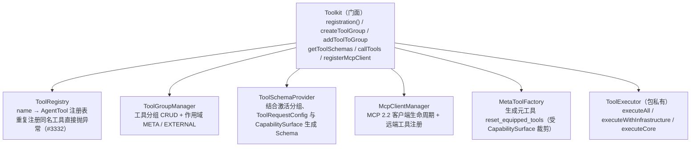
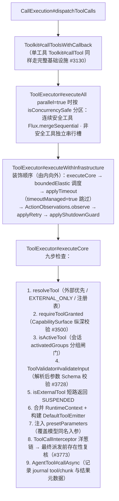

# 第 4 章 工具系统（核心）

> 路径前缀：`agentscope-core/src/main/java/io/agentscope/core/tool/`
> 上一章讲到 `CallExecution#actingStream` 经过授权裁剪与权限门后把工具批次交给 `Toolkit#callToolsWithCallback`；本章拆解工具注册、Schema 生成、执行基础设施、MCP 2.2 接入，以及**服务端授权面 + 外部请求视图 + 按需工具搜索（`tool_search`）**三层动态工具面。框架基线统一为上游 main `80926f92df182d258118456ae458043af0d7e807`（`2.1.0-SNAPSHOT`）。

## 4.1 Toolkit：门面 + 五个管理器

`Toolkit.java` 是门面类，内部职责拆给五个组件；`ToolExecutor` 是包私有的真正执行器：



核心规则：

- **同名工具重复注册改为快速失败（`#3332`）**：早期版本重复注册同名工具会静默覆盖旧实例，MCP 挂载或多个技能包撞名时极难排查；当前 `ToolRegistry` 遇到重名直接抛出异常（除非显式开启删除并先移除）。
- **分组激活态归属会话存档**：只有激活分组内的工具（以及不属于任何分组的全局工具）会进入发给模型的 `ToolSchema` 列表。运行期激活列表保存在 `AgentState.toolContext.activatedGroups` 中，共享 `Toolkit` 在运行期只读不改。
- **元工具 `reset_equipped_tools` 与授权面联动（`#3500`）**：`META` 作用域的工具组允许模型通过 `reset_equipped_tools` 自主开关（入参 `to_activate` 为目标全集而非增量）；配置了 `CapabilitySurface` 时，未获授权的分组会从元工具的枚举列表与描述中一并隐去。
- **构建期深拷贝元数据、共享工具实例**：`ReActAgent.Builder#build` 与 `HarnessAgent.Builder#build` 都会调用 `Toolkit#copy()` 隔离注册表与分组表，但底层 `@Tool` 宿主对象按引用复用，业务工具类自身必须保持无状态或线程安全。

## 4.2 从注解到 Schema：@Tool 新属性与直接返回 ContentBlock

```java
@Tool(
    name = "query_order",
    description = "按订单号查询订单详情与履约状态",
    readOnly = true,
    concurrencySafe = true
)
public OrderInfo queryOrder(@ToolParam(name = "orderId", description = "订单号") String orderId) { ... }
```

- **`@Tool`（`Tool.java`）完整属性集**：
  - 基础与 Schema：`name`、`description`、`strict`（开启后递归向生成 Schema 的所有 object 节点注入 `additionalProperties: false`，`#1392`，已回合 `2.0.5`）、`deferLoading`（配合原生延迟加载协议）、`converter`；
  - 执行与权限：`readOnly`、`concurrencySafe`（默认 `true`）、`externalTool`、`returnDirect`、`dangerousFiles`、`dangerousDirectories`、`stateInjected`；
  - **2.1 新增的四个治理属性**：
    1. `evictable`（默认 `true`）：是否允许 Harness 的 `ToolResultEvictionMiddleware` 将超大输出转存为工作区文件；
    2. `prunable`（默认 `true`，`#4294`）：上下文压缩裁剪历史工具输出预算时是否允许裁剪该工具结果（关键状态工具可设 `false` 豁免）；
    3. `timeoutManaged`（默认 `false`，`#3879` / `#4278`）：设为 `true` 时表示工具内部自行管理等待超时（如 `WaitAsyncResultsTool`、子 Agent 等待工具），`ToolExecutor` 将跳过外层默认 5 分钟的 `ExecutionConfig` 超时包裹，避免长任务等待被通用工具超时误杀；
    4. `system`（默认 `false`，`#3500`）：标记为框架级系统工具，始终通过 `CapabilitySurface` 授权检查。
- **直接返回 `ContentBlock` 不再二次 JSON 序列化（`#4299`）**：`@Tool` 方法如果直接返回 `ContentBlock`（如 `ImageBlock`、`DocumentBlock`、`AudioBlock`、`TextBlock`），`DefaultToolResultConverter` 会将其原样装入 `ToolResultBlock.output`，不再把块对象当普通 POJO 序列化成 JSON 字符串，多模态工具编写大幅简化。
- **未标 `@ToolParam` 的上下文参数注入规则**：`ToolMethodInvoker` 按类型自动注入 `ToolEmitter`、`Agent`、`AgentState`（取 `RuntimeContext` 中的当前会话存档）、`RuntimeContext`；其余参数仅当属于自定义业务 POJO（非基本类型、非 `Msg`/`ContentBlock`、非 `java.*`/`javax.*`）时才从 `RuntimeContext` 类型化属性查找。切记不要写裸 `String tenantId` 却漏标 `@ToolParam`。
- **`ToolBase` 继承边界决定权限门与并发行为**：`@Tool` 反射工具、`McpTool`、`SchemaOnlyTool` 均继承 `ToolBase`，完整参与 `PermissionEngine` 规则评估与 `isConcurrencySafe()` 分区（其中 `McpTool` 固定 `concurrencySafe = false`）；直接实现 `AgentTool` 接口的裸实现（如 core 的 `ShellCommandTool`、`SubAgentTool`）在 `evaluateOne` 中会直接短路为 `ALLOW` 且默认按可并发处理。

## 4.3 执行链路：executeCore 九步闸门与装饰顺序

从 `CallExecution#dispatchToolCalls` 到具体工具实现的方法级链路：



关键工程细节：

- **完整性先于 Schema，解析值与校验源严格对齐（`#3739`、`#3728`、`#3886`）**：流式残缺 JSON 已在 `acting` 入口拦截；进入 `executeCore` 后，Schema 校验对准 `JsonUtils#resolveToolCallArgsJson` 解析出的真实参数对象，杜绝空对象覆盖已解析参数或吞掉解析异常。
- **错误结构化软着陆**：未找到工具、未激活分组、参数校验失败、超时或普通执行异常都会转为带 `ToolErrorMetadata`（`NOT_FOUND` / `INVALID_ARGUMENT` / `TIMEOUT` / `EXECUTION_FAILED`）的 `ToolResultBlock.error(...)` 喂回模型自愈；唯独 `ActionObservationException` 与 `JournalException` 严禁吞掉，必须原样上抛阻断调用，防止“账没记上却继续执行”。

## 4.4 MCP 2.2 接入与 Shell 白名单安全加固

- **MCP Java SDK 跨代升级至 `2.2.0`（`#3751`、`#4318`）**：`agentscope-dependencies-bom` 中的 `mcp.version` 已从早期的 `0.17.2` 升级到 `2.2.0`。`McpClientBuilder` 支持 stdio、SSE 与 Streamable HTTP 传输：
  - **工具前缀与元数据传播控制**：`mcpToolNamePrefix("crm_")` 解决多 Server 同名冲突；`McpMeta` 类型化属性仅在连接级与工具级 `propagateMeta` 同时开启时随请求发出（默认附带 `io.agentscope/toolCallId`）。
  - **新增 `McpToolResultMetadataCustomizer`（`#4266`）**：允许应用从远端 MCP `CallToolResult`（含 `_meta` 字段）提取自定义键值写入 `ToolResultBlock.metadata`，随 `ToolResultEndEvent` 直达前端 UI。
  - **安全提醒**：`McpTool.isReadOnly()` 仍取自远端 Server 自报的 `readOnlyHint`；接入不可信第三方 MCP Server 时，切勿仅靠 `EXPLORE` / `ACCEPT_EDITS` 模式放行只读工具，应显式配置 `ask` / `deny` 规则。
- **Shell `CommandValidator` 白名单防绕过加固（`#3286`，已回合 `2.0.5`）**：此前部分复杂引号或展开语法存在白名单绕过风险；现在只要配置了非空命令白名单，凡包含命令替换/变量展开（`$()`、`` ` ``、`${}`）、管道、重定向、命令分隔符、分组括号或未闭合引号/转义的命令，**一律禁止自动放行**，必须将完整原始命令交给审批回调并拿到显式 `true` 才允许执行。注：`agentscope-core/pom.xml` 中预留的 `tree-sitter-bash` 原生依赖在当前基线仍未被 Java 代码引用。

## 4.5 三层动态工具面：授权面、外部工具与按需工具检索（ToolSearch）

一个共享 `Toolkit` 如何在多租户、上百工具的场景下既安全又省上下文？当前主干将其正交拆分为三层（互不修改共享 `Toolkit`）：

| 层次 | 核心类 | 解决什么问题 | 对未命中工具的行为 |
|---|---|---|---|
| **1. 服务端授权面（`#3500`）** | `CapabilityResolver` + `CapabilitySurface` | 多租户/角色权限硬隔离（哪些技能、工具组、工具对该用户根本不存在） | 不进 Schema；模型强调时在权限门前直接回 `Tool not found` |
| **2. 调用方外部视图（`#3283`）** | `ToolRequestConfig` + `ToolMergeMode` | AG-UI 等前端每次请求动态自带 `SchemaOnlyTool`（合并或 `EXTERNAL_ONLY`） | 命中外部工具在 `executeCore` 第 5 步挂起（`SUSPENDED`）交回前端执行 |
| **3. 上下文按需发现（`#3680`，2.1 新增）** | `ToolSearchMiddleware` + `ToolSearchTool` (`tool_search`) | 工具总数上百时，避免每轮把全部 Schema 塞爆 prompt，让模型按关键词/自定义策略按需检索加载 | 未发现前隐藏或标记 `deferLoading=true`，发现后记录进 `ToolContextState.discoveredTools` |

**`ToolSearchMiddleware`（`core/tool/search/ToolSearchMiddleware.java`）的工作机制**：
构造时向 `Toolkit` 注册名为 `tool_search` 的检索工具（默认使用大小写与分词友好的 `KeywordToolSearchStrategy`，也可传入自定义 `ToolSearchStrategy`），并在 `ON_MODEL_CALL` 切点按当前模型的 `getToolSearchMode()` 自动适配三种协议：
- **`ToolSearchMode.CLIENT`（如 OpenAI Responses API）**：将 `tool_search` 标记为客户端检索协议工具，配合原生 `tool_search` 往返；
- **`ToolSearchMode.DEFERRED`（如 Anthropic）**：发送全量候选但对未激活工具打上 `deferLoading = true`，由厂商侧按需展开参数定义；
- **`ToolSearchMode.FUNCTION`（通用模型兜底）**：请求里只暴露 `alwaysVisible`、`tool_search`、`generate_response` 以及 `ToolContextState.discoveredTools` 中已检索出的工具 Schema；模型调一次 `tool_search(query)` 后，命中的工具名持久写入 `AgentState`，后续轮次（哪怕经历过上下文压缩或切换了模型协议）自动保持可见。

## 4.6 customer_work 实战

> 以下 customer_work 示例保留历史基线：agentscope `2.0.3`、应用 commit `17007e4a`（2026-10-02）。

- **七域业务工具 + `RuntimeContext` 强类型身份注入**：`OrderTools` 等业务类只做 `@Tool` Schema 壳，内部委托 `OrderBackend` SPI，并通过无注解的 `RuntimeContext` 参数提取 `AgentInvocationIdentity`，杜绝模型伪造租户身份。
- **`ManagedToolkit` 与 `DefaultActiveGroupsToolkit` 升级评估**：应用将默认超时收紧为 15s、关闭并发与重试（防退款重复提交），这部分在当前 `main` 依然是合理的业务防线；而为绕过 2.0.0 空激活组 bug 编写的 `DefaultActiveGroupsToolkit`（覆写单参 `getToolSchemas` 且 `copy()` 返回自身）在当前 `main` 上已完全失效且破坏构建期隔离，升级时应直接移除。
- **网关侧 vs 框架内工具检索**：`17007e4a` 借助 `HigressMcpClientBuilder#toolSearch` 在网关侧做工具裁剪；在当前 `2.1.0-SNAPSHOT` 下，本地工具与普通 MCP 工具也可以直接在 Agent 内挂载 `new ToolSearchMiddleware(toolkit)` 实现同等按需加载。

## 固定基线源码入口

- [Toolkit 与请求视图](https://github.com/agentscope-ai/agentscope-java/blob/80926f92df182d258118456ae458043af0d7e807/agentscope-core/src/main/java/io/agentscope/core/tool/Toolkit.java)。
- [执行、授权、拦截、观察与错误边界](https://github.com/agentscope-ai/agentscope-java/blob/80926f92df182d258118456ae458043af0d7e807/agentscope-core/src/main/java/io/agentscope/core/tool/ToolExecutor.java)。
- [按需工具搜索中间件](https://github.com/agentscope-ai/agentscope-java/blob/80926f92df182d258118456ae458043af0d7e807/agentscope-core/src/main/java/io/agentscope/core/tool/search/ToolSearchMiddleware.java)。
- [参数完整性累积](https://github.com/agentscope-ai/agentscope-java/blob/80926f92df182d258118456ae458043af0d7e807/agentscope-core/src/main/java/io/agentscope/core/agent/accumulator/ToolCallsAccumulator.java)。
