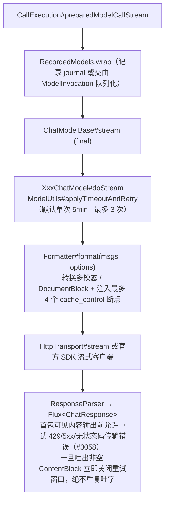
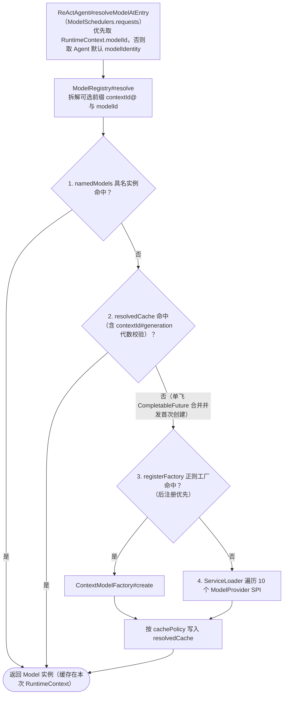

# 第 5 章 模型层（核心）

> 路径前缀：`agentscope-core/src/main/java/io/agentscope/core/model/`（抽象）与 `agentscope-extensions/agentscope-extensions-model/`（6 个实现模块：dashscope / openai / anthropic / gemini / ollama + openai-official Responses API 模块；SPI 提供商共 10 个）。
> 第 3 章的 `preparedModelCallStream` 调用 `Model#stream` 后发生的一切都在本章。框架基线统一为上游 main `80926f92df182d258118456ae458043af0d7e807`（`2.1.0-SNAPSHOT`）。

## 5.1 Model 窄接口与能力自省方法

`Model.java` 核心抽象方法只有一个：

```java
Flux<ChatResponse> stream(List<Msg> messages, List<ToolSchema> tools, GenerateOptions options);
```

没有单独的同步方法，非流式调用即 `collectList()`。接口上的默认能力自省方法决定了上层 ReAct、工具搜索与上下文压缩的分流策略：

- `supportsNativeStructuredOutput()` / `supportsNativeStructuredOutputWithTools()`：结构化输出走原生 `response_format` 还是合成 `generate_response` 工具；
- `supportsToolChoiceSpecific()`：兜底结构化输出能否下发强制指定工具名；
- `getContextWindowSize()`：模型上下文窗口大小（默认 `0` 表示未知，Harness 侧还配有 `LearnedContextWindows` 从厂商超长报错中动态学习真实窗口）；
- `getToolSearchMode()`（2.1 新增）：返回 `FUNCTION` / `CLIENT` / `DEFERRED`，驱动第 4 章 `ToolSearchMiddleware` 选择工具延迟加载协议。

`ChatModelBase.java` 用 `public final Flux<ChatResponse> stream(...)` 模板方法统一包裹 `TracerRegistry.get().callModel(...)`，各厂商模型只需实现 `doStream`。自定义 `Model` 装饰器在转发 `stream` 时，**务必一并转发上述默认能力方法**，否则结构化输出、上下文预算和工具检索都会退回保守默认值。

## 5.2 Formatter 与多模态文档生命周期（DocumentBlock）

`formatter/Formatter.java` 是三泛型协议翻译器 `Formatter<TReq, TResp, TParams>`，负责消息、缓存断点、工具 Schema 与响应分片的双向映射。

**2.1 新增全链路文档处理能力（`#3869`、`#3979`、`#2275`、`#4032`、`#4348`）**：
配合第 2 章新增的 `DocumentBlock` 与 `FileIdSource`，各厂商模块实现了统一的文档输入与降级契约：

| 厂商模块 | 文档与多模态路由行为 |
|---|---|
| **Anthropic**（SDK `2.72.0`） | 原生映射 PDF / 纯文本 `DocumentBlock`，支持文档标题、上下文说明与 `citationsEnabled` 引用溯源解析 |
| **OpenAI / Responses**（SDK `4.109.0`） | 支持 Base64 / URL / `FileIdSource` 文档输入项转换 |
| **DashScope**（SDK `2.23.6`） | `FileIdSource` 对接百炼 `qwen-long` 文档理解（自动注入 `fileid://...` 系统引用）；Qwen4 等新一代多模态模型自动路由至多模态端点（`#4348`） |
| **Gemini**（SDK `2.6.0`） | 默认模型更新为 `gemini-3.8-flash`（`#3914`，已回合 `2.0.5`），按模型代数自动路由 `thinkingBudget` / `thinkingLevel`（`#4220`），修复多工具调用 ID 唯一性与媒体扩展名解析 |
| **不支持原生文档的端点** | 统一经 `core/formatter/DocumentReferenceRenderer.java` 安全渲染为可读文本引用，避免静默丢块 |

## 5.3 传输层、流式背压与可见内容重试边界

`transport/HttpTransport.java` 默认使用 `JdkHttpTransport`（明文 `http://` 自动降级 HTTP/1.1 避免 vLLM/uvicorn 因 h2c 升级丢弃 POST 请求体，`https://` 走 HTTP/2；配置代理时切换 `OkHttpTransport` 并使用 `subscribeOn(boundedElastic(), false)` 防止 `readLine()` 阻塞循环饿死下游 `request(n)` 背压信号）。响应流停滞时支持响应体取消及时脱困（`#4021`）。



`ModelUtils#hasVisibleContent` 严格划定了流式重试红线：只带 usage 的空分片不关闭重试窗口；一旦向订阅者发出了任何文本、思考或工具调用分片，后续即便遇到网络断开也直接报错上抛，防止前端收到半截重复回复。

## 5.4 Prompt Caching 与归一化 ChatUsage

- **Prompt Caching**：单条 `Msg` 可通过 `_cache_control = true / false` 显式控制缓存断点；开启 `GenerateOptions.cacheControl(true)` 时，DashScope 与 OpenAI 兼容 Formatter 会在最后一个内容块上自动打标（优先最后一条消息，其次各条 system 消息，总数不超过 `MAX_CACHE_MARKERS = 4`）；Anthropic 则按 `tools → system → messages` 顺序设置 `ephemeral` 断点。
- **跨厂商归一化的 `ChatUsage`**：包含 `inputTokens`、`outputTokens`、`cachedTokens`（恒为 `inputTokens` 子集，Anthropic 的 `input + cache_read + cache_creation` 已自动折算对齐 OpenAI 口径）、`cacheCreationTokens`、`reasoningTokens` 与 `toolUsePromptTokens`，汇总后随 `ModelCallEndEvent` 与 `OtelTracingMiddleware` 输出。

## 5.5 ModelRegistry：统一标识符词表、按请求选模型与并发单飞

`ModelRegistry.java` 在 2.1 中完成了标识符词表统一（`#3965`、`#3940`）与并发缓存加固（`#3791`，已回合 `2.0.5`），并与 `RuntimeContext#modelId`（`#2097`）打通了**请求级动态切模型**。

### 统一模型坐标语法：`[contextId@]provider:modelName`

1. **标准语法 `"provider:modelName"`**：如 `"dashscope:qwen-plus"`、`"openai-official:gpt-4.1"`，共内置 **10 个 SPI `ModelProvider`**（`dashscope`、`openai`、`openai-official`、`anthropic`、`gemini`、`ollama`，以及 `-model-openai` 内置的 `deepseek`、`glm`、`kimi`、`minimax` 四个方言兼容 provider）。
2. **多租户/多网关上下文前缀 `"contextId@provider:modelName"`（`#3965`）**：早期版本中 `.model("openai:gpt-4o")` 全局共享环境变量里的同一把 API Key。现在应用可以通过 `ModelRegistry.registerCreationContext("tenantA", ctx)` 注册带独立 `apiKey / baseUrl / headers` 的命名上下文，随后无论在 Builder 还是在单次请求的 `RuntimeContext.builder().modelId("tenantA@openai:gpt-4o")` 中，都能用纯字符串安全路由到对应凭证实例！凭证轮换时重新调用 `registerCreationContext` 会递增内部代数（`contextId#generation`），自动使旧实例缓存失效，并支持 `unregister` 与 `evictResolvedCache`。
3. **缓存淘汰与并发单飞（`#3791`）**：调用 `registerFactory` 注册自定义工厂时会立即清理匹配的已缓存条目；同一缓存键首次并发解析时通过 `CompletableFuture` 共享单次创建过程，避免瞬时流量击穿时重复初始化几十个底层 HTTP/SDK 客户端。



## 5.6 主备切换（Failover）与 RecordedModels 队列化挂接

`ReActAgent#modelForCall` 在每次推理/总结前将主模型与可选 `fallbackModel` 包装在一起：

- **首信号切换原则**：通过 `switchOnFirst` 观察主模型第一个信号；只有在首包产出前报错（且主模型自身重试已耗尽）才触发 `FailoverListener#onFailover` 并切往备用模型。配置了 `ModelRequestPreparer` 时，切到备用模型会按备用模型的窗口和能力重新编译一次请求。
- **不吞宿主控制与日志异常**：`RecordedModels.wrap`（取代了旧 `SessionModels.wrap`）在模型最内层对接 `ThreadJournal` 与 `ModelInvocation`。一旦抛出 `JournalException` 或 `AgentExecutionHost.Paused`（例如 Durable 将模型请求投递进外部消息队列后主动挂起当前 Run，`#4218`），异常会直接穿透，绝不会误触发 `fallbackModel` 去调第二次模型。

## 5.7 OpenAI Responses API 与厂商服务端工具

- **`agentscope-extensions-model-openai-official`（`openai-official:<model>`）**：基于官方 `openai-java` SDK（`4.109.0`）对接 Responses API，默认 `.store(false)` 无状态发送完整输入项，通过 `ThinkingBlock` 的 `encrypted_content` 跨轮回放加密推理链，并对 `additionalBodyParams` 实施严格白名单校验。
- **服务端工具（Anthropic / Gemini / OpenAI Responses）**：通过 `AnthropicServerTool`、`GeminiServerTool`、`OpenAIServerTool` 声明由厂商云端直接执行的 `web_search`、`code_interpreter`、`image_generation` 等能力。响应解析器在对应的 `ToolUseBlock` / `ToolResultBlock` 上标记 `serverTool = true`；当同一条回复内所有服务端工具均已附带结果时，`ReActAgent#isFinished` 直接判定本轮完成，不再进入本地 `Toolkit` 分发。

## 5.8 customer_work 实战

> 以下 customer_work 示例保留历史基线：agentscope `2.0.3`、应用 commit `17007e4a`（2026-10-02）。

- **九家厂商统一工厂与三层装饰器栈**：`ChatModelFactory` 统一封装各 provider 构建细节，外层叠 `MutableDelegatingModel`（配置热更新原子替换）→ `FailoverModel`（带熔断器的主备切换）→ `ResilientChatModel`（退避重试）。若升级至 `2.1.0-SNAPSHOT`，自定义装饰器需注意补齐转发 `supportsToolChoiceSpecific()`、`getContextWindowSize()` 与 `getToolSearchMode()`；同时按请求切模型或按租户换 Key 的场景可直接利用新增的 `RuntimeContext.modelId("tenant@provider:model")` 简化热缓存管理。
- **裸调 `Model#stream` 的边界**：`TicketClassifier` 与 `ConversationSummaryService` 等无状态单轮分类/摘要直接调 `Model#stream`，不启动完整 `ReActAgent`，保持最低延迟开销。

## 固定基线源码入口

- [Model 能力接口](https://github.com/agentscope-ai/agentscope-java/blob/80926f92df182d258118456ae458043af0d7e807/agentscope-core/src/main/java/io/agentscope/core/model/Model.java)。
- [ModelRegistry 统一解析与缓存](https://github.com/agentscope-ai/agentscope-java/blob/80926f92df182d258118456ae458043af0d7e807/agentscope-core/src/main/java/io/agentscope/core/model/ModelRegistry.java)。
- [流式超时与可见内容重试边界](https://github.com/agentscope-ai/agentscope-java/blob/80926f92df182d258118456ae458043af0d7e807/agentscope-core/src/main/java/io/agentscope/core/model/ModelUtils.java)。
- [模型模块与 SPI 所在目录](https://github.com/agentscope-ai/agentscope-java/blob/80926f92df182d258118456ae458043af0d7e807/agentscope-extensions/agentscope-extensions-model/pom.xml)。
