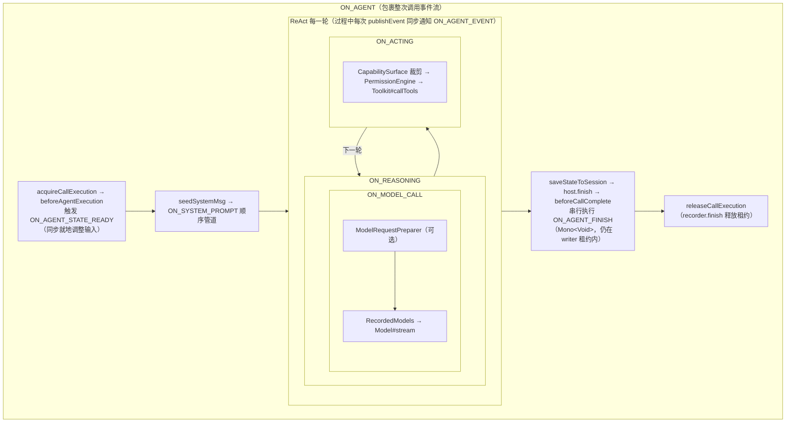
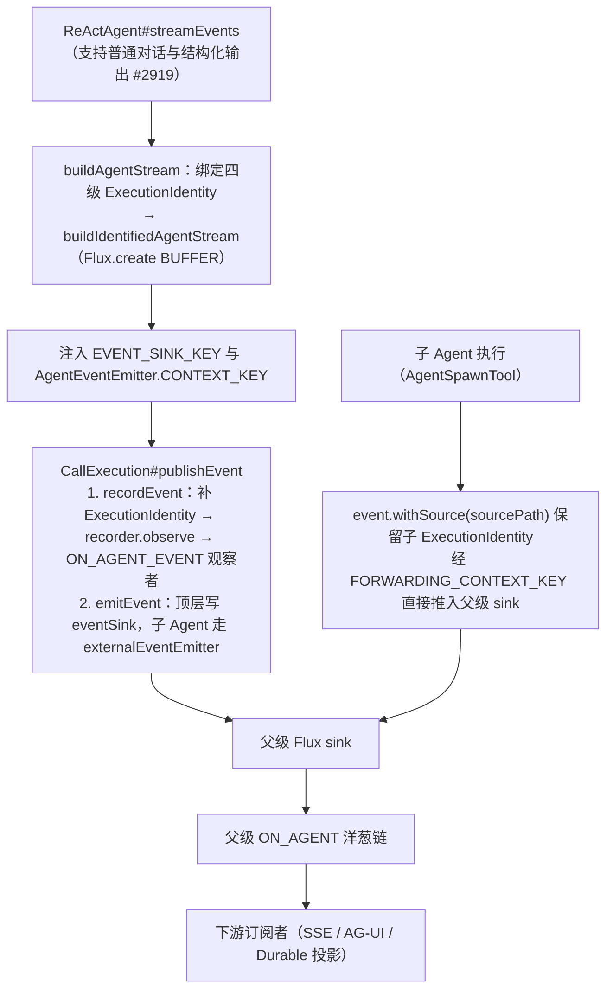

# 第 6 章 Middleware、Hook 与事件流（核心）

> 本章讲框架的三套横切机制：2.x 核心扩展机制 **`MiddlewareBase`（现已扩展为 8 个扩展点）**、兼容保留的遗留 `Hook`，以及面向消费端的 **32 种细粒度不可变事件流 `AgentEvent`**。
> 路径前缀：`agentscope-core/src/main/java/io/agentscope/core/`
> 源码基线：上游 main `80926f92df182d258118456ae458043af0d7e807`（`2.1.0-SNAPSHOT`）。正文描述该提交的当前行为；历史版本差异单独说明。

固定提交源码入口：[MiddlewareBase 8 切点](https://github.com/agentscope-ai/agentscope-java/blob/80926f92df182d258118456ae458043af0d7e807/agentscope-core/src/main/java/io/agentscope/core/middleware/MiddlewareBase.java#L80)、[最终请求准备契约](https://github.com/agentscope-ai/agentscope-java/blob/80926f92df182d258118456ae458043af0d7e807/agentscope-core/src/main/java/io/agentscope/core/middleware/ModelRequestPreparer.java#L28)、[最终请求准备调用](https://github.com/agentscope-ai/agentscope-java/blob/80926f92df182d258118456ae458043af0d7e807/agentscope-core/src/main/java/io/agentscope/core/ReActAgent.java#L3683)、[事件生产边界与观测](https://github.com/agentscope-ai/agentscope-java/blob/80926f92df182d258118456ae458043af0d7e807/agentscope-core/src/main/java/io/agentscope/core/ReActAgent.java#L3128)、[工具进度与终态回调](https://github.com/agentscope-ai/agentscope-java/blob/80926f92df182d258118456ae458043af0d7e807/agentscope-core/src/main/java/io/agentscope/core/ReActAgent.java#L4787)、[ThreadJournal 事件选择性记录](https://github.com/agentscope-ai/agentscope-java/blob/80926f92df182d258118456ae458043af0d7e807/agentscope-core/src/main/java/io/agentscope/core/journal/InvocationRecorder.java#L928)。

## 6.1 MiddlewareBase：8 个扩展点、排序特例与自动切点推断

`middleware/MiddlewareBase.java` 的 `ExtensionPoint` 枚举已从早期的 6 个扩展为 **8 个扩展点**——包含 **4 个洋葱包裹切点**、**1 个顺序管道切点**以及 **3 个生命周期通知/收尾切点**：

| 扩展点枚举 | 方法签名模式 | 触发时机与语义边界 |
|---|---|---|
| `ON_AGENT` | 洋葱：`AgentInput → Flux<AgentEvent>` | 包裹整次调用（含全部 ReAct 轮次与转发上来的子 Agent 事件） |
| `ON_REASONING` | 洋葱：`ReasoningInput → Flux<AgentEvent>` | 包裹单轮推理（输入组装 → 模型调用 → 流式解码） |
| `ON_ACTING` | 洋葱：`ActingInput → Flux<AgentEvent>` | 包裹单批次工具执行（注意：工具事件在链内已发布，见下文） |
| `ON_MODEL_CALL` | 洋葱：`ModelCallInput → Flux<AgentEvent>` | 包裹单次模型 API 调用（改写 `TextBlockDeltaEvent` 会回灌进最终消息） |
| `ON_SYSTEM_PROMPT` | 管道：`String → Mono<String>` | `seedSystemMsg` 阶段按 `order()` 从外向内顺序变换系统提示词 |
| `ON_AGENT_STATE_READY` | 同步通知：`void onAgentStateReady(agent, ctx, state, inputMsgs)` | `beforeAgentExecution` 刚绑定好 `AgentState` 时调用一次；可就地修改本次私有 `inputMsgs` 副本；**抛异常直接中止整次调用** |
| **`ON_AGENT_EVENT`（2.1 新增）** | 同步只读观测：`void onAgentEvent(agent, ctx, event)` | 在 `recordEvent` 生产边界（绑定 `ExecutionIdentity` 之后、入缓冲或外发之前）同步调用，不依赖下游订阅者背压拉取；**异常会被捕获忽略**，绝不影响主流程 |
| **`ON_AGENT_FINISH`（2.1 新增）** | 异步收尾：`Mono<Void> onAgentFinish(agent, ctx, result)` | 在 `beforeCallComplete` 中、终态 `Msg` 已产出且首次保存已完成，但**最终 journal `finish` 与 writer 租约释放之前**串行执行（如 Harness 的记忆刷盘与技能使用统计），仍持有活跃的 `RuntimeContext` |

完整嵌套与时序位置：

### 排序规则与 `ContextConventionsMiddleware` 特例（`#3846`）

`ReActAgent.Builder#build` 对注册的所有 middleware 按 `Comparator.comparingInt(MiddlewareBase::order).reversed()` 做一次**稳定降序排序**：`order()` 越大越靠外，同值保持注册先后，默认值是 `1`。

> **重要更正（对照旧版“所有内置 middleware 的 order 都是 1”）**：`#3846` 修复了一个隐蔽的上下文丢失问题——Harness 的 `ContextConventionsMiddleware` 负责在每次调用的 `ON_SYSTEM_PROMPT` 入口重置 `RuntimeContext` 上的 `WorkspaceContextMaterials` 快照。早期它的 `order()` 也是 `1`，如果用户自定义了一个 `order() = 10`（或先注册）的 middleware 往 `WorkspaceContextMaterials` 里塞了业务上下文材料，紧随其后的 `ContextConventionsMiddleware` 就会把用户刚注册的材料一锅端清空！
> 当前基线中，**`ContextConventionsMiddleware#order()` 显式返回 `Integer.MAX_VALUE - 1000`**，确保框架级的每轮材料池初始化永远排在普通用户中间件（`1` 乃至 `200`）之前；如果真有更高优先级的中间件抢在它前面注册了非 `harness:` 前缀的材料，它会打出明确的 warn 日志提示调低 `order()`。

### `activePoints()` 与 `ActivePointsResolver` 自动推断（`#3579`）

构造 Agent 时，`groupMiddlewares` 按每个扩展点预先过滤出参与者列表：

- **显式声明优先**：如果 middleware 覆写 `activePoints()` 返回了非空集合（如 `EnumSet.of(ExtensionPoint.ON_REASONING)`），框架严格以该集合为准（返回空集则全关但保留注册）。
- **默认返回 `null` 自动按类反射推断（`#3579`）**：`MiddlewareBase#activePoints()` 默认返回 `null`（不再是早期的 `EnumSet.allOf`）。当返回 `null` 时，`ActivePointsResolver` 通过 `ClassValue` 在每个类首次出现时扫描一次方法表，**精准激活该类（含父类）实际覆写了钩子方法的那些扩展点**，既避免了未声明中间件在无关切点上空跑，也避免了新增扩展点时拖慢存量匿名中间件。
- **继承内置类的陷阱仍在**：core 与 harness 自带的中间件都显式返回了收窄后的 `EnumSet`（如 `TaskReminderMiddleware` 只返回 `ON_SYSTEM_PROMPT` + `ON_REASONING`）。如果你 `extends` 这些内置类并新覆写了别的切点，**必须同步覆写 `activePoints()` 把新切点加进去**，否则不会触发 `null` 自动推断，新覆写的方法永远不会被调用。

### 在不同切点改写事件流的真实效果边界

| 切点 | 改写 `TextBlockDeltaEvent` 是否进入 `AgentState` 历史 | 改写/追加事件能否被下游 `streamEvents` 消费者看到 | 原因 |
|---|---|---|---|
| `ON_MODEL_CALL` | **是**（推理轮由 `replaceAccumulatedText` 回灌累加器） | 能 | 位于累加器最终定稿之前、外层 `publishEvent` 之前 |
| `ON_REASONING` | 否（累加器在内层已定稿） | 能（`reasoning` 在链外 `doOnNext(this::publishEvent)`） | 适合注入面向前端的瞬态 `HintBlockEvent` |
| `ON_AGENT` | 否 | **能（且唯一能同时看到父 Agent 与子 Agent 转发事件的切点）** | 包裹在最外层 sink 出口 |
| `ON_ACTING` | 否 | **不能**（仅 `RequestStopEvent` 会被外层识别） | `actingStream` 在链内已直接调用 `publishEvent`，脱敏或打标请放 `ON_AGENT` 或工具返回值 |

### 最终请求准备器：`ModelRequestPreparer`

在 `ON_MODEL_CALL` 洋葱链最内层、真正调用模型前，还可挂载唯一一个 `ModelRequestPreparer`（Harness 用它挂载 `HarnessContextBuilder`）：它在所有中间件改写完成后做最终的 Token 预算裁剪、压缩触发与系统分段拼装，并发出 `CustomEvent("context_build", ...)` 及 `ModelCallStartEvent.metadata["contextManifest"]`。因此启用 Harness 后，`onModelCall` 看到的还不是发给厂商 HTTP 接口的最终字节载荷，真正的最终载荷记录在 `InvocationRecorder#prepareModel` 的 `request/prepared` 日志事件中。

## 6.2 遗留 Hook 与 Tracer：兼容运行但新代码勿用

- **`Hook`（`hook/Hook.java`）**：`@Deprecated(forRemoval = true, since = "2.0.0")`，提供 12 个离散回调点，优先级按 `priority()` 升序（越小越先），位置在 `MiddlewareChain` **内侧**。新功能一律写 `MiddlewareBase`。
- **`Tracer`（`tracing/Tracer.java`）**：同样已废弃，推荐切换为 `OtelTracingMiddleware`（支持传入应用自管 `OpenTelemetry` 实例，产出符合 GenAI 语义约定的 `invoke_agent` / `chat` / `execute_tool` 嵌套 Span 及缓存/推理 Token 属性）。注意旧版 `TelemetryTracer` 位于独立扩展包 `agentscope-extensions-studio` 中。

## 6.3 AgentEvent：32 种不可变流式事件与父子转发链路

`event/AgentEventType.java` 定义 **32 种事件类型**（`#4312` 对流式事件类型与载荷做了不可变和合法性加固）：

- **生命周期（3）**：`AGENT_START`、`AGENT_RESULT`（携带终态 `Msg`）、`AGENT_END`；
- **模型调用（2）**：`MODEL_CALL_START`（可带 `contextManifest`）、`MODEL_CALL_END`（带归一化 `ChatUsage`）；
- **内容块（9）**：`TEXT_BLOCK_{START,DELTA,END}`、`THINKING_BLOCK_{START,DELTA,END}`、`DATA_BLOCK_{START,DELTA,END}`；
- **工具生命周期与进度（8）**：`TOOL_CALL_{START,DELTA,END}`、`TOOL_PROGRESS`（`ToolEmitter` 实时进度）、`TOOL_RESULT_{START,TEXT_DELTA,DATA_DELTA,END}`（`end` 与 `delta` 携带完整 `ToolResultBlock.metadata` 含 `ToolErrorMetadata`）；
- **控制与扩展（10）**：`EXCEED_MAX_ITERS`、`REQUIRE_USER_CONFIRM`、`USER_CONFIRM_RESULT`、`REQUIRE_EXTERNAL_EXECUTION`、`EXTERNAL_EXECUTION_RESULT`、`REQUEST_STOP`、`ALL_TOOLS_DENIED`、`SUBAGENT_EXPOSED`、`HINT_BLOCK`、`CUSTOM`。

记住两条铁律：**① 事件流不是持久化权威**——`AgentEndEvent` 只代表当前响应式流结束，跨断连重放请走 `ThreadJournal` 或 `DurableSession#observe`；**② 工具内切勿 `.block()` 调子 Agent**，否则丢失父 Reactor Context 中的 `AgentEventEmitter`，子 Agent 流式事件会直接断流。

## 6.4 customer_work 实战

> 本节保留 customer_work `17007e4a`（依赖框架 `2.0.3`）的历史应用快照。

- **`MiddlewareOrders` 显式契约**：项目用常量类把 32 个业务治理中间件排成 `200 → 50` 八个优先级段（准入 → 计量 → 审计 → 入站风控 → 出站脱敏 → 工具治理 → 质量 → 预算裁剪）。若升级至当前 `main` 并接入 Harness：内置 `ContextConventionsMiddleware`（`MAX_VALUE - 1000`）会排在 `200` 外面先完成每轮上下文材料池初始化，而其余 `order() = 1` 的内置层仍在 `50` 内侧，顺序契约天然兼容。
- **全量与增量消费分层**：C 端对话接口只取 `TextBlockDeltaEvent`（流末对跨分片敏感词过滤器执行 `flush()`），管理台则把 32 种事件全量映射为思考面板、工具时间线与 Token 账单。
