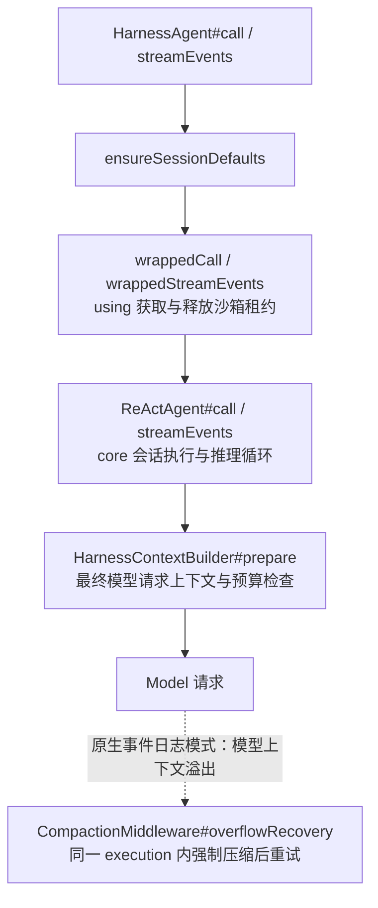
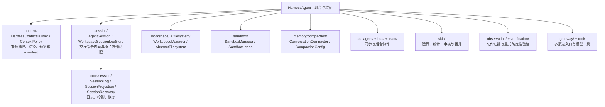
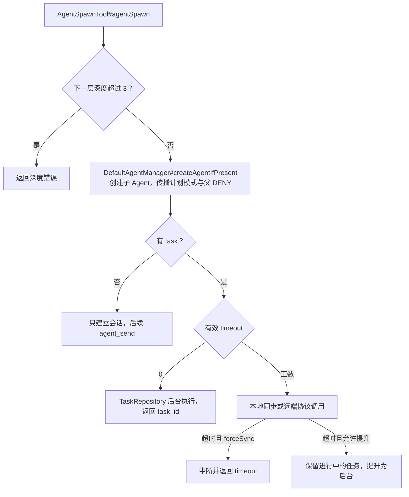
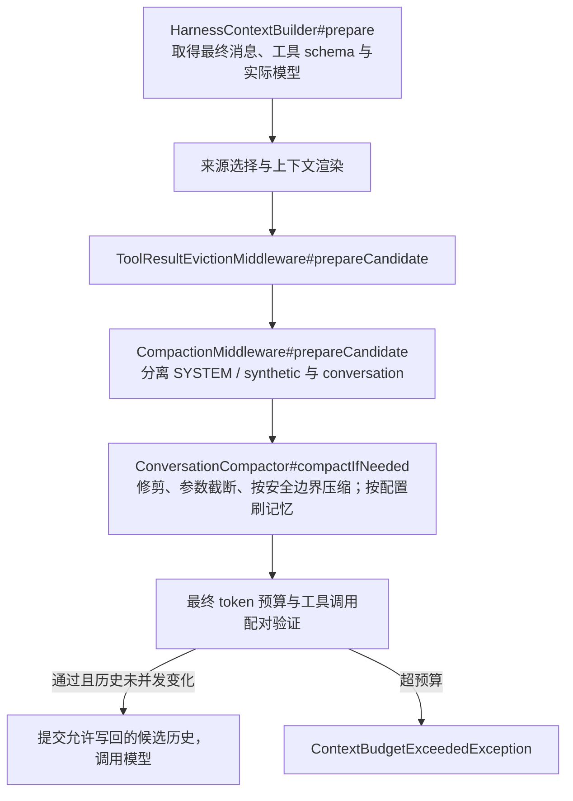

# 第 7 章 Harness 工程化外壳（核心）

> 路径前缀：`agentscope-harness/src/main/java/io/agentscope/harness/agent/`。
> 唯一框架基线：agentscope-java main `dcb131a3f257f06e2b7ddcd3dacfe75d31d04028`（2026-10-26 核对）。本章按真实类名与方法定位，不沿用旧快照行号；源码版本为 `2.1.0-SNAPSHOT`，不据此推断发布状态。
> Harness 组合 core 的推理循环，并承担工作区、会话日志、上下文预算、子 Agent 与沙箱装配。customer_work 示例单独保留 `17007e4a` / 2.0.3 历史边界。

## 7.1 组合而非继承：HarnessAgent 的结构

`HarnessAgent implements Agent, AutoCloseable`，内部持有 `ReActAgent delegate`。普通 `call` 和 `streamEvents` 分别通过 `wrappedCall` 与 `wrappedStreamEvents` 管理沙箱租约；`prepareRun` / `prepareCall` 创建可取消的单次运行句柄。没有传 sessionId 时，`ensureSessionDefaults` 仍以 Agent 名字补齐，并补沙箱、文件系统等运行上下文。



**溢出恢复已经分成两条路径**：默认事件日志模式把恢复挂在 `onReasoning`，因此 `call` 与 `streamEvents` 都能覆盖，并保留同一 turn、execution 与日志 writer。中断、`SessionLogException` 不进入这条恢复分支。显式 legacy 模式才使用 `wrappedCall` 的 `onErrorResume`：压缩后通过 `updateAgentState` 持久化，输入已经在历史中时用空输入重试，避免用户消息重复。legacy 的 `wrappedStreamEvents` 没有对应外层恢复。

这些是组合关系：工作区和技能中间件、工具与最终模型请求准备器共同装配进 core；图中没有把它们画成 core 必然逐个调用的业务工具。

## 7.2 Builder 装配：中间件与最终请求准备器

`HarnessAgent.Builder#build` 的注册顺序如下，具体项受能力开关约束；core 最后按 `MiddlewareBase#order()` 稳定降序排序。同为默认 order 时用户中间件先注册、位于外层；自定义 order 可以改变这个层次，不能说用户永远最外。

```text
用户 middleware
→ ContextConventionsMiddleware
→ SandboxLifecycleMiddleware → AgentTraceMiddleware
→ WorkspaceContextMiddleware → AtPathExpansionMiddleware
→ MemoryFlushMiddleware → MemoryMaintenanceMiddleware
→ CompactionMiddleware#overflowRecovery 返回的中间件
→ InboxMiddleware → TeamsMiddleware
→ DynamicSubagentsMiddleware / SubagentsMiddleware
→ AsyncToolMiddleware → PlanModeMiddleware
→ SkillUsageMiddleware → SkillCuratorMiddleware → HarnessSkillMiddleware
```

`SandboxLifecycleMiddleware` 不靠切点获取租约，租约由外层 using 包装驱动。**普通压缩与工具结果驱逐不再作为这张中间件表里的独立层注册**：`build` 把 `CompactionMiddleware`、`ToolResultEvictionMiddleware` 交给 `HarnessContextBuilder`，通过 `inner.modelRequestPreparer(...)` 放到最终模型请求边界。

当前默认 `SessionHistoryMode.EVENT_LOG`。未设置 `sessionLogStore` 时，使用 `WorkspaceSessionLogStore`；原生会话从 journal 恢复，**不会隐式导入 `.stateStore(...)` 的旧状态**。`legacySessionHistory(true)` / `sessionHistoryMode(LEGACY)` 才启用旧 StateStore 历史路径。legacy 或沙箱基础设施元数据确实需要 StateStore 时，未显式配置才回退 `JsonFileAgentStateStore(defaultStateDir(agentId))`，路径为 `~/.agentscope/state/<agentId>/`，可由 `agentscope.state.home` 改根目录。不能再把这个路径称为所有 Harness 对话的默认历史后端。

`fromAgent(existingReActAgent)` 复制公开可读的 core 配置，也会保留可识别的 Harness 上下文策略与来源；过滤 `HarnessRuntimeMiddleware`、`GracefulShutdownMiddleware` 以免装两遍。工作区、文件系统、沙箱、技能治理等仍需在返回的 builder 上明确配置。迁移历史应用时应先选择会话模式，再确定状态后端，而不是只复制旧 Builder 链。

## 7.3 能力子包地图



| 子包 | 实际职责与关键类 |
|---|---|
| `context` | `HarnessContextBuilder` 实现 core `ModelRequestPreparer`；`ContextSources`、`ContextSelectionPolicy`、`ContextRenderer`、`ContextManifest` 描述来源、选择、渲染与预算结果。`ContextPolicy` 的 0 限制由实际模型窗口决定，不是固定分层配额 |
| `session` | `AgentSession` 提供 `submit/resume/respond/steer/inject/interrupt/await`，调用者可读取 transcript、pending 与投影；`WorkspaceSessionLogStore` 选择工作区对应的存储适配 |
| `session` 存储 | `LocalSessionStorage` 在 POSIX 上组合进程内锁、OS 文件锁、强制写入与原子替换；Windows 走 `SqliteSessionStorage` 同步事务；`StoreSessionStorage` 适配远端存储。这不是旧 transcript JSONL 原地追加机制 |
| `workspace` / `filesystem` | `WorkspaceManager`、`PathPolicy` 与本地/远端/沙箱文件系统。远端或沙箱业务 IO 应使用抽象，不能绕过它直接读宿主 `Files` |
| `sandbox` | `SandboxManager`、`SandboxLease`、执行守卫与快照；隔离范围 SESSION/USER/AGENT/GLOBAL 决定资源共享边界 |
| `memory` | 每日记忆、`MEMORY.md` 合并和 `ConversationCompactor` 压缩工作上下文；原始会话记录归 core journal 管理 |
| `subagent` / `bus` / `team` | 声明式子 Agent、`TaskRepository` 后台任务、信箱及团队任务板；后台结果在后续推理中注入提醒 |
| `skill` | `SkillRuntime`、`SkillCurator`、安全扫描与晋升门；治理策略由宿主配置 |
| `observation` / `verification` | legacy 由 `StateStoreActionObserver` 存动作证据，原生模式从日志取证；`VerificationService` 仅验证已持久化证据，不重执行动作，也不注册成模型工具 |
| `gateway` / `tool` | `HarnessGateway` 的渠道路由与会话互斥；文件、shell、子 Agent、任务、产物交付等工具 |

旧 `memory/session/SessionTree`、`SessionTranscriptWriter`、`TranscriptMiddleware` 与 `transcript/*` 已从当前源码删除；不要沿旧目录寻找恢复与查询入口。长期记忆与会话 journal 也不是同一后端：修改 `MEMORY.md` 不等于改写已经提交的会话事实。

### 两条核心链路：agent_spawn 与上下文压缩



同步本地子 Agent 通过 Reactor Context 向父事件流转发事件；纯后台任务独立执行，不能假设它拥有父流 emitter。结果由后台任务与信箱路径交付。工具结果还包含执行状态，宿主不能把 accepted 或后台 task_id 当成任务成功。



这是最终请求级预算：不能只算对话 token 而漏掉系统提示词、动态来源或工具 schema。候选压缩与驱逐先计算后校验，synthetic 注入不应泄漏进持久化历史。普通压缩错误可以降级，但最终预算校验仍生效；中断与日志错误向上传播。全量历史由原生日志保存，旧版“先写一份 transcript 文件再把文件路径放摘要”的链路不能继续套用。

### 动作证据与验证边界

`VerificationService#verify` 只接受已确认的验收条件，要求先固定任务主体版本，并查找已结束动作的证据；内置 `ShellExitCodeVerifier`、`JsonResultSchemaVerifier` 是确定性验证器。模型提出候选验收条件、工具执行成功、验收通过是三个不同事实。`taskContext(...)` 选择投影和候选工具，本身不运行验证。

## 7.4 几个容易忽略但很实用的机制

### `deliver_artifact`：沙箱里的产物怎么出来

沙箱是个封闭盒子——Agent 在里面生成了报告、图表、压缩包，宿主拿不到。以前各家自己写"从沙箱下载再上传到某处"的胶水代码。现在这条路被收敛成一个内置工具：

```
模型调 deliver_artifact(filePath, fileName?, description?, force?)
  → ArtifactDeliveryTool 从 AbstractFilesystem 把文件下载出来（沙箱工作区也好、远端也好）
  → 交给 builder 上配置的 ArtifactDeliveryTarget 负责运输（对象存储、回调、消息推送……由你实现）
  → 返回 ArtifactDeliveryResult
```

几个设计约束值得注意：

- **不配 `ArtifactDeliveryTarget` 就不注册这个工具**（`Builder#artifactDeliveryTarget(...)`）。没有出境通道时，模型的工具列表里根本看不到它——比"工具存在但一调就报错"干净。`disableFilesystemTools` 也会一并关掉它。
- `fileName` 必须是**纯文件名**：不许有路径分隔符、不许是 `.` 或 `..`。运输目的地的命名空间不由模型的输入决定。
- `force` 默认 `false`，同名文件存在时不覆盖——产物交付是有外部副作用的操作，默认取保守档。

### MCP 注册从"只打日志"到"有回执"

MCP server 注册一直是 **best-effort**：某台 server 起不来、或者 `listTools` 超时，只记日志、不阻断启动（第 4 章 4.6 里 customer_work 也是这个 fail-open 策略）。问题是宿主服务只能去 grep 日志，没法用程序判断"我配的 8 个 MCP，现在几个是活的"。

现在多了一对类型：

```java
public record McpServerRegistrationResult(
        String serverName, String transport, Status status, Instant completedAt, Throwable cause) { }
// Status: SUCCESS / FAILED / SKIPPED

@FunctionalInterface
public interface McpServerRegistrationListener {
    void onCompleted(McpServerRegistrationResult result);   // 每个 server 终态回调一次
}
```

record 的紧凑构造器做了不变式校验：`SUCCESS` 不许带 `cause`，非 `SUCCESS` 必须带 `cause`。挂上 `Builder#mcpServerRegistrationListener(...)` 就能把不健康的 MCP 配置采集进监控、下线或告警——**best-effort 的语义没变，变的是失败对调用方从此可见**。

### 记忆刷写与后台隔离

`MemoryFlushMiddleware` 与 `MemoryMaintenanceMiddleware` 在完成后安排后台工作，以会话上下文快照作为输入，并通过 `PeriodicGate` 节流。调用完成不代表记忆已写完；后台失败需从日志或监控观察。当前上下文传播与隔离 key 按源码实现核对，不将旧行号当作稳定协议。

### 文件搜索工具的输出封顶

`grep_files` / `glob_files` 曾被归类为"自限流"的工具，实际不是——一个宽松的 pattern 打在大仓库上，几万行结果直接灌进上下文，一次就把窗口撑爆。现在两个工具都有 `limit` 参数：

| 工具 | 默认 | 硬上限 |
|---|---|---|
| `grep_files` | 100 | 1000 |
| `glob_files` | 200 | 1000 |

超出时截断并追加一条说明，告诉模型"还有多少条没显示"——让它知道该缩小搜索范围，而不是以为自己看到了全部。只有 `list_files` 仍算自限流（正常就返回一个目录的条目）。另外 `read_file` 的区间读改成了流式，读大文件的指定行段不再把整个文件载进内存。

### 沙箱绑定按调用隔离

`SandboxLifecycleMiddleware` 早期把沙箱绑定放在 agent 实例级字段上。一个 `HarnessAgent` 并发服务多个会话时（第 3 章讲过这是框架的正常用法），A 会话的租约会被 B 会话覆写，出现串沙箱。现在绑定是**每次 call 独立**的，与 `CallExecution` 的 per-call 作用域对齐。这条修正的意义和第 3 章 `CallExecution` 设计成 per-call 是同一个：**凡是"属于本次调用"的东西，就不能挂在 agent 实例上**。

### 子 Agent 的两处继承与描述

- `Builder#subagentFactory(name, description, factory)`多了带 `description` 的重载，内部存为 `HarnessAgentBuilderSupport.SubagentFactoryEntry(name, description, factory)`。以前自定义工厂注册的子 Agent 在 `agent_spawn` 的工具描述里只有名字，模型只能靠名字猜什么时候该派它；`description` 为空时仍回退为名字。
- 子 Agent 现在**继承父 Agent 的 memory 配置**。此前子 Agent 用默认 memory 配置，父 Agent 关掉的记忆能力在子 Agent 里又活了过来，行为不一致。
- **父 Agent 的 DENY 规则强制下发**（2.0.1）。`AgentSpawnTool#collectParentDenyRules`（`AgentSpawnTool.java`）把父 `PermissionContextState` 里的 deny 规则摊平后带给子 Agent，本地子 Agent 与远程子 Agent（经 `RemoteSubmitContext`）走同一份。只下发 DENY、不下发 ALLOW 是刻意的：默认继承时父 DENY 继续约束子 Agent。声明式 `inheritParentPermissions` 默认开启，但允许显式关闭，因此不能把它说成不可绕过的强制安全边界。

当前 main 会向声明式及内置通用子 Agent 下发 `enablePendingToolRecovery`，声明式 frontmatter 可单独覆盖。历史 2.0.3 应用应在其自身版本源码上核对这一行为，不能因指南 main 已支持而默认获得。

### 同一实例上的会话级操作补齐

`HarnessAgent` 是组合而非继承（7.1），所以 `ReActAgent` 上新增的会话级 API 不会自动出现在它身上，得逐个转发。当前 main 提供以下转发接口；原生模式的交互命令还可通过 `AgentSession` 使用：

| API | 位置 | 说明 |
|---|---|---|
| `interrupt(ctx)` / `interrupt(ctx, msg)` / `interrupt(userId, sessionId)` / `interrupt(userId, sessionId, msg)` | `HarnessAgent` | 按会话身份中断；需要精确到运行时还应使用 AgentRun / runId |
| `clearContext(ctx)` / `clearContext(userId, sessionId)` | `HarnessAgent` | 清空模型可见的会话上下文，身份与权限/工具/任务状态保留（语义详见第 2 章 2.4） |
| `clearStateCache()` 及两个按会话的重载 | `HarnessAgent` | 只释放本地缓存，不动 store |

### 后台节流的 key 不能撞

记忆刷写、记忆维护使用不同的节流前缀与隔离维度。分布式部署使用 `StoreBackedPeriodicGate`，本地使用 `LocalPeriodicGate`；不能把某个会话获得执行资格误当成全局都可执行。

### 文件系统错误必须与空结果区分

`LocalFilesystemWithShell` 并发排空子进程 stdout/stderr，避免先 wait 再读导致管道堵塞。`BaseSandboxFilesystem` 的执行失败会转成错误，调用者不能把失败解释为空目录或文件不存在。遇到超时要同时检查子进程执行、输出截断与沙箱连接，不能只重试路径。

### 压缩的 token 估算把 thinking 算进去了

`TokenCounterUtil`（`memory/compaction/TokenCounterUtil.java`）估算上下文 token 数时，`ThinkingBlock` 以前按一个固定的兜底开销计。推理模型一轮的 thinking 可能有几千 token，被严重低估的后果是**压缩触发得太晚**，真正发请求时才撞上模型的上下文上限。现在按 thinking 文本实际长度估算，嵌套在 `ToolResultBlock` 里的 thinking 也一并计入（#3009）。

### 其它 2.0.1 起的小项

- 默认工作区可由环境变量 `AGENTSCOPE_WORKSPACE`指定，便于镜像打包时把工作区挂到固定卷上。解析顺序是系统属性 `agentscope.workspace` → 环境变量 `AGENTSCOPE_WORKSPACE` → `${user.dir}/.agentscope/workspace`（`resolveDefaultWorkspace`）。

### main 新增：宿主与 Agent 看到的工作区不一致（#3247、#3020）

宿主程序用 `java.nio` 往工作区根目录写文件（比如 `uploads/{sessionId}/result.md`），Agent 的文件工具却读不回来：历史默认后端带有按用户分的命名空间，相对路径解析到 `{workspace}/{userId}/...`，而宿主写的是 `{workspace}/...`。这是一种静默的读写不对称，模型会花几十轮去试各种路径变体（#3245）；`UNRESTRICTED` 还允许 `list_files` 一路往上走到盘符根。

main 在 `RemoteFilesystemSpec` 和 `LocalFilesystemSpec` 上加了可选开关 `sharedLocalWorkspace(true)`（#3247，默认关闭，保持原行为）：开启后默认后端改为沙箱化的 `LocalFilesystem`，工作区根共享、没有命名空间前缀，绝对路径被重新挂到工作区下、`..` 直接拒绝；`memory/`、`skills/` 这类共享路由仍保留按用户的命名空间。

另一处相关修正（#3020）：开了会话隔离后，文件工具的相对路径落在会话目录下，但提示词里告诉模型的还是基础工作区路径。现在提示词的工作区段和状态存储段统一给出本次调用的实际工作区路径。

路径策略本身由 `LocalFsMode` 控制：`SANDBOXED`（一律锚定到根，拒绝 `..` 和越界绝对路径）、`ROOTED`（本地模式默认，绝对路径只能落在 `PathPolicy` 的项目、工作区和额外根目录里）、`UNRESTRICTED`（绝对路径原样放行）。

### main 新增：沙箱上传下载的两处修正

- **大文件上传必失败**（#2923，修 #2618）：`SandboxFileTransfer` 接口早就有，但没有一个沙箱实现它，上传一律走“Base64 编码后拼进 shell 命令”的兜底；`DockerSandbox` 把整条命令当成 `docker exec` 的一个参数传进去，大文件直接超过系统的 `ARG_MAX`。现在 Docker 沙箱实现了原生文件传输，下载时也会拒绝被截断的结果，不再把半个文件当成完整文件交出去。
- **非 UTF-8 文件被破坏**（#2456，修 #2447）：上传内容改为严格 UTF-8 解码，解不了就退回 Base64，二进制文件上传再下载能原样往返。

### main 新增：记忆与会话检索支持多关键词（#3062）

`memory_search` 和 `session_search` 多了一个 `matchMode` 参数：`phrase`（默认，整串子串匹配，和以前一样）、`all`（空格分隔的关键词全部出现在同一行记忆或同一条会话记录里）、`any`（至少出现一个）。都是不区分大小写的字面匹配，**不做中文自动分词**，中文关键词要自己用空格隔开。

当前 main 通过 `Builder#disableWebTools()` 控制 `web_fetch` 与 `web_search` 注册；后者依赖 Tavily。`Builder#webHttpClient(HttpClient)` 允许宿主注入代理或出网策略。工具是否注册与调用时是否有可用网络、凭证是两个检查点。

## 7.5 何时用 ReActAgent，何时用 HarnessAgent

| 场景 | 选择 |
|---|---|
| 对话、意图识别、轻量工具调用 | `ReActAgent` 足够 |
| 需要文件系统/工作区、长任务、上下文压缩、子 Agent、Plan Mode、沙箱执行代码 | `HarnessAgent` |
| 已有 ReActAgent 想加渠道/工程能力 | `HarnessAgent.Builder.fromAgent(agent)` 包装 |

## 7.6 customer_work 实战（历史应用快照）

以下只描述 `17007e4a`（2026-10-02）依赖 2.0.3 的应用装配，不是当前 main 的可直接运行模板。升级时必须先决定原生 journal 与 legacy StateStore 的边界；当前新增的上下文预算、动作证据、验证与会话门面不会因为更新文档自动接入历史应用。

### 全量配置的 HarnessAgent 装配

`customer-work-starter/.../agent/HarnessAgentFactory#createHarnessAgent` 是 Harness Builder 用法的活字典，在内层 ReActAgent 之上叠加：

```
HarnessAgent.Builder.fromAgent(innerReActAgent)
  .stateStore(...)  .permissionContext(...)
  .generateOptions(...)          ← 历史应用显式设置生成参数（历史适配见第 10 章坑 2）
  .workspace(...)  .compaction(ContextMemoryFactory#createCompaction)   ← CompactionConfig 按 yml 的
                                    context.{compression-enabled,max-token,msg-threshold,last-keep} 生成
  .memory(MemoryConfig)  .environmentMemory(...)
  .toolResultEviction(ToolResultEvictionConfig.defaults())
  .enableSkillManageTool()  .enableSkillCurator(SkillCuratorConfig.defaults())
  .additionalContextFile(...)
  .enablePlanMode().allowShellInPlanMode().planFileDirectory(...)
  .subagentFactory(name, id -> expert)    ← 把 MultiAgentOrchestrator 的三个专家注册为 subagent
  + applySandbox：LocalFilesystemSpec | DockerFilesystemSpec + IsolationScope.{SESSION,USER,AGENT,GLOBAL}
```

每个能力对应 `customer-work.harness.*` 一个配置开关——"每个能力 = 一个开关 + 一个可替换实现"是该项目的总设计原则。

### 用 MybatisTaskRepository 替换框架实现

admin 的 VibeCoding 场景里，子 Agent 后台任务（`agent_spawn`）默认由 `subagent/task/WorkspaceTaskRepository` 落工作区文件；`customer-admin-server/.../workspace/task/runtime/MybatisTaskRepository implements TaskRepository` 改为落库，任务列表就能进管理界面查询。**Harness 的每个子系统都留了接口缝**，这是替换点用法的范例。

### 渠道接入：fromAgent 包装

`customer-channel/.../DingTalkChannelConfigurer#start`：`HarnessAgent.Builder.fromAgent(customerServiceAgent)` + `DingTalkChannel` + `ChannelConfig`（Stream 模式 WebSocket，免公网回调），飞书/企微同构——**同一个业务 Agent，包一层就接入一个新渠道**，gateway/channel 抽象（7.3）在生产中的直接体现。

### VibeCoding：workspace 布局

`workspace/vibecoding/service/VibeCodingService` 的目录设计：HarnessAgent workspace 根为 `{agentCode}/`（`MEMORY.md` 跨会话共享），会话级目录 `data/admin-workspace/{agentCode}/sessions/{sessionId}/`——对应 7.3 的三层状态：agent 级记忆与会话级工作产物分层存放。

### 多 Agent 编排：框架之外的 Reactor 手工编排

1.x 的 `Pipelines` 编排 API 在 2.0 已移除。`MultiAgentOrchestrator#consult` 用纯 Reactor 实现"快慢车道"：规则快车道（关键词命中唯一意图直接路由）→ LLM 分诊 → fanout 三个专家 ReActAgent（各自 `subscribeOn(boundedElastic)` + `maxConcurrency` 限流 + 单专家 timeout 隔离）→ reduce 归纳统一口径。**框架提供 Agent 原语，编排交给通用响应式代数**——这是 2.0 的明确取向（详细链路见第 9 章场景 8）。

源码定位：[HarnessAgent 装配与调用](https://github.com/agentscope-ai/agentscope-java/blob/dcb131a3f257f06e2b7ddcd3dacfe75d31d04028/agentscope-harness/src/main/java/io/agentscope/harness/agent/HarnessAgent.java)、[最终上下文准备](https://github.com/agentscope-ai/agentscope-java/blob/dcb131a3f257f06e2b7ddcd3dacfe75d31d04028/agentscope-harness/src/main/java/io/agentscope/harness/agent/context/HarnessContextBuilder.java)、[AgentSession](https://github.com/agentscope-ai/agentscope-java/blob/dcb131a3f257f06e2b7ddcd3dacfe75d31d04028/agentscope-harness/src/main/java/io/agentscope/harness/agent/session/AgentSession.java)、[验证服务](https://github.com/agentscope-ai/agentscope-java/blob/dcb131a3f257f06e2b7ddcd3dacfe75d31d04028/agentscope-harness/src/main/java/io/agentscope/harness/agent/verification/VerificationService.java)。
