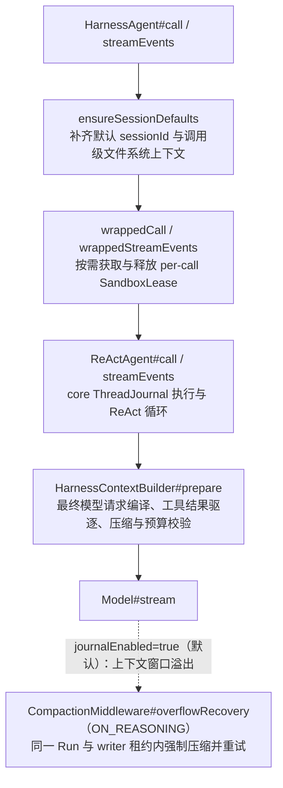
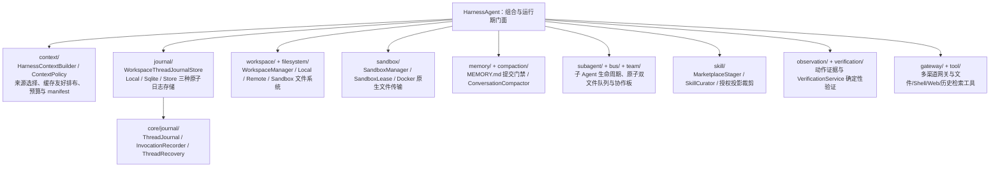
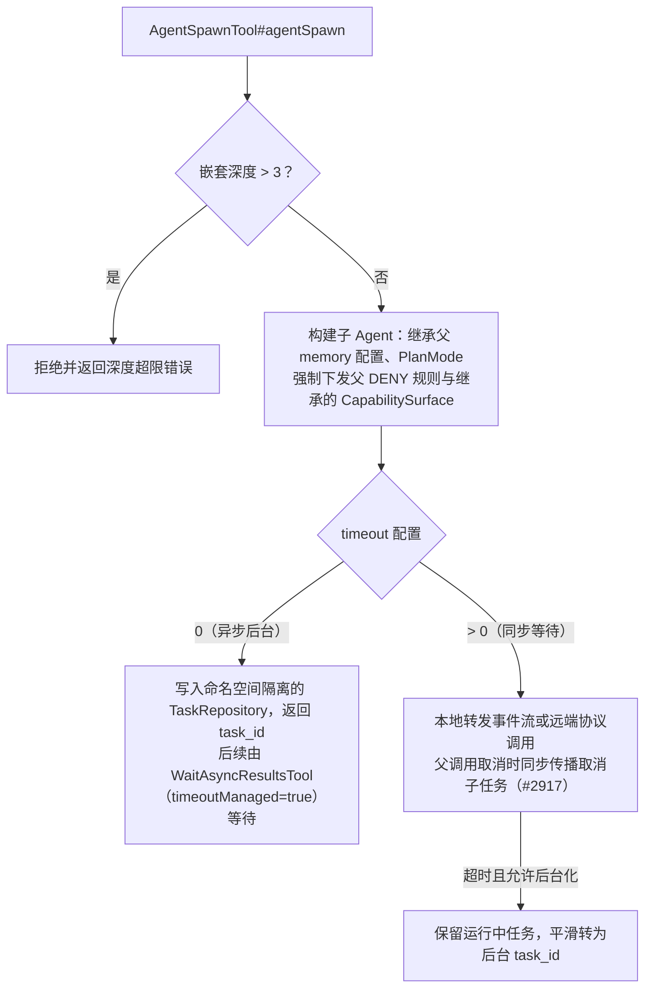
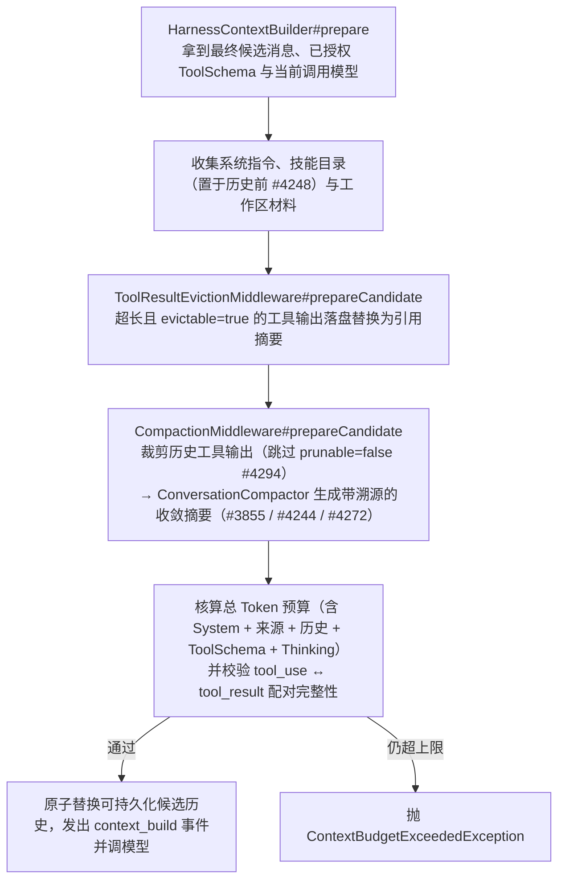

# 第 7 章 Harness 工程化外壳（核心）

> 路径前缀：`agentscope-harness/src/main/java/io/agentscope/harness/agent/`。
> 唯一框架基线：agentscope-java main `80926f92df182d258118456ae458043af0d7e807`（2026-11-27 核对，`2.1.0-SNAPSHOT`）。
> Harness 通过组合（而非继承）`ReActAgent`，将工作区、文件系统、原生 `ThreadJournal`、上下文预算与压缩、子 Agent、沙箱及确定性验证装配成开箱即用的编码与通用智能体运行时。跨进程任务队列与 `steer / pause / resume` 编排已上移至第 8 章的 `agentscope-durable`。customer_work 示例单独保留 `17007e4a`（依赖 `2.0.3`）历史边界。

## 7.1 组合而非继承：HarnessAgent 的结构与调用外壳

`HarnessAgent implements Agent, AutoCloseable` 内部持有 `ReActAgent delegate`。普通 `call` 和 `streamEvents`（含结构化输出重载）分别经 `wrappedCall` 与 `wrappedStreamEvents` 管理单次调用的沙箱租约（`SandboxLease`）；`prepareRun` / `prepareCall` 返回可按 `runId` 精确取消的执行句柄；未传 `sessionId` 时，`ensureSessionDefaults` 补齐默认会话与工作区上下文。



**上下文溢出恢复的双路径边界**：
- **默认 `journalEnabled = true` 模式**：`CompactionMiddleware#overflowRecovery()` 注册在 `ON_REASONING` 切点，因此 **`call` 与 `streamEvents` 两条路径均具备自动溢出恢复能力**，且重试留在同一个 `runId` 与 journal writer 租约内（中断与 `JournalException` 不触发重试）；同时 `LearnedContextWindows` 会从厂商超限报错中动态记录真实窗口上限，供后续轮次提前压缩。
- **显式 `journalEnabled(false)` 模式**：由 `wrappedCall` 外层的 `onErrorResume` 兜底，压缩后通过 `updateAgentState` 写回（输入已入历史时改用空输入重试，避免消息重复，`#3661`）；此模式下 `wrappedStreamEvents` 无外层溢出重试。

## 7.2 Builder 装配：中间件链、2.0 状态自动导入与最终请求准备器

`HarnessAgent.Builder#build`（`HarnessAgent.java:2802` → `buildInstance`）每次构建先深拷贝一份独立的 `Toolkit`（并在构建异常时自动回滚自注入的 store / snapshot 配置，保证同一个 Builder 可安全复用），再按能力开关向 `inner`（`ReActAgent.Builder`）注册中间件与工具。最终由 `ReActAgent.Builder#build` 按 `MiddlewareBase#order()` 稳定降序排列：

```text
ContextConventionsMiddleware（order = Integer.MAX_VALUE - 1000，永远在最外层重置每轮上下文材料池 #3846）
→ 用户自定义 order > 1 的 middleware
→ 用户默认 order = 1 的 middleware（先于以下内置层注册，故同为 1 时排在内置层外侧）
→ SandboxLifecycleMiddleware → AgentTraceMiddleware
→ WorkspaceContextMiddleware → AtPathExpansionMiddleware
→ MemoryFlushMiddleware → MemoryMaintenanceMiddleware
→ CompactionMiddleware#overflowRecovery
→ RepeatedFailureGuard（检测连续重复的工具失败并注入换路提醒）
→ InboxMiddleware → TeamsMiddleware
→ DynamicSubagentsMiddleware / SubagentsMiddleware
→ AsyncToolMiddleware → PlanModeMiddleware
→ SkillUsageMiddleware → SkillCuratorMiddleware → HarnessSkillMiddleware
→ HarnessToolBindings（绑定框架自有工具归属）
→ 用户自定义 order <= 0 的 middleware（排在最内侧）
```

两项核心装配机制务必看清（修正早期 `v2.1.0-BETA1` 阶段的表述）：

1. **普通压缩与大结果驱逐不在中间件链上逐层串跑**：`CompactionMiddleware` 与 `ToolResultEvictionMiddleware` 直接交给 `HarnessContextBuilder`，通过 `inner.modelRequestPreparer(...)` 在 `ON_MODEL_CALL` 最内层一次性完成“驱逐 → 压缩 → Token 预算核算”。
2. **`ThreadJournal` 默认开启，同时自动桥接 2.0 `AgentStateStore`（`HarnessAgent.java:2926-3063`）**：
   - 原 `SessionHistoryMode` 与 `harness/agent/session/AgentSession` 已从仓库移除；当前由 `Builder#journalEnabled(boolean)`（默认 `true`）控制。
   - 开启时默认装配 `WorkspaceThreadJournalStore(wsManager)` 并注册 `ThreadHistoryTool`；同时 **Builder 依然把 `effectiveSession`（显式 `.stateStore(...)` 或默认的 `~/.agentscope/state/<agentId>/` `JsonFileAgentStateStore`）传给 `inner.stateStore(effectiveSession)`**！这样当 `main` 线程日志尚为空时，`ReActAgent` 会自动把既有 2.0 `agent_state` 作为 `migration/baseline` 导入 `ThreadJournal`，并在每次 checkpoint 后镜像回写 `stateStore`（详见第 2 章 2.4）。只有显式配置 `.journalEnabled(false)` 时，才退回纯 `AgentStateStore` + `StateStoreActionObserver` 模式。

`HarnessAgent.Builder.fromAgent(existingReActAgent)` 会复制公开可读的 core 配置及 Harness 上下文策略，并自动过滤掉 `HarnessRuntimeMiddleware` 与 `GracefulShutdownMiddleware` 防止重复挂载。

## 7.3 能力子包地图与双核心链路



| 子包 | 职责与当前关键演进 |
|---|---|
| `context` | `HarnessContextBuilder` 实现 `ModelRequestPreparer`；`#4248` 将稳定很少变动的技能目录（`harness:skills`）排到对话历史之前，显著提升多轮 Prompt Cache 命中率 |
| `journal`（取代原 `session`） | `WorkspaceThreadJournalStore` 按 `agents/<agent>/sessions/<user>/<session>/threads/<thread>/head.json` 路由；底层 POSIX 走 `LocalJournalStorage`（进程锁 + OS 文件锁 + 原子 rename），Windows 走 `SqliteJournalStorage`（批量 `readAll` 单次往返重放），分布式走 `StoreJournalStorage` |
| `workspace` / `filesystem` | `WorkspaceManager`、`PathPolicy`（`SANDBOXED` / `ROOTED` / `UNRESTRICTED`；`#3292` 对 `ROOTED` 绝对路径强制校验命名空间边界）及 `sharedLocalWorkspace(true)` 宿主共享根支持 |
| `sandbox` | `SandboxManager`、`SandboxLease`（按调用隔离，绝不跨会话串租约）、`DockerSandbox` 原生文件流传输（规避 Base64 `ARG_MAX` 上限） |
| `memory` / `compaction` | `MemoryConsolidator` 新增**整理提交门禁**（仅完整、纯文本、非空且不超预算的正文才替换 `MEMORY.md`，读回确认后才推进水位）；带命名空间的调用方不再越界回退读取根目录 `MEMORY.md`；压缩新增溯源元数据（`#4244`）与多轮摘要再压缩（`#4272`） |
| `subagent` / `bus` / `team` | 声明式与动态子 Agent、按存储命名空间隔离的 `TaskRepository`（含孤儿任务恢复 `#4043` 与取消向下传播 `#2917`）；文件系统 `WorkspaceMessageBus` 改用 **`{id}.payload` + `{id}.ready` 双文件原子发布与认领**（`#3281`，已回合 `2.0.5`） |
| `skill` | 后台线程重加载技能（移出 EventLoop，`#3792`）、UTF-8 BOM 兼容、防路径穿越物化（`#3787`），并在沙箱启动前按当前调用的 `CapabilitySurface` 仅投影已授权技能缓存（`prestageForProjection`） |
| `observation` / `verification` | `VerificationService#verify` 仅基于已持久化的确定性动作证据（如 `ShellExitCodeVerifier`、`JsonResultSchemaVerifier`）校验已确认的 `TaskRequirement`，绝不让模型口头自证“测试已通过” |

### 两条高频核心链路：`agent_spawn` 与 `HarnessContextBuilder#prepare`





## 7.4 生产高频实用机制速查

- **`deliver_artifact` 受控出境**：配置 `Builder#artifactDeliveryTarget(...)` 后才向模型暴露该工具；强制校验纯文件名（禁路径分隔符与 `..`），默认 `force = false` 不覆盖已有产物。
- **MCP 注册结果可观测**：`Builder#mcpServerRegistrationListener` 为每个配置的 MCP Server 回调 `McpServerRegistrationResult(SUCCESS / FAILED / SKIPPED)`，保持 fail-open 启动的同时把故障暴露给监控。
- **文件检索与读取硬限流**：`grep_files`（默认 100 / 上限 1000）、`glob_files`（默认 200 / 上限 1000）、`read_file` Unicode 安全流式分页（`#3821`）、`write_text_file` 行号边界校验防文件写坏（`#3208`），以及共享单例 `HttpClient` 的 `web_fetch / web_search`（`#3833`）。
- **实例级会话管理 API 完整转发**：`HarnessAgent` 直接转发 `interrupt(...)`、`clearContext(...)`、`clearStateCache(...)` 以及新增的 **`replacePermissionContext(...)`（`#4117`）**，无需拆壳拿内部 `ReActAgent`。

## 7.5 何时用 ReActAgent / HarnessAgent / DurableRuntime

| 场景需求 | 推荐层级 |
|---|---|
| 单轮/多轮轻量对话、结构化意图分类、简单业务 API 工具调用 | `ReActAgent`（`agentscope-core`） |
| 需要工作区文件读写、长上下文自动压缩、Markdown 技能、子 Agent、沙箱跑代码 | `HarnessAgent`（`agentscope-harness`） |
| 客户端刷新/断网不丢进度、服务滚动重启自动续跑、运行中 `steer` 插话、20 分钟长测试工具与推理主机解耦 | 在前两者外层套 `DurableRuntime` + `AgentScopeAdapter`（第 8 章 8.3） |

## 7.6 customer_work 实战（历史应用快照）

> 本节描述 customer_work `17007e4a`（依赖 AgentScope `2.0.3`）的历史装配，不代表已升级到当前 `main`。

- **全量开关化装配（`HarnessAgentFactory#createHarnessAgent`）**：基于 `HarnessAgent.Builder.fromAgent(innerReActAgent)` 按 `customer-work.harness.*` 配置项叠加工作区、压缩、长期记忆、大结果驱逐、技能治理、Plan Mode、专家子 Agent 与 Local/Docker 沙箱。升级到当前 `main` 时，默认开启的 `WorkspaceThreadJournalStore` 会自动接管主线程历史并从原有 `stateStore` 导入 2.0 基线。
- **接口替换与多渠道包装**：后台通过 `MybatisTaskRepository implements TaskRepository` 将子 Agent 任务落库供管理台分页查询；`customer-channel` 用 `fromAgent` 将同一个客服 Agent 零侵入挂载到钉钉 Stream、飞书与企业微信渠道。

源码定位：[HarnessAgent 装配与调用](https://github.com/agentscope-ai/agentscope-java/blob/80926f92df182d258118456ae458043af0d7e807/agentscope-harness/src/main/java/io/agentscope/harness/agent/HarnessAgent.java#L2802)、[最终上下文准备](https://github.com/agentscope-ai/agentscope-java/blob/80926f92df182d258118456ae458043af0d7e807/agentscope-harness/src/main/java/io/agentscope/harness/agent/context/HarnessContextBuilder.java#L53)、[工作区 ThreadJournal 存储](https://github.com/agentscope-ai/agentscope-java/blob/80926f92df182d258118456ae458043af0d7e807/agentscope-harness/src/main/java/io/agentscope/harness/agent/journal/WorkspaceThreadJournalStore.java#L33)、[验证服务](https://github.com/agentscope-ai/agentscope-java/blob/80926f92df182d258118456ae458043af0d7e807/agentscope-harness/src/main/java/io/agentscope/harness/agent/verification/VerificationService.java#L42)。
