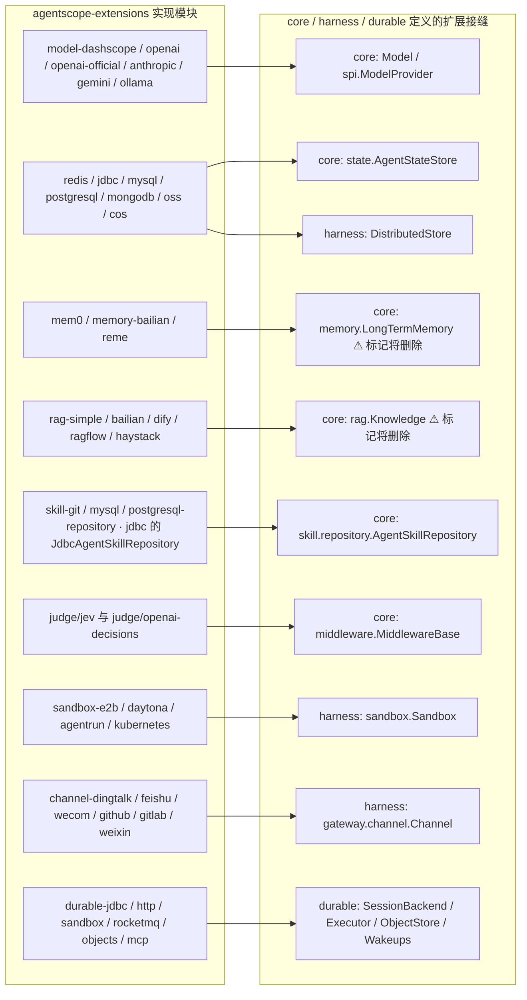
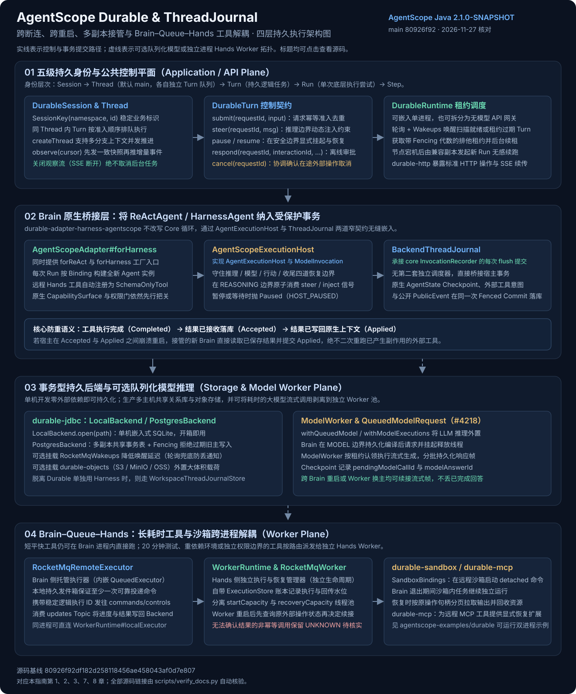
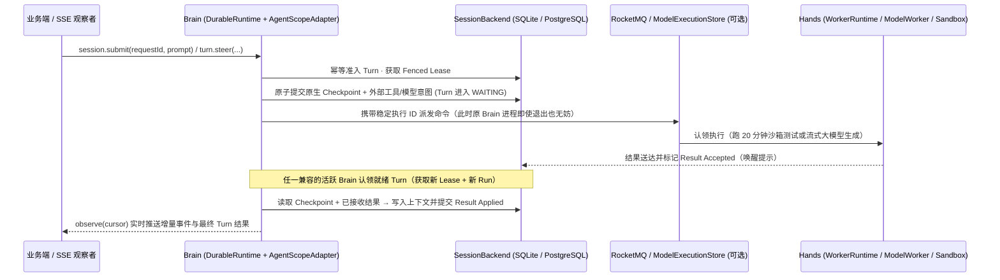

# 第 8 章 扩展生态与 Durable 持久执行（按需查阅）

> 路径前缀：`agentscope-extensions/` 与 `agentscope-durable/`。框架统一基线 main `80926f92df182d258118456ae458043af0d7e807`（2026-11-27 核对，`2.1.0-SNAPSHOT`）。
> `agentscope-extensions` 下共有 **27 个一级模块**（26 个能力/分类模块 + `agentscope-spring-boot-starters` 聚合）；递归共有 **85 个 Maven 项目：13 个 POM 聚合项目 + 72 个 jar 模块**。jar 中包含 14 个 starter、57 个可发布扩展实现和 1 个设置 `maven.deploy.skip=true` 的 `model-e2e-tests`，因此按默认 deploy 配置计 **71 个可发布 jar**（原 `agentscope-extensions-controlplane` 与顶层 `agentscope-service` 已在 `#4154` 移除，新增 6 个 `agentscope-extensions-durable-*` 基础设施模块）。
> 本章前半部分给出 71 个扩展 jar 的接口全景地图，**8.3 节专门拆解 2.1 新增的 `agentscope-durable` 持久执行框架与 Brain–Queue–Hands 架构**。

## 8.1 全景图：每类扩展接在哪个核心接缝上

协议适配层（AG-UI / A2A / agent-protocol / chat-completions-web）与 14 个 Spring Boot Starter 不是实现单一窄接口，而是把 `Agent` 整体封装暴露成外部协议端点或自动装配 Bean。

**两条历史接缝仍保持“计划删除”状态**：`core` 中的 `rag/Knowledge`（含 `RAGMode`）与 `memory/LongTermMemory`（含 `LongTermMemoryMode`）自 `2.0.0` 起即标注 `@Deprecated(forRemoval = true)`。当前 `main` 上对应的 5 个 RAG 扩展与 3 个长期记忆扩展依然可用，但新项目应优先把知识检索实现为普通 `@Tool` 或瞬态注入 `MiddlewareBase`，把跨会话记忆交给 Harness 工作区记忆体系（第 7 章）。

## 8.2 扩展模块分类速查

### 1. 模型厂商（`agentscope-extensions-model/`）

| 模块 | 定位与关键能力 |
|---|---|
| `-dashscope` | 阿里云百炼/通义：`DashScopeChatModel`（原生 HTTP/SSE、`qwen-long` `FileIdSource` 文档理解、Qwen4 多模态端点自动路由 `#4348`、thinking 模式）+ `DashScopeMultiModalTool`（文生图、图生图、音视频等 9 个多模态工具） |
| `-openai` | OpenAI Chat Completions 及兼容网关；`compat/` 内置 `deepseek` / `glm` / `kimi` / `minimax` 四个方言 Provider |
| `-openai-official` | 基于官方 `openai-java`（`4.109.0`）的 Responses API 模块（`openai-official:` 前缀，支持服务端工具与客户端 `tool_search`） |
| `-anthropic` / `-gemini` / `-ollama` | Claude（SDK `2.72.0`，原生 PDF 文档与引用、缓存断点）/ Gemini（SDK `2.6.0`，默认 `gemini-3.8-flash`，按代数路由 thinking）/ 本地 Ollama（原生结构化 Schema） |
| `-e2e-tests` | 跨厂商端到端一致性测试模块（`maven.deploy.skip=true`，唯一不发布的扩展 jar） |

### 2. 存储、分布式与统一 JDBC（`-redis / -jdbc / -mongodb / ...`）

- **`-jdbc`（推荐的关系型统一后端）**：通过 `AbstractJdbcDialect.from(dataSource).build()` 自动探测 MySQL / PostgreSQL / H2 / SQLite，一套表方言同时支撑 `JdbcAgentStateStore`、`JdbcStore`、`JdbcDistributedStore`、`JdbcRemoteSnapshotClient`、`JdbcSandboxExecutionGuard` 与 `JdbcAgentSkillRepository`。注意 `2.0.5+` 与当前 `main` 新建表将 PostgreSQL/H2 `item_key` 扩为 `VARCHAR(2048)`（`#3464`）、MySQL key 列定为 `utf8mb4_bin`（`#3288`）。
- **`-redis`**：兼容 Jedis / Lettuce / Redisson，Lua 脚本实现原子版本 CAS；新增可选 `KeyLayoutVersion.V1`（`#3129`）用 hash tag 适配 Redis Cluster。
- **`-mongodb`**：单会话单文档乐观并发状态存储、基础存储、快照与分布式沙箱锁。
- **`-oss` / `-cos`**：阿里云 OSS / 腾讯云 COS 状态与工作区快照存储。
- **`-mysql` / `-postgresql`**：保留向后兼容，其 `*DistributedStore` 与旧 `skill-{mysql,postgresql}-repository` 均已标注 `@Deprecated`，引导迁往 `-jdbc`。

### 3. Durable 基础设施扩展（6 个 `agentscope-extensions-durable-*` 模块，2.1 新增）

这 6 个一级扩展模块实现 `agentscope-durable` 定义的存储、传输与执行器接口（均已纳入 `agentscope-bom` 与 `agentscope-all`）：

| 模块 | 核心实现类 | 用途 |
|---|---|---|
| `-durable-jdbc` | `LocalBackend`（嵌入式 SQLite）、`PostgresBackend` | `SessionBackend` 与 `ModelExecutionStore` 的事务型数据库实现；单机零外部服务即可跑通断点恢复，多主机共享 PostgreSQL 实现自动故障接管 |
| `-durable-http` | `DurableHttpHandler`、`HttpPublicTransport` | 将 Durable 的公开会话操作与基于游标的 SSE 事件流（支持 `Last-Event-ID` 续传）暴露为独立 HTTP 服务，支持纯 API 网关无模型部署 |
| `-durable-sandbox` | `SandboxBindings`、`SandboxExecutor` | 让沙箱中的脱离式（detached）长命令与主机解耦：支持跨 Brain 重启查询原命令状态、分页拉取增量输出与生命周期清理 |
| `-durable-rocketmq` | `RocketMqRemoteExecutor`、`RocketMqWorker`、`RocketMqWakeups` | 基于 RocketMQ 的 **Brain–Queue–Hands** 远程工具可靠投递与跨实例低延迟任务唤醒提示 |
| `-durable-objects` | `S3ObjectStore`、`OssObjectStore` | 将超大 Checkpoint、模型流输出与工具产物外置到 S3/MinIO 或阿里云 OSS，减轻关系库事务表体积 |
| `-durable-mcp` | `DurableMcpExecutor` | 为远程 MCP 工具提供显式操作标识与可验证的恢复适配 |

### 4. 沙箱、RAG、长期记忆、渠道、协议与裁判

- **云端沙箱（`-sandbox-{e2b,daytona,agentrun,kubernetes}`）**：`-kubernetes` 基于 Kubernetes SIG `agent-sandbox` CRD（`SandboxClaim`）申领容器，并在工作区初始化失败与命令超时上严格快速失败（`#3951`、`#4006`）；`-e2b` 支持服务端超时强杀与快照重绑定（`#4081`、`#2976`）。
- **RAG 与长期记忆**：`-rag-{simple,bailian,dify,ragflow,haystack}`（近期修复了 pgvector 扩展初始化顺序 `#3802`、`TikaReader` 并发隔离 `#3196` 等）与 `-mem0 / -memory-bailian / -reme`。
- **六大 IM/研发渠道（`-channel-{common,dingtalk,feishu,wecom,github,gitlab,weixin}`）**：涵盖 Webhook 推送、钉钉 Stream WebSocket 与个人微信 iLink 长轮询（带 `WeixinLease` 代数防旧主写入）。注意默认去重表、Token 缓存与 `InMemoryWeixinStateStore` 均为单机内存实现，多副本生产环境需注入共享存储实现。
- **三大外部协议与内部远程子 Agent 协议**：
  - `-protocol/-agui`：零 Spring 依赖的 AG-UI 事件流与请求级外部工具（`ToolRequestConfig`）适配器，SSE 断连后可保持 MVC 后台运行（`#3745`）；
  - `-protocol/-a2a/{-client,-server}`（SDK `1.5.1.Final`）：跨进程 Agent 互调。`A2aAgent` 每次执行仅解析一次 Agent Card 并在取消时同步中止远端流与关闭客户端（`#3767`、`#4097`），详见 [A2aAgent#startCall](https://github.com/agentscope-ai/agentscope-java/blob/80926f92df182d258118456ae458043af0d7e807/agentscope-extensions/agentscope-extensions-protocol/agentscope-extensions-a2a/agentscope-extensions-a2a-client/src/main/java/io/agentscope/core/a2a/agent/A2aAgent.java#L355) 与 [解析次数与失败边界测试](https://github.com/agentscope-ai/agentscope-java/blob/80926f92df182d258118456ae458043af0d7e807/agentscope-extensions/agentscope-extensions-protocol/agentscope-extensions-a2a/agentscope-extensions-a2a-client/src/test/java/io/agentscope/core/a2a/agent/A2aAgentTest.java#L168)；
  - `-protocol/-chat-completions-web`：暴露 OpenAI `/v1/chat/completions` 兼容端点；
  - `-protocol/-agent-protocol`：Harness 远程子 Agent 的 `/tasks` 提交、序号回放与 HITL `/resume` 协议（多副本下需将默认内存 `AgentProtocolTaskEventBus` 替换为共享流实现）。
- **结构化裁判与周边**：`-judge/-jev`（TypeSafe System One 概率与结构化决策套件）、`-judge/-openai-decisions`、`-nacos/{-a2a,-prompt,-skill}`、`-scheduler/{-common,-quartz,-xxl-job}`、`-higress`、`-studio`（含 `TelemetryTracer`）、`-training`，以及 `agentscope-spring-boot-starters` 下的 **14 个 Starter**。

---

## 8.3 agentscope-durable：跨进程长程持久执行框架（核心新增）

> **架构演进说明**：在 `v2.1.0-BETA1` 及更早提交中，仓库顶层曾包含一套强绑定独立控制面（Go `service-controlplane` + Java `service-gateway / dataplane / scheduler`）的服务平台模块 `agentscope-service` 与 `-controlplane` SDK。`#4154` 将这套重平台整体移出，取而代之的是顶层模块 **`agentscope-durable`**——它把“跨断连、跨重启、跨主机接管、长耗时工具解耦”提炼成了**零平台绑定的嵌入式 Java 框架**，既能在单 JVM + 本地 SQLite 文件里跑，也能在多副本 Spring Boot + PostgreSQL + RocketMQ 集群里跑。

先看完整架构与数据流全景图（点击图内类名可直达固定 SHA 源码行）：

### 1. 为什么单靠 Core / Harness 还不够？

`ReActAgent` 与 `HarnessAgent` 解决的是**一次进程内调用（Run）**里的推理循环、上下文预算与本地/沙箱工具调用；哪怕开了 `ThreadJournal`，调用本身仍绑在发起它的那个 JVM 和响应式订阅上。一旦遇到真实生产中的长程任务（例如“定位线上超时 Bug → 在沙箱跑 20 分钟集成测试 → 第二天早上等主管审批后再提交补丁”），就会撞上五个生命周期断层：

1. **客户端断连与刷新**：用户关掉浏览器再打开，需要看到已产出的半篇报告和实时进度，而不是重新提交一遍 Prompt，更不能因为 SSE 断开就把后台任务取消掉；
2. **运行中动态干预（`steer` vs `submit`）**：任务跑了一半，用户补一句“只排查数据库层，别改 API 签名”（应注入当前任务的下一个推理边界），或者追加第二个后续任务（应在同一线程后排队）；
3. **推理进程滚动重启 / 节点宕机**：发版滚动替换 Pod 时，正在跑的任务需要由新实例在旧租约过期后自动认领续跑，且保留同一个业务任务 ID；
4. **20 分钟长工具与推理主机的寿命错配**：测试命令在远程沙箱里跑了 8 分钟时 Brain 节点重启了——新节点必须重连原测试拿结果，绝不能把测试重跑第二遍造成重复副作用；
5. **隔天审批不占内存**：等待人工审批的十几个小时里，无需在任何 JVM 内存里挂着 Agent 实例。

### 2. 四大核心契约与五级身份层次

`agentscope-durable` 将模块拆为三块：`durable-runtime`（状态机、调度与公开协议）、`durable-worker`（Hands 侧可靠投递账本与执行器管理）和 `durable-adapters`（含原生 `durable-adapter-harness-agentscope`、`claude`、`agui`）。四个核心接口切清职责：

| 边界契约 | 核心职责 |
|---|---|
| `DurableRuntime` | 业务入口、定义注册与宿主调度循环：管理 Session/Thread、按租约认领就绪 Turn、执行续租与故障自动接管；不调 `start()` 时可作为纯 API 客户端部署 |
| `HarnessAdapter`（`AgentScopeAdapter`） | 桥接原生 Agent 循环与持久事务：解释私有 Checkpoint，把原生 `ThreadJournal` 提交合并进宿主受 Fencing 保护的后端事务 |
| `SessionBackend` | 持久事实唯一真相源：事务化保存任务队列、Checkpoint、幂等请求回执（`requestId` 去重）、带代数的租约（Fencing）与可按游标重放的公开事件 |
| `Executor` / `WorkerRuntime` | 独立工具生命周期管理（启动 / 查询 / 取消 / 分页拉取输出）；无法确认外部结果时诚实保留 `UNKNOWN`，绝不捏造成功或盲目重试 |

五级身份从外到内严格嵌套：
- **`Session`（`SessionKey(namespace, id)`）**：稳定的业务会话身份，默认自动创建名为 `"main"` 的主线程；
- **`Thread`**：绑定固定 Agent 定义版本（`harness + definitionVersion`）的独立上下文与严格按准入顺序执行的 **Turn 队列**（同一 Session 下不同 Thread 可并发推进）；
- **`Turn`（`DurableTurn`）**：一个持久化的用户逻辑任务（进程重启不会产生新 Turn）；
- **`Run`**：推进某个 Turn 的一次具体底层调用（首次执行是一次 Run，重启恢复或外部工具返回后唤醒是同 Turn 下的新 Run）；
- **`Step`**：一次 Run 内部的推理（`REASONING`）、行动（`ACTING`）或收尾（`FINALIZATION`）步骤。

### 3. 原生桥接内幕：`AgentScopeAdapter` + `AgentScopeExecutionHost` + `BackendThreadJournal`

`AgentScopeAdapter.forReAct(...)` / `forHarness(...)` 是把第 3 章 `ReActAgent` 无缝接入 Durable 的关键胶水，内部做了三件精巧的事：

1. **按次新建 Builder + 外部工具转 `SchemaOnlyTool`**：每次 Run 激活时调用应用注册的工厂拿到全新 Builder，将需要交由 Durable `Executor`（Hands）执行的工具注册为 `SchemaOnlyTool`——这样模型照常看到完整 Schema，且 **Core 原生的 `CapabilitySurface` 与 `PermissionEngine` 依然先在 Brain 侧把关**，获批后才在 `executeCore` 挂起交由 Durable 派发！
2. **`AgentScopeExecutionHost` 守住四个原生恢复边界**：实现第 3 章讲的 `AgentExecutionHost`，在 `REASONING` 边界读取 Durable 帧中的 `input:steer` / `input:inject` 信号写入 `AgentState` 上下文并记录 `input/applied`；检测到 `TurnStatus.PAUSING` 时直接抛出 `AgentExecutionHost.Paused` 让 Core 在安全边界停下；检测到取消请求时抛出 `FENCED` 交还宿主协调在途外部工具取消。
3. **`BackendThreadJournal` 消除双写不一致**：它直接实现了 `core/journal/ThreadJournal`，不做本地文件写入，而是把 `InvocationRecorder` 产出的原生日志事件、Checkpoint 与 Durable 的公开消息/事件打包进同一个 `Commit`，经 `HarnessContext` 在单次受 Fencing 租约校验的数据库事务里原子提交。

### 4. Brain–Queue–Hands 与队列化模型续跑（`#4218`）

Durable 支持按工具与模型的成本特征自由组合部署拓扑，不必一刀切拆微服务：

两条高阶恢复保证尤为关键：

- **工具结果三阶段分离（Completed → Accepted → Applied）**：如果 Hands 刚把 20 分钟测试的结果交回 Backend（`Accepted`），Brain 还没来得及把它拼进 `AgentState`（`Applied`）就挂了，替补上来的新 Brain 会直接消费已保存的结果继续下一轮推理，**绝不会让沙箱把 20 分钟测试再跑一遍**（由 `agentscope-examples/durable/integrated/tool-in-sandbox` 实测验证副作用只发生一次）。
- **队列化模型调用跨实例续跑（`#4218`，`ModelWorker` + `QueuedModelRequest`）**：通过 `adapter.withQueuedModel(publisher)` 或 `adapter.withModelExecutions(executions, route)`，连大模型推理本身都可以从 Brain 剥离到专门的 `ModelWorker` 池。`AgentScopeExecutionHost` 在 `MODEL` 边界把编译好的请求持久化并挂起当前 Run；`ModelWorker` 执行流式调用并将增量帧持久化到 `ModelExecutionStore` / `ObjectModelOutputStore`，即使 Brain 重启或 Worker 重试换主，也能按协议校验续接剩余流式帧并恢复推理！

## 8.4 customer_work 实战：扩展选型取舍

> 本节保留 customer_work `17007e4a`（依赖框架 `2.0.3`）的历史快照。

项目引入了 24 个 extensions 模块与 3 个官方 starter，遵循“**默认内存/本地实现保证离线零依赖启动，生产通过单一配置项切换 Redis / JDBC / 云厂商后端，多模块按需 exclude 自动装配**”的工程原则。若未来将该应用中的 VibeCoding 长耗时编码任务升级至 `2.1.0-SNAPSHOT`，可直接在现有 `HarnessAgent` 外层套上 `AgentScopeAdapter.forHarness(...)` + `PostgresBackend` + `durable-sandbox`，即可获得跨服务发版不断连的长任务能力。

## 固定基线源码入口

- [扩展 Maven 模块声明（27 个一级模块）](https://github.com/agentscope-ai/agentscope-java/blob/80926f92df182d258118456ae458043af0d7e807/agentscope-extensions/pom.xml#L33)。
- [Spring Boot Starter 模块声明（14 个 Starter）](https://github.com/agentscope-ai/agentscope-java/blob/80926f92df182d258118456ae458043af0d7e807/agentscope-extensions/agentscope-spring-boot-starters/pom.xml#L32)。
- [Durable 架构设计与场景说明](https://github.com/agentscope-ai/agentscope-java/blob/80926f92df182d258118456ae458043af0d7e807/agentscope-durable/README.md#L1)。
- [DurableRuntime 调度与恢复内核](https://github.com/agentscope-ai/agentscope-java/blob/80926f92df182d258118456ae458043af0d7e807/agentscope-durable/durable-runtime/src/main/java/io/agentscope/durable/DurableRuntime.java#L75)。
- [AgentScopeAdapter 原生桥接入口](https://github.com/agentscope-ai/agentscope-java/blob/80926f92df182d258118456ae458043af0d7e807/agentscope-durable/durable-adapters/durable-adapter-harness-agentscope/src/main/java/io/agentscope/durable/agentscope/AgentScopeAdapter.java#L178)。
