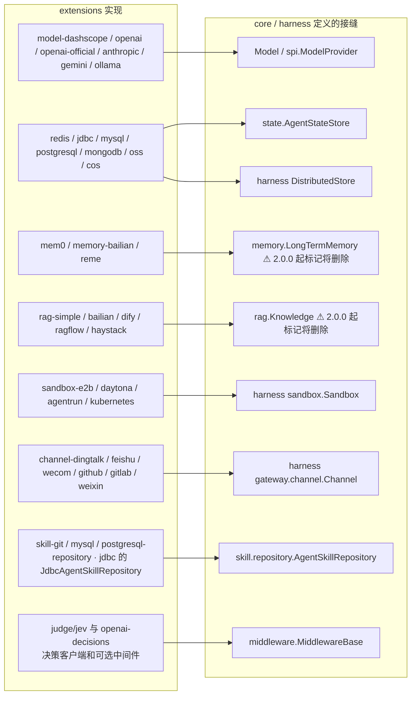
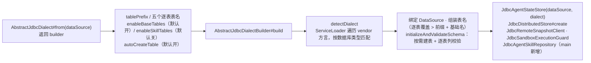
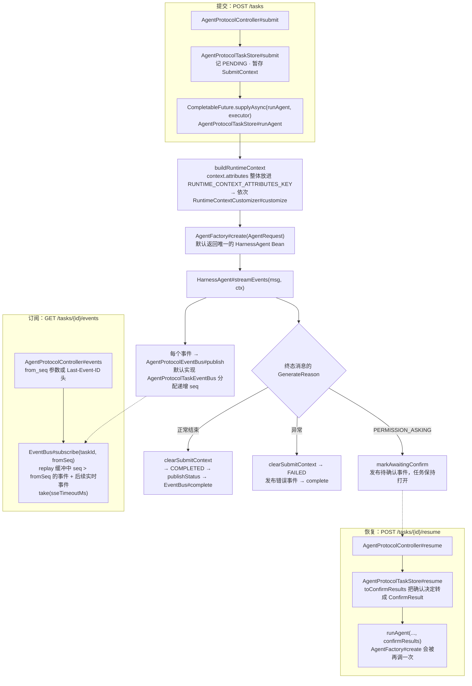
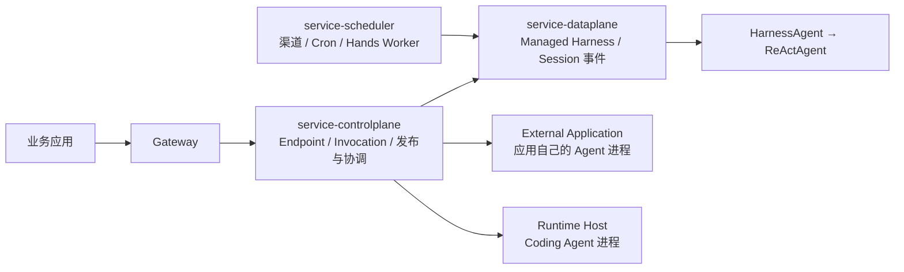

# 第 8 章 扩展生态（非核心，按需查阅）

> 路径前缀：`agentscope-extensions/`。框架统一基线 main `dcb131a3f257f06e2b7ddcd3dacfe75d31d04028`。除 starters 外 **21 个一级模块**；整个 extensions 树（含 starters）有 **80 个 Maven 项目：13 个 POM 聚合项目 + 67 个 jar 项目**。jar 中包含 14 个 starter、52 个可发布扩展实现和 1 个设置 `maven.deploy.skip=true` 的 model-e2e-tests；因此按默认 deploy 配置计 **66 个可发布 jar**，聚合 POM 单独计算。这是源码构建口径，不代表所有构件已经上传到仓库。扩展实现 core 或 harness 接口，由应用按需引入。
> 本章是"地图"而非"精读"——先知道有什么、接在哪个接口上，用到时再进对应模块。

## 8.1 全景图：每类扩展接在哪个核心接口上



协议层（AG-UI / A2A / agent-protocol / chat-completions）与 Spring Boot Starter 不实现单一接口，而是把 `Agent` 整体适配/暴露出去，单列于 8.2 的“协议、渠道与周边”和 Starters 小节。

**两条接缝已经标了"将删除"**：`rag/Knowledge`（连同 `RAGMode`、`KnowledgeRetrievalTools`、`GenericRAGHook`、`Document`、`RetrieveConfig`）和 `memory/LongTermMemory`（连同 `LongTermMemoryMode`、`LongTermMemoryTools`、`StaticLongTermMemoryHook`）从 **2.0.0 起**就是 `@Deprecated(forRemoval = true, since = "2.0.0")`，javadoc 写明“rag 包已移除，请在应用层集成检索”“长期记忆已移除，会话上下文改放在 `AgentState#getContext()`”。`ReActAgent.Builder` 里 `knowledge(...)` / `ragMode(...)` / `longTermMemory(...)` 仍能用（main 上 `ragMode` 默认 `GENERIC`，`AGENTIC` 时注册 `KnowledgeRetrievalTools`），所以 RAG 的 5 个扩展、长期记忆的 3 个扩展今天照常工作，但它们实现的是**计划删除的接口**。选型时的含义：

- 新项目把检索做成普通工具或中间件，不要再往 `ragMode` 上建；跨会话记忆优先用 harness 的记忆文件（第 7 章）；
- 已经用上的项目（customer_work 的 C 端就是 `RAGMode.AGENTIC` + `LongTermMemoryMode.BOTH`，见 8.4）在升级大版本前要留迁移时间。

`judge/jev` 与 `judge/openai-decisions` 提供独立决策客户端，并附带可显式注册的 Agent 中间件；它们不属于聊天模型 SPI。

## 8.2 分类速查

### 模型厂商（`agentscope-extensions-model/`）

| 模块 | 一句话 |
|---|---|
| `-dashscope` | 阿里云百炼/通义：`DashScopeChatModel` + `DashScopeHttpClient`（原生 HTTP/SSE、多模态端点自动选择、thinking 模式、请求加密），第 5 章的示例厂商。另带 `tool/DashScopeMultiModalTool`，把文生图、**图生图（`dashscope_image_to_image`，2.0.3 新增，改图而非按描述重画）**、图生文、文/图生视频、语音合成与识别等 9 个能力以 `@Tool` 暴露给 Agent |
| `-openai` | OpenAI 及一切兼容端点。2.0.1 起在 `compat/` 下内置 DeepSeek / GLM / Kimi / MiniMax 四个一等提供商（`deepseek:` / `glm:` / `kimi:` / `minimax:` 前缀），它们复用 `OpenAIChatModel`、只替换方言 formatter（第 5 章 5.5 有完整对照表） |
| `-openai-official` | **当前 main（#3078）**：基于官方 `openai-java` SDK 的 Responses API 模块（第 5 章 5.7） |
| `-anthropic` / `-gemini` / `-ollama` | Claude / Gemini / 本地 Ollama |
| `-e2e-tests` | 跨厂商端到端一致性测试（覆盖原生厂商，也包括 DeepSeek、GLM 等兼容提供商） |

每个模块都带 `XxxModelProvider implements ModelProvider`（SPI，main 上共 10 个实现：6 个原生 + 4 个兼容），支撑 `ModelRegistry.resolve("openai:gpt-4o")`（第 5 章 5.5）。

### RAG（`agentscope-extensions-rag/`）

| 模块 | 一句话 |
|---|---|
| `-simple` | 自建 RAG 全套：`EmbeddingModel` 抽象（DashScope/Ollama 实现）、reader（Text/PDF/Word/Image/Tika + `TextChunker`）、store（InMemory/PgVector/Qdrant/Milvus/Elasticsearch）、`SimpleKnowledge` |
| `-bailian` / `-dify` / `-ragflow` / `-haystack` | 分别对接百炼托管知识库 / Dify / RAGFlow / Haystack 检索服务 |

core 侧的接缝：`rag/Knowledge`（`addDocuments` / `retrieve`）+ `RAGMode`（`GENERIC` 自动检索注入 / `AGENTIC` 模型经 `KnowledgeRetrievalTools` 自主决定 / `NONE`）。**这两者 2.0.0 起都标了将删除**（见 8.1）。

### 长期记忆（`agentscope-extensions-mem/`）

`-mem0`（Mem0 本地/云）、`-memory-bailian`（百炼记忆服务）、`-reme`（ReMe，含轨迹记忆）——都实现 core 的 `LongTermMemory` 两方法接口（`record` / `retrieve`，第 2 章 2.3），**该接口 2.0.0 起标了将删除**（见 8.1）。

### 存储与分布式

| 模块 | 一句话 |
|---|---|
| `-redis` | `RedisAgentStateStore`（Jedis/Lettuce/Redisson 三套客户端）、`RedisDistributedStore`、`RedisSandboxExecutionGuard`（分布式沙箱执行锁）、快照客户端 |
| `-jdbc` | **2.0.3 新增的统一 JDBC 模块**，见下文；main 上把技能持久化也并了进来 |
| `-mysql` | `MysqlAgentStateStore`、`JdbcStore` + Mysql/Postgres/H2/Sqlite 四方言、`JdbcSandboxExecutionGuard`。v2.0.3 起类原样保留，`MysqlDistributedStore` 标 `@Deprecated(since = "2.1", forRemoval = true)`，官方指引迁往 `-jdbc` |
| `-mongodb` | **当前 main（#2698）**：`MongoAgentStateStore`（支持乐观并发）、`MongoBaseStore`、`MongoDistributedStore`、`MongoSandboxExecutionGuard`、`MongoRemoteSnapshotClient`，文档型存储的一套完整后端 |
| `-postgresql` | `PostgresAgentStateStore` + `BaseStore` 的 PostgreSQL 实现，独立成模块（不在 `-mysql` 的方言里）；支持乐观并发（第 2 章 2.5） |
| `-oss` / `-cos` | 阿里云 OSS / 腾讯云 COS 的状态存储 + 分布式存储 + 快照 |

**`-jdbc` 的方言设计**（`io.agentscope.extensions.jdbc.dialect`，`package-info.java` 里有完整示意图）值得单独看一眼，它把"一个组件 × 四种数据库"的矩阵收敛成了两层：

```
按表拆接口（dialect.table）：StoreDialect / SessionStateDialect / SnapshotDialect
                            + SkillDialect / SkillResourcesDialect（main 新增，#3345）
    —— 每个接口 = 抽象 DDL + ANSI 标准业务 SQL 的 default 实现
          ▲ implements
AbstractJdbcDialect（聚合抽象类）：同时实现五个表接口 + SandboxLockStrategy
    —— 持有表名前缀（默认 agentscope_）与逐表覆盖；默认用表锁实现 tryEnter()
          ▲ extends
按库一个类（dialect.vendor）：MysqlDialect / PostgresDialect / H2Dialect / SqliteDialect
    —— 只覆写 DDL、不兼容的 upsert 语法、以及原生锁（MySQL 用 GET_LOCK，其余继承表锁）
```

入口是 `AbstractJdbcDialect.from(dataSource)` 返回的 builder：`build()` 经 `ServiceLoader` 探测数据库类型 → 绑定 `DataSource` → 组装表名 → 按需建表并**逐表校验列**（main 上 #3309 把建表和列校验都收进了 builder，`autoCreateTable` 默认 `true`，关掉后仍会校验已有表的列）。表按两组开关：`enableBaseTables` 默认开（存储、会话状态、快照三张表），`enableSkillTables` **默认关**（技能、技能资源两张表）；两组都关时 `build()` 直接抛 `IllegalStateException`。上层组件——`JdbcAgentStateStore`、`JdbcStore`、`JdbcDistributedStore`（`create(dataSource)` 一行拿到）、`JdbcRemoteSnapshotClient`、`JdbcSandboxExecutionGuard`，以及 main 新增的 `JdbcAgentSkillRepository`——都只依赖表接口，不感知具体数据库。与旧 `-mysql` 模块"每个组件各配一个方言类"相比，**新增一种数据库只需加一个 vendor 类**，新增一个组件也只需依赖已有表接口。`JdbcAgentStateStore` 支持乐观并发（第 2 章 2.5），且不在代码里拼库名，第 10 章坑 7 在它身上不存在。



> 发版说明称 `MysqlDistributedStore` / `PostgresDistributedStore` "已委托给统一 JDBC 模块"，但 v2.0.3 源码里这两个类的改动只有新增 `@Deprecated` 注解与 javadoc，原文写的是"preserved unchanged for backward compatibility"，**并未委托**。以源码为准：旧类行为不变，新旧模块是两套独立实现。
>
> **当前 main 实现**：#3345 把技能持久化并入 `-jdbc`，`skill-mysql-repository` 的 `MysqlSkillRepository` 与 `skill-postgresql-repository` 的 `PostgresSkillRepository` 都标了 `@Deprecated`，javadoc 指向 `JdbcAgentSkillRepository`。

### 沙箱（`agentscope-extensions-sandbox/`）

`-e2b` / `-daytona` / `-agentrun`（阿里云，含 OSS/NAS 挂载）/ `-kubernetes`——云端沙箱。其中 `-kubernetes` 在 2.0.1 迁到了 Kubernetes SIG 的 [agent-sandbox](https://github.com/kubernetes-sigs/agent-sandbox) CRD / 控制器模型（经 `SandboxClaim` 申领），沙箱生命周期与预热池由集群侧控制器负责，框架只通过运行时镜像约定的 `/execute`、`/upload`、`/download` 接口交互，不再自己管理 Pod；本地 Docker 实现在 harness 自带（`impl/docker/DockerSandbox`，第 7 章）。main 上 `-e2b` 新增按沙箱自动清理旧的 `NATIVE_SNAPSHOT` 快照（#2555）。

### 协议、渠道与周边

| 模块 | 一句话 |
|---|---|
| `-protocol/-agui` | AG-UI 协议：`AguiAgentAdapter` 把 `Flux<AgentEvent>` 编码成 AG-UI 事件流。协议层 SPI（`AgentEventConverter`、`AguiEventEnricher`、`AguiAgentAdapterFactory`，以及后来从 starter 下沉回来的 `AguiRuntimeContextRequest` / `AguiRuntimeContextResolver` / `AguiRequestBodyParser`）都在这里，**不带 Spring 依赖**——纯 WebFlux / RSocket 接入方也能复用 |
| `-protocol/-a2a/{-client,-server}` | Agent-to-Agent 协议，跨进程 agent 像微服务一样互调（agent-card + JSON-RPC）。server 侧的 `AgentRunner` 已从废弃的 `stream()`/`Event` 迁到 `streamEvents()`/`AgentEvent`，`AgentScopeAgentExecutor` 负责把类型化事件转成 A2A 的流式 artifact 与终态消息 |
| `-protocol/-agent-protocol` | 内部任务 HTTP 协议的 Spring MVC 端点，**用于远程子 Agent**（第 7 章 subagent 的跨进程形态），默认关闭（`agentscope.agent-protocol.enabled=false`）。2.0.2 集中增强了这一层：`AgentFactory` 在首次 `POST /tasks` 和**每次** `POST /tasks/{id}/resume` 时都被调用，可按 `agentId`、租户或任意上下文属性路由到不同的 `HarnessAgent`（默认实现总是返回唯一的那个 `HarnessAgent` Bean）；调用方提交的 `context.attributes` 整体以一个 map 放进 `RuntimeContext` 的专用 key（`AgentProtocolConstants#RUNTIME_CONTEXT_ATTRIBUTES_KEY`，不会与框架 key 冲突），要把其中某个属性提升为独立 key 或转成类型化对象，就注册 `RuntimeContextCustomizer` Bean；`TaskStore` 也与执行侧 `WorkspaceManager` 解耦。2.0.3 引入 `AgentProtocolEventBus`：负责给每个任务分配单调递增的序号、发布事件、按 `fromSeq` 回放；默认实现 `AgentProtocolTaskEventBus` 把回放缓冲放在**进程内存**里——**多副本部署时 SSE 断线重连若落到另一个实例就回放不出来**，需要自己提供共享实现（如 Redis Streams）注册为该 Bean |
| `-protocol/-chat-completions-web` | 把 agent 暴露成 OpenAI `/v1/chat/completions` 兼容接口 |
| `-channel/{-common,-dingtalk,-feishu,-wecom,-github,-gitlab,-weixin}` | 各 IM/代码平台的 harness `Channel`（`harness/agent/gateway/channel/Channel`）实现，公共部分在 `-common`；main 上的变化见下文“渠道” |
| `-judge/{-jev,-openai-decisions}` | 两个独立的结构化决策客户端，及显式注册的中间件和应用辅助能力，见下文“裁判” |
| `-nacos/{-a2a,-prompt,-skill}` | Nacos 做 A2A 注册发现 / 提示词动态下发 / 技能仓库 |
| `-scheduler/{-common,-quartz,-xxl-job}` | 定时任务触发 agent |
| `-higress` | Higress AI 网关做 MCP 工具按需发现（第 4 章 4.6） |
| `-studio` | AgentScope Studio 可视化调试对接；**并承载完整 OTel 语义实现 `tracing/telemetry/TelemetryTracer`** |
| `-skills/skill-{git,mysql,postgresql}-repository` | 从 Git / MySQL / PostgreSQL 加载 Markdown 技能（main 上 mysql、postgresql 两个已标 `@Deprecated`，迁往 `-jdbc`） |
| `-training` | 强化学习训练闭环（TrainingRunner / RewardCalculator / TrinityClient） |
| `-controlplane` | 控制面 SDK：`ControlPlane.instrument` 将自部署 Agent 接入 Service；原 `-aistio` 的目录、artifact 和 Java 包均已改名，见 8.3 |

### 渠道：三种收消息方式与默认进程内状态

六个渠道实现（另有 common 公共模块）按“消息怎么进来”分三类：

| 收消息方式 | 渠道 | 入口 |
|---|---|---|
| 平台推送（HTTP 回调 / Webhook） | 飞书、企业微信、GitHub、GitLab、钉钉的 `http` 模式 | 各自的 `XxxCallbackController` / `XxxWebhookController`，验签后分发 |
| 长连接 | 钉钉的 `stream` 模式（默认） | `DingTalkStreamClient`，WebSocket |
| 长轮询（拉取） | 个人微信 | `WeixinChannel` 主动拉 iLink 的 `getupdates` |

main 上 channel 的改动：

- **钉钉 HTTP 回调**（#3177）：`DingTalkChannelProperties.mode` 取 `stream`（默认）或 `http`；`http` 模式由 `DingTalkCallbackController` 接 `POST /api/channels/dingtalk/{channelId}/callback`，校验 `timestamp`/`sign` 头，请求体超过 64 KB 直接 400；重复投递、非文本、环路保护、分发失败这些“良性”情况一律回 200，免得钉钉重试。
- **入站去重可插拔**（#3175）：`InboundEventDeduplicator` 接口，默认实现 `IdempotencyStore` 是有界的 JVM 内存表；`BotLoopGuard` 防两个机器人互相刷屏（默认 60 秒窗口 20 条，触发后冷却 60 秒），并补了空闲 peer 的回收。
- **access token 存储可插拔**（#3182）：`AccessTokenStore`，默认 `InMemoryAccessTokenStore`。
- **入站媒体元数据**（#3180）：`ChannelMediaMetadata`，把图片、文件这类入站消息作为中性元数据交给上层。
- **个人微信 iLink 渠道**（#3184）：新模块 `-channel-weixin`，是这些渠道实现之一。要点：
  - 走腾讯官方 iLink 长轮询接口（默认 `https://ilinkai.weixin.qq.com`；`WeixinEndpointPolicy` 只放行官方域名的 443 端口或本机回环地址，凭证不会发往别的地址）；扫码登录由 `WeixinLoginClient` / `WeixinLoginChallenge` 提供；首版只处理私聊文本，群聊、媒体、事件消息一律忽略；
  - **至少一次投递 + 租约防旧主**：`WeixinStateStore` 按账号保存游标、对端 context token、租约和收件箱。`acquireLease` 每次换主都把 `generation` 加一（`WeixinLease(holderId, generation)`），之后每次写入都先校验租约仍有效，过期的旧消费者写不进去；`acceptBatch` 在一个事务里把整批消息按 messageId 去重存入并推进游标；`claimMessages` 按收到的顺序认领，每次认领生成新的 `claimId`，迟到的完成回执结束不了更新的那次尝试；
  - 一条消息分发失败 3 次（`MAX_DISPATCH_ATTEMPTS`）就放弃，凭证被拒不算失败次数；默认长轮询 35 秒、租约 90 秒、单条分发超时 120 秒；
  - 模块**只带内存实现** `InMemoryWeixinStateStore`，javadoc 写明“Not for production”：重启丢游标和会话上下文，第二个实例看到的是另一份状态；生产要由宿主自己实现持久化的 `WeixinStateStore`（模块不带 Redis/JDBC 适配器）。README 还提醒这是**个人账号自动化**，合规和告知用户是部署方的责任。

把 agent-protocol 的事件总线、去重表、token 缓存、微信状态存储放在一起看，规律是一样的：**扩展的默认实现都放在单个进程的内存里，接口留好了，多副本部署时由你换成共享存储**。上线前逐个确认这几处有没有换。

### 裁判：`judge/jev` 与 `judge/openai-decisions`

两个扩展都是独立决策客户端，不实现 `Model`，不会增加第 5 章的聊天模型 SPI 数量。`JevClient` 对接 TypeSafe System One，问题为 `NoulQuestion`、`ChoiceQuestion`、`ScoreQuestion`；当前模块除 `example` 的模型路由、工具选择与自动模式中间件外，还包含 `application`、`routing`、`context`、`evaluation` 等能力。不能再把整个 JEV 模块概括为“三个示例中间件”。具体业务判断与阈值由应用决定，放行后仍受 core 权限管线约束。

`OpenAIDecisionsClient` 使用官方 OpenAI Java SDK，通过 `decide()`（冷 `Mono`）或 `decideBlocking()` 返回按问题名称索引的 `DecisionResult`。问题是 `DecisionQuestion.Predicate / Choice / Score`，答案还可能是 `DecisionAnswer.Refusal`；拒答保留为显式结果，不变成零概率。客户端校验答案名称、类型、选项分布、概率范围与和、评分一致性；非法响应以 `OpenAIDecisionsException` 失败。请求支持文本与图片 URL/data URL；不在本地拉取图片。

该客户端默认超时 30 秒、封装重试关闭；`OpenAIDecisionsRetryPolicy.defaults()` 配置额外两次重试及 500ms 初始退避。超时作用于每次尝试。自建 SDK 客户端会关闭 SDK 内部重试，借用客户端的生命周期与重试由调用方负责，避免叠乘。

三个 `example/OpenAIDecisions*Middleware` 默认关闭，需 `.enabled(true)` 后注册：模型路由器每次 Agent 调用判断一次，工具筛选器每轮推理选择，自动执行判断器在派发前检查受保护工具。前两者默认 `failOpen(true)`，执行判断默认失败拒绝；拒答不会被转成执行许可。它们使用有限文本窗口，不能据此声称对全部历史或图片做了判断。`agentscope-openai-decisions-spring-boot-starter` 只自动配置客户端，不自动启用三个中间件。源码测试使用 fixture/桩，不证明真实提供商判断效果。

### A2A 客户端的 Agent Card 解析边界

`A2aAgent` 的 `call` 与 `streamEvents` 共用 `startCall`。当前实现每次执行只调用一次 `AgentCardResolver#getAgentCard`，把同一张 card 传给 `buildA2aClient` 并用于日志，避免日志参数求值再次触发远程发现。这是本次 main 的最新增量（#3767）。下一次执行仍会重新解析；Builder 构建 Agent 时也会解析 card 以取得描述，因此不能理解成“整个 Agent 生命周期只解析一次”。

解析失败发生在客户端创建之前，不会启动该次远程调用；前一次已经成功的执行不受下一次解析失败影响。对应源码与测试分别见 [A2aAgent#startCall](https://github.com/agentscope-ai/agentscope-java/blob/dcb131a3f257f06e2b7ddcd3dacfe75d31d04028/agentscope-extensions/agentscope-extensions-protocol/agentscope-extensions-a2a/agentscope-extensions-a2a-client/src/main/java/io/agentscope/core/a2a/agent/A2aAgent.java#L348) 和 [每次执行的解析次数与失败边界测试](https://github.com/agentscope-ai/agentscope-java/blob/dcb131a3f257f06e2b7ddcd3dacfe75d31d04028/agentscope-extensions/agentscope-extensions-protocol/agentscope-extensions-a2a/agentscope-extensions-a2a-client/src/test/java/io/agentscope/core/a2a/agent/A2aAgentTest.java#L168)。

### agent-protocol 的任务链路

远程子 Agent（第 7 章 `agent_spawn` 的远程分支）落到服务端，走的是 `-protocol/-agent-protocol` 这条链路（`io.agentscope.extensions.agentprotocol`）：



默认事件总线（`AgentProtocolTaskEventBus`）有三个边界，部署前要确认能否接受：

- **回放窗口有限**：每个任务的 channel 是 `Sinks.many().replay().limit(replayBufferSize)`，默认 256（`agentscope.agent-protocol.sse-replay-buffer-size`，最小 16），断线重连只能补回最近这么多条事件，再早的拿不回来。
- **只在单个进程内有效**：channel 保存在进程内存里，多副本部署时，重连请求如果落到别的实例，一条都回放不出来（前文讲过，需要替换成共享实现）。
- **任务结束后再订阅会一直空等**：`complete` 会把该任务的 channel 从表里移除；之后的订阅通过 `computeIfAbsent` 拿到一个**新建的空 channel**，收不到任何事件，只能等 `take(sseTimeoutMs)` 超时才结束（默认 `sseTimeoutMs` 是 10 800 000 毫秒，即 3 小时），而且这个空 channel 不会再被清理。客户端应该先用 `GET /tasks/{id}` 查任务状态，确认任务还在运行再订阅事件流。

当前 `AgentProtocolTaskStore#resume` 以持久的 `awaiting_confirm` 标记判断可恢复，在每任务 JVM 锁内重新读取并清除标记，防止并发 resume 重复启动。旧 Future 还在完成清理时也允许已暂停任务恢复；清理使用 `futures.remove(taskId, future)`，避免删掉新一轮的 Future。这是进程内串行保护，不能直接推导为多副本分布式锁。

还有一个细节：`resume` 会再次调用 `AgentFactory#create`。如果你的工厂每次都 new 一个新的 `HarnessAgent`，恢复时就换成了另一个实例——状态能否接上取决于两次实例是否指向同一持久会话及一致身份：当前 Harness 默认走 Native Session 日志，显式 legacy 模式才用 `AgentStateStore`（第 2、7 章）。不能把实例重建本身当作恢复保证。

### Spring Boot Starters（`agentscope-extensions/agentscope-spring-boot-starters/`）

| Starter | 一句话 |
|---|---|
| `agentscope-spring-boot-starter` | 核心自动装配：`AgentscopeAutoConfiguration` + 配置属性即建 agent |
| `-dashscope` / `-openai` / `-openai-official` / `-anthropic` / `-gemini` / `-ollama` | 各厂商模型自动装配（`-ollama` 为 2.0.1 新增） |
| `-agui` / `-a2a` / `-chat-completions-web` | 三种协议端点自动暴露（agui 同时提供 MVC 与 WebFlux 两套） |
| `-nacos` | Nacos 提示词/A2A/agent 三套装配 |
| `-admin` | 运维面：会话管理、指标、快照恢复、审计、优雅停机端点、OpenAPI |
| `-jev` / `-openai-decisions` | 分别装配 `JevClient` / `OpenAIDecisionsClient`，中间件要自己注册 |

## 8.3 agentscope-service：从框架到服务平台

### 当前目录与产品入口

`agentscope-service/` 是框架的消费者，提供 Endpoint 发布、Invocation 执行观察与人工交互。当前目录包含四个 Java 模块 `service-common / service-gateway / service-dataplane / service-scheduler`，Go 控制面已从历史 `aistio/` 改名为 **`service-controlplane/`**，控制台位于 `frontend/`；另有 `deploy / helm / release / scripts`。Java 父 POM 设置 `maven.deploy.skip=true`，四个子 jar 继承该设置，不计入默认发布扩展 jar。

当前源码 README 的安装入口明确使用 `2.1.0-BETA1` 预发布 Compose 包与 Helm Chart，不能继续写“尚未发版”。这里描述固定 main 的实现，不能把 main 的任意后续行为反推到该预发布二进制。

| 平面 | 负责 | 边界 |
|---|---|---|
| Gateway | 公网入口、认证、路由 | 不保存业务执行状态 |
| Control Plane（`service-controlplane`） | 资源目录、发布、公共 Invocation 与事件、任务协调、运行时命令 | 不执行 Harness 推理，也不生成原生 Managed Session 事件 |
| Dataplane | Managed Harness、原生会话事件日志/SSE、Turn Lease、HITL、工作队列 | 不直接读取产品目录表 |
| Scheduler | 渠道、Cron、出站任务、自托管 Hands Worker | 不承担推理循环 |

三种执行形态仍是 `managed`、`external-application`、`hosted-runtime`：分别由托管 Harness、应用自己的进程、Runtime Host 拉起的 Coding Agent 执行。外部业务通过 Endpoint / Invocation 契约观察结果；Jobs 表示独立后台工作，Conversations 用于支持会话的单 Agent，每个任务或会话回合有自己的 Invocation。原生 Managed Session、文件、子 Agent 与 checkpoint API 有各自的 id、认证和游标，不能与公共 Invocation 混用。Team 和 Workflow 面向 Jobs，交互能力取决于运行时。



### 数据面怎样调用框架

`service-dataplane/src/main/java/io/agentscope/builder/web/` 中，`catalog/HarnessAgentBuildService` 根据解析得到的 Agent 快照、工作区和定义构建并缓存 Harness；`managed/SessionTurnRunner` 调用 `prepareRun` 运行一轮，消费类型化事件并写入原生会话日志。`ToolConfirmationMiddleware` 在工具总线层落实确认策略；`EnvironmentSpecFactory` 把部署环境配置转成 Harness 的文件系统与沙箱配置。这里是应用编排层，core 的工具循环、参数校验、权限判断仍由框架实现。

自托管 Hands 模式把工具的决策与执行分开：Brain 侧向模型提供外部工具 Schema，工具挂起后将工作交给环境工作队列；Worker 在其环境执行并提交结果以恢复。这依赖持久状态、租约和工作项认领，不能把一次 JVM 内 `Flux` 当成跨进程运行保证。

当前 dataplane 直接依赖 `-controlplane`、`-jdbc`、`-model-dashscope`、`-sandbox-e2b`、JEV 扩展及 `jev` 运行库；scheduler 依赖钉钉、飞书、企业微信、GitHub、GitLab 五个渠道和 JDBC，不自动接入个人微信模块。

### 外部 Agent 与控制面 SDK

当前 SDK artifact 为 **`agentscope-extensions-controlplane`**，Java 包为 `io.agentscope.extensions.controlplane`，入口 `ControlPlane.instrument(agent, config, adapter)`；对应 `ControlPlaneConfig`、`ControlPlaneObserverMiddleware` 等名称不能沿用旧 Aistio import。对构建前接入的 Agent 可通过 `AgentScopeAdapter.middleware()` 观察完整事件；已构建 Agent 的接入边界见 `ControlPlane` javadoc。默认事件 outbox 为 `~/.agentscope/service-controlplane/event-journal`。`ControlPlaneStores` 提供分布式基础存储、消息总线、任务仓库、异步工具等适配，调用方仍需按接口选择与部署后端。

harness 的 `TeamClient` 当前只有 `LocalTeamClient` 实现。Service 控制面的 Team / Workflow / Invocation 是平台对象，不等同于 core 的 ReAct 循环，也不能据模块同名就推断已经有框架分布式 `TeamClient`。

## 8.4 customer_work 实战：扩展的取舍

customer_work（历史快照 `17007e4a`；以下内容不代表其当前 main，也不是框架当前 API 的保证）在各模块的 pom 里一共引入了 24 个 extensions 模块和 3 个官方 starter（admin、chat-completions-web、agui）。它对每类扩展的选型都是"**一个配置项切换多后端**"（各后端在第 2、9 章有细讲，此处看全景）：

| 能力 | 配置项 | 可选后端（全部来自本章模块） |
|---|---|---|
| 模型 | `customer-work.model.provider` | dashscope / openai / anthropic / gemini / ollama |
| 会话状态 | `customer-work.session.mode` | memory / json（core 自带）/ redis / mysql |
| 长期记忆 | `customer-work.memory.provider` | memory（自研）/ bailian / mem0 / reme |
| RAG | `customer-work.rag.provider` | memory（自研）/ simple / bailian / dify |
| 调度 | `admin.scheduler.mode` 等 | internal / xxl-job |
| 沙箱 | `customer-work.harness.sandbox.mode` | none / local / docker |

两处要对照 8.1 看：C 端 `CustomerServiceAgentFactory` 用的是 `ragMode(RAGMode.AGENTIC)` 和 `longTermMemoryMode(LongTermMemoryMode.BOTH)`，长期记忆和 RAG 的后端也都实现 core 的 `LongTermMemory` / `Knowledge`——**这几条都在 2.0.0 标的“将删除”名单上**，升级大版本前要先规划迁移；会话状态的关系库后端引的是旧的 `-mysql`，不是统一的 `-jdbc`。

**三个模块三种集成姿势**，很有代表性：

1. `customer-work-starter`：项目自己的 starter，写 `@AutoConfiguration`（`CustomerWorkAutoConfiguration`），直接 new 扩展类（如 `JedisAgentStateStore`），完全掌控装配顺序；
2. `customer-channel`：用官方 starter（admin 控制台 / chat-completions / AG-UI 三套端点零代码获得），只在 `CustomerWebAgentConfig` 里定义 `Agent`/`Toolkit`/`Model` Bean 供官方 starter 接管；同时用 `spring.autoconfigure.exclude` 关掉项目自己的 `CustomerWorkAutoConfiguration`；
3. `customer-admin-server`：同样**用 `spring.autoconfigure.exclude` 关掉 `CustomerWorkAutoConfiguration`**，只复用 starter 里与 web 无关的能力类，一切显式 new（`AdminAgentRuntimeConfig`）——因为管理后台要按数据库配置动态构建 agent，静态装配反而碍事。

选型判断可以借用该项目的实践：**默认后端保证离线开箱即用（memory/json/mock），生产后端全部可由配置切换**——扩展生态的意义不是"全都用上"，而是"接口统一，随时可换"。

## 固定基线源码入口

- [扩展 Maven 模块声明](https://github.com/agentscope-ai/agentscope-java/blob/dcb131a3f257f06e2b7ddcd3dacfe75d31d04028/agentscope-extensions/pom.xml)。
- [Starter 模块声明](https://github.com/agentscope-ai/agentscope-java/blob/dcb131a3f257f06e2b7ddcd3dacfe75d31d04028/agentscope-extensions/agentscope-spring-boot-starters/pom.xml)。
- [Service 当前架构与安装入口](https://github.com/agentscope-ai/agentscope-java/blob/dcb131a3f257f06e2b7ddcd3dacfe75d31d04028/agentscope-service/README.md)。
- [Service 发布跳过配置](https://github.com/agentscope-ai/agentscope-java/blob/dcb131a3f257f06e2b7ddcd3dacfe75d31d04028/agentscope-service/pom.xml)。
