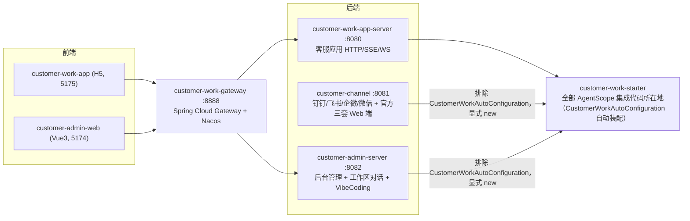
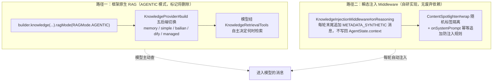
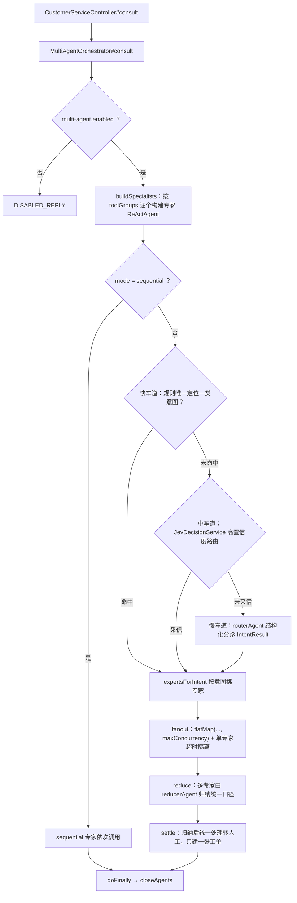
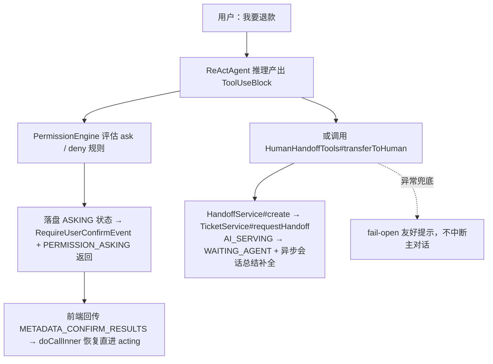
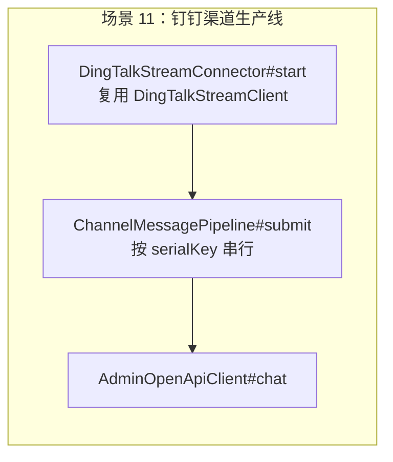
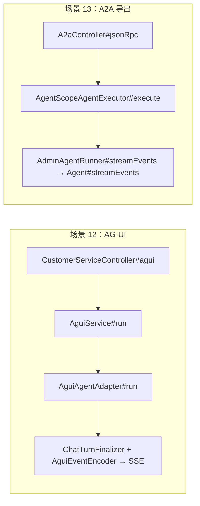
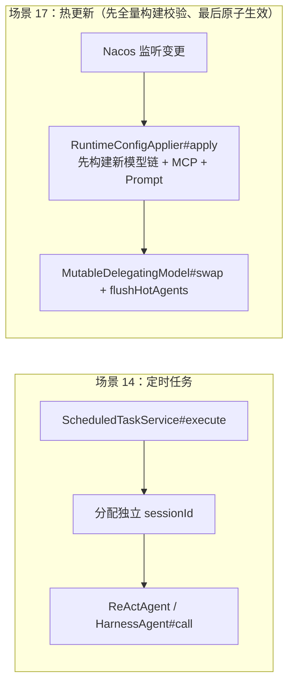

# 第 9 章 customer_work 场景全景映射（实战）

> 本章从**业务场景**视角出发：每个场景 = 用了什么 AgentScope 能力 + 入口在哪 + 调用链长什么样 + 对应本指南哪一章。
> 实战路径相对 customer_work 仓库根；`starter/...` 代表 `customer-work-starter/src/main/java/com/richard/fyoung/customerwork/...`，`admin/...` 代表 `customer-admin-server/src/main/java/com/richard/fyoung/customeradmin/...`。starter 内部按职责分层：`core/`（agent、service、memory、middleware、model）、`data/`（rag、ticket、calllog）、`safety/`（quota、sensitiveword、security）、`capability/`（handoff、semanticcache、routing、typesafe……）、`infra/`（config、lock）、`tool/`、`observability/`。
> 本章业务链路保留 customer_work 历史提交 `17007e4a`（2026-10-02，依赖 **AgentScope 2.0.3**），不声称该应用本身已升级。框架对照基线统一为官方 main `80926f92df182d258118456ae458043af0d7e807`（`2.1.0-SNAPSHOT`）。

### 与当前框架 main（`80926f92`）的兼容与升级边界

1. **`ThreadJournal` 默认启用与 2.0 存档自动导入**：历史应用通过 `.stateStore(...).defaultSessionId(...)` 存取状态。当前 `HarnessAgent` 默认开启 `journalEnabled = true` 与 `WorkspaceThreadJournalStore`，但仍保留 `inner.stateStore(...)` 以便在空 `main` 线程首次激活时将 2.0 `agent_state` 自动作为 `migration/baseline` 导入日志并做主线程镜像回写（第 2、7 章）；若希望维持纯键值快照模式，需显式配置 `.journalEnabled(false)`。
2. **Builder 权限规则首次激活生效 + 租户能力裁剪**：`#3361` 与 `#3377` 修复了老会话忽略 Builder 新增规则与确认规则不落盘的问题；多租户工具/技能可见性边界在当前 `main` 上可进一步收敛到服务端 `CapabilityResolver` → `CapabilitySurface`（第 3 章 3.5）。
3. **最终请求级预算与中间件排序特例**：当前 `HarnessContextBuilder#prepare` 在最内层统一核算系统指令、动态来源、对话历史与工具 Schema 的总预算；`ContextConventionsMiddleware` 以 `Integer.MAX_VALUE - 1000` 排在项目治理中间件（`50~200`）外侧先做每轮材料池重置，其余内置层仍为 `1`，与 `MiddlewareOrders` 顺序契约兼容（第 6 章）。
4. **跨断连持久执行与废弃接口边界**：原 `AgentSession` 与 `agentscope-service` 已由 `agentscope-durable`（`DurableRuntime` + `AgentScopeAdapter`）接替（第 8 章 8.3）；原生 `Knowledge`、`LongTermMemory` 与旧 `Hook` 在当前 `main` 仍可编译运行，但保持 `@Deprecated(forRemoval = true)` 标记。

## 9.0 项目模块与请求流向

## 9.1 场景速查表

| # | 业务场景 | AgentScope 能力 | 入口 | 详见 |
|---|---|---|---|---|
| 1 | 客服同步对话 | `ReActAgent#call` + StateStore + 权限 + Middleware 链 | `starter/core/service/CustomerServiceService#chat` | 第 3 章 |
| 2 | 流式回复（SSE） | `ReActAgent#streamEvents` 事件流 | 同上 `#chatStream` | 第 3、6 章 |
| 3 | 结构化意图识别 | `call(prompt, Class, ctx)` 结构化输出 + 专用轻量 Agent | 同上 `#classifyIntent` | 第 3 章 3.7 |
| 4 | 知识库检索 / RAG | `Knowledge` + `RAGMode.AGENTIC`（标记将删除）+ 自研注入 middleware | `starter/data/rag/KnowledgeProvider` | 本章 9.2、第 8 章 |
| 5 | 七域业务工具 | `Toolkit` 分组 + `@Tool` + 后端 SPI | `starter/tool/ToolRegistrar` | 第 4 章 |
| 6 | MCP / AI 网关 | `McpClientBuilder` + `HigressMcpClientBuilder` | `starter/tool/McpToolkitConfigurer` | 第 4 章 |
| 7 | 三层会话记忆 | StateStore（L1）+ `LongTermMemory`（L2，标记将删除）+ 自研 FactLog（L3）+ Compaction | `starter/core/memory/` | 第 2、7 章 |
| 8 | 多 Agent 编排 | 多 `ReActAgent` + Reactor 手工编排 + subagent 注册 | `starter/core/agent/MultiAgentOrchestrator` | 本章 9.3 |
| 9 | Harness 高级能力 | `HarnessAgent.Builder.fromAgent` + Compaction / Sandbox / Subagent | `starter/core/agent/HarnessAgentFactory` | 第 7 章 |
| 10 | 人机协作（审批+转人工） | `PermissionEngine` ask 规则 + `@Tool` 转工单 | `starter/infra/config/PermissionConfig`、`tool/HumanHandoffTools` | 本章 9.4 |
| 11 | 多渠道接入 | harness `Channel` + `DingTalkStreamClient` 复用 | `customer-channel/.../access/...` | 第 7、8 章 |
| 12 | AG-UI 协议 | `AguiAgentAdapter` + `AguiEventEncoder` | `starter/core/agent/AguiService` | 第 8 章 |
| 13 | A2A 对外导出 | `AgentScopeA2aServer` + 自定义 `AgentRunner` | `admin/a2a/A2aController` | 第 8 章 |
| 14 | 定时任务驱动 Agent | `XxlJobAgentScheduler` / 同步 `Agent#call` | `starter/infra/config/XxlJobSchedulerConfig`、`admin/aiconfig/scheduledtask/` | 第 8 章 |
| 15 | VibeCoding 编码助手 | HarnessAgent workspace + `agent_spawn` + 自研 `TaskRepository` | `admin/workspace/vibecoding/` | 第 7 章 |
| 16 | 可观测与调用日志 | `OtelTracingMiddleware` + 自研 `Tracer` + 框架 Hook `JsonlTraceExporter` + 打点 middleware | `starter/observability/`、`starter/data/calllog/` | 第 6 章 |
| 17 | 配置热更新 | Nacos 提示词 + `MutableDelegatingModel#swap` | `starter/infra/config/NacosPromptService`、`RuntimeConfigApplier` | 第 5 章 |

### 所有入口共用的装配：`CustomerServiceAgentFactory#createAgent` + `AgentGovernanceAssembler#applyTo`

`starter/core/agent/CustomerServiceAgentFactory#createAgent` 每一行 Builder 调用都对应前面某一章：

| Builder 调用 | 作用 | 对应章节 |
|---|---|---|
| `.toolkit(buildToolkit(sessionId))` | `ToolkitConfigs.sequentialWith(...)`：收紧工具执行超时为 15s；业务工具按域分组注册，可选 Meta-Tool、MCP、Higress | 第 4 章 |
| `.stateStore(stateStore).defaultSessionId(sessionId)` | 会话状态外置到 StateStore，按 `(userId, sessionId)` 加载/持久化 | 第 2 章 |
| `.permissionContext(permissionContext)` | 权限引擎：`PermissionConfig` 为配置里的敏感工具逐个 `addAskRule` / `addDenyRule` | 第 3 章 3.5 |
| `.maxIters(...)`、`.enablePendingToolRecovery(...)` | 推理轮数上限；中断后恢复待执行工具 | 第 3 章 |
| `.enableTaskList()` | 框架内置 `TodoTools` 与 `TaskReminderMiddleware` | 第 4、6 章 |
| `governanceAssembler.applyTo(builder)` | 统一挂载并发冲突策略、生命周期门禁、风控脱敏、审计与计量中间件 | 第 6 章 |
| `.hook(traceExporter())` | 框架遗留 Hook `JsonlTraceExporter`，JSONL trace 落盘 | 第 6 章 |
| `.longTermMemory(...).longTermMemoryMode(BOTH)` | 2.0.0 起标记将删除的长期记忆接口 | 第 8 章 8.1 |
| `.knowledge(...).ragMode(RAGMode.AGENTIC)` | 2.0.0 起标记将删除的原生 RAG 接口 | 第 8 章 8.1 |
| `.skillBox(...)`、`.skillCodeExecutionEnabled(true)` | 技能库与代码执行技能开关 | 第 7 章 |

### 场景 1~3：一次客服请求的三条入口

```mermaid
flowchart TB
    subgraph S1["场景 1：同步对话"]
        C1["CustomerServiceController#chat"] --> SV1["CustomerServiceService#chat"]
        SV1 --> Q1{"TenantQuotaGuard#check"}
        Q1 -->|"BLOCK，或 DEGRADE 无备用模型"| QR["QUOTA_EXCEEDED_REPLY（fail-closed）"]
        Q1 -->|"放行 / 降级"| SC1{"启用语义缓存？<br/>SemanticCacheService#lookup"}
        SC1 -->|"命中"| HIT["applyOutboundGuard 出站过滤后直接返回"]
        SC1 -->|"未命中 / 未启用"| IA["invokeAgent → resolveAgent（sessionAgents 热缓存）"]
        IA --> LOCK["withSessionLock（InMemory / Redisson 分布式锁）"]
        LOCK --> CALL["ReActAgent / HarnessAgent#call(spotlightAttachments(text), ctx)"]
        Q1 -.->|"降级"| DEG["contextWrite(ModelRoutingContext#preferFallback)"]
    end
    subgraph S2["场景 2：流式回复"]
        C2["CustomerServiceController#chatStream"] --> SV2["CustomerServiceService#chatStream"]
        SV2 --> SC2{"语义缓存"}
        SC2 -->|"命中"| SCA["streamCachedAnswer 切块模拟流式"]
        SC2 -->|"未命中"| SFA["withSessionLockFlux → streamEvents → publishOn(boundedElastic)<br/>丢弃 source != null 的子 Agent 事件 · 取 TextBlockDeltaEvent"]
        SFA --> GUARD["SensitiveWordStreamGuard 逐片过滤 + 流末 flush"]
    end
    subgraph S3["场景 3：结构化意图识别"]
        C3["CustomerServiceController#classifyIntent"] --> SV3["CustomerServiceService#classifyIntent"]
        SV3 --> USING["Mono.using 新建专用轻量分类 Agent（空工具集、不落状态，用完即关）"]
        USING --> SO["ReActAgent#call(prompt, IntentResult.class, ctx)"]
        SO -->|"无结构化数据 / 异常"| FB["fallbackIntent：intent = other"]
    end
```

## 9.2 场景 4：RAG 的两条互补路径

## 9.3 场景 8：多 Agent 编排（快中慢三车道 + 并行会诊 + reduce）

## 9.4 场景 10：人机协作全链路（审批 + 转人工 + 工单）

## 9.5 渠道、协议、定时与热更新链路（场景 11 / 12 / 13 / 14 / 17）

