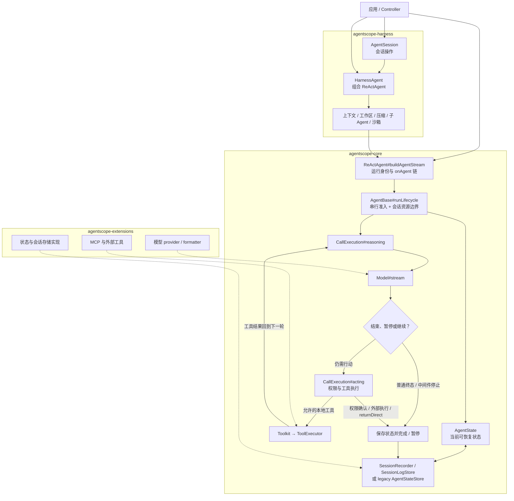
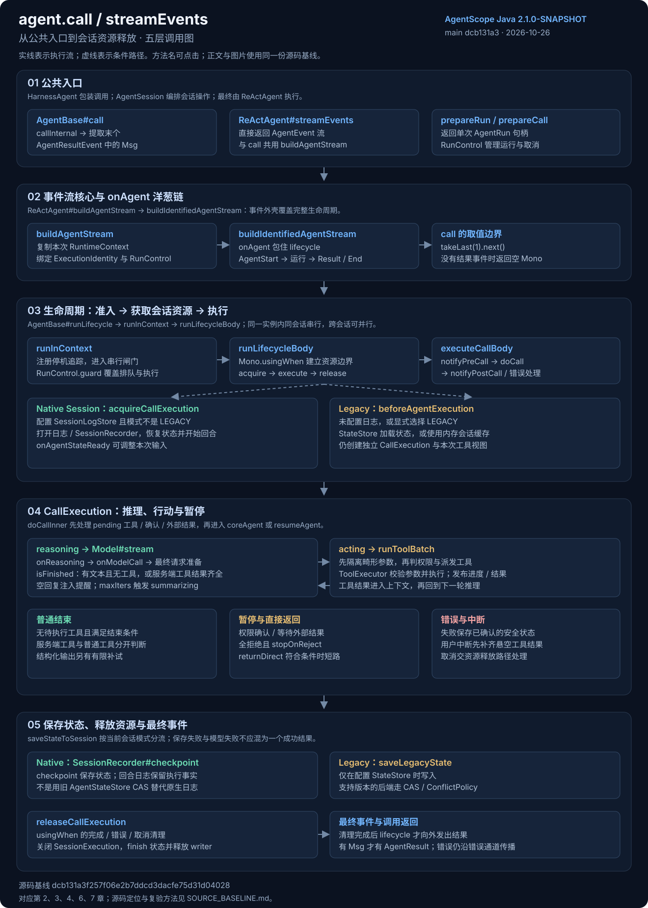

# AgentScope Java 源码阅读指南

> **源码版本：`2.1.0-SNAPSHOT`**。全文框架说明与图片统一对齐官方 **main [`dcb131a3f257f06e2b7ddcd3dacfe75d31d04028`](https://github.com/agentscope-ai/agentscope-java/commit/dcb131a3f257f06e2b7ddcd3dacfe75d31d04028)**，核对日期 **2026-10-26**。
> 框架仓库：[agentscope-ai/agentscope-java](https://github.com/agentscope-ai/agentscope-java)。版本来自该提交根 `pom.xml` 的 `<revision>`；源码链接固定到完整 SHA，后续 main 移动不会使本次说明的定位漂移。
> [基线与核对记录](SOURCE_BASELINE.md) 列出源码入口、模块计数口径和复验方法。历史版本仅用于解释迁移差异，不能代替当前实现。
> customer_work 实战保持独立的历史快照 **`17007e4a`（依赖 `2.0.3`）**，不表示该应用已升级到 `2.1.0-SNAPSHOT`。框架路径相对 agentscope-java 根目录；实战路径相对 customer_work 根目录。

## 一、这份指南怎么读

AgentScope Java 基于 Java 17 与 Project Reactor（`Mono` / `Flux`）构建 Agent。理解一次调用，需要同时看清执行循环、会话状态和事件流：

- **`agentscope-core`**：ReAct 循环、消息与状态、原生 Session 日志、工具、模型抽象、Middleware、权限和动作观测。当前有 **22 个直接子包**。
- **`agentscope-harness`**：组合 ReActAgent，装配工作区、文件系统、沙箱、子 Agent、上下文预算、压缩与验证能力；`AgentSession` 提供会话操作入口。
- **`agentscope-extensions`**：22 个一级 Maven 模块（包含 starters 聚合），递归有 **67 个 jar 模块，其中 66 个允许发布**；包括模型、存储、RAG、长期记忆、渠道、协议、沙箱、评测和 14 个 starter。聚合 POM 与不发布的模型端到端测试模块单独计数，见第 8 章。
- **`agentscope-service`**：框架之上的管控平台。Go 控制面位于 `service-controlplane`，Java 侧有 gateway / dataplane / scheduler / common；它消费 Harness 与扩展能力，不是执行一次裸 ReAct 调用的前提。

阅读顺序建议从数据进入执行，再看工程化组合：

```text
1 模块地图 → 2 消息、状态与 Session → 3 ReAct 主循环
→ 4 工具系统 → 5 模型层 → 6 Middleware 与事件流
→ 7 Harness → 8 扩展生态 → 9 历史应用映射 → 10 避坑与迁移
```

“主链相关”不等于“每次调用都执行”：没有工具调用就不会执行工具，未配置 SessionLogStore 的裸 ReActAgent 仍可走 legacy 状态路径，外部扩展按依赖与配置启用。

## 二、章节目录

| 章 | 文件 | 主要问题 |
|---|---|---|
| 1 | [模块全景与依赖拓扑](01-模块全景与依赖拓扑.md) | 7 个顶层 Maven 模块、22 个 core 包，依赖方向是什么？ |
| 2 | [消息与状态模型](02-消息与状态模型.md) | Msg、AgentState、SessionLog 与 StateStore 各保存什么？ |
| 3 | [ReAct 主循环](03-ReAct主循环.md) | 公共入口如何进入推理/行动，如何暂停、取消与保存？ |
| 4 | [工具系统](04-工具系统.md) | 工具视图、Schema、参数解析、拦截器、进度和 MCP 如何连接？ |
| 5 | [模型层](05-模型层.md) | 模型请求准备、协议转换、SSE、缓存和 10 个 SPI providerId 如何工作？ |
| 6 | [Middleware 与事件流](06-Middleware与事件流.md) | 五个变换切点与状态就绪回调如何运行，32 种事件在哪里发布？ |
| 7 | [Harness 工程化外壳](07-Harness工程化外壳.md) | AgentSession、上下文、沙箱、子 Agent、压缩和验证如何组合？ |
| 8 | [扩展生态](08-扩展生态.md) | 66 个可发布 jar 的能力边界，以及 service 的当前结构是什么？ |
| 9 | [customer_work 场景全景映射](09-customer_work场景全景映射.md) | 17 个历史业务场景如何使用框架，与当前 main 有哪些边界？ |
| 10 | [避坑清单](10-避坑清单.md) | 历史问题在当前源码中的状态与迁移约束是什么？ |

## 三、全局架构图

实线表示应用入口、组合关系或执行流；虚线表示可插拔接口实现。调用细节见第 3 章，依赖拓扑见第 1 章。



下图展开公共入口、运行身份、生命周期、ReAct 循环与持久化分支。它与正文使用相同的 main SHA；点击 SVG 内的方法可以跳转到对应源码。



## 四、customer_work 实战的使用边界

[customer_work](https://github.com/liulangjietou/customer_work/tree/17007e4a) 是业务集成对照材料。本指南保留 `17007e4a` 快照中的客服、RAG、模型路由、子 Agent、人工确认等场景；第 9 章应用侧调用图依据该快照，框架侧解释依据本次 main。

| 应用模块 | 职责与框架关系 |
|---|---|
| `customer-work-starter` | 业务 Agent 装配、模型与工具接入、会话和记忆等可复用基础设施 |
| `customer-work-app-server` | 用户对话入口，经 starter 编排应用能力 |
| `customer-channel` | 消息渠道与官方 Web starter 接入 |
| `customer-admin-server` | 管理、工作区对话与 Agent 配置，包含独立的运行时装配 |
| `customer-work-gateway` | 应用路由，不承担 ReAct 执行职责 |

阅读实战时先确认应用依赖版本；本文并未把该历史应用迁移到新的 Native Session、上下文构建或工具扩展接口。

## 五、框架自带的对照学习材料

- `agentscope-examples/documentation/src/main/java/io/agentscope/examples/documentation2/`：17 个直接子包，包括 `agui`、`copilotkit`、`judge`、`harness`、`middleware`、`model`、`state`、`tool` 等，与官方文档和能力示例对应。
- `agentscope-examples/pom.xml`：当前聚合 `documentation`、`jev` 和 paw / chat / dataagent / codingagent 四个应用。不要把已移动的旧示例目录当作当前 Maven 模块。
- `docs/v2/zh/docs/`：中文官方文档；`harness/architecture.md`、`building-blocks/middleware.md` 可辅助理解，但最终以同一 SHA 的 Java 实现为准。
- 根目录 `SKILL.md`：框架约定与 Reactor 使用限制。
- `docs/v2/zh/docs/others/release-notes.md`：该 main 快照已有 `2.0.4`、`2.0.3` 等记录；发布历史与当前 POM 版本是不同事实。本指南不再使用“所有 main 改动尚未发布”这一笼统判断。
