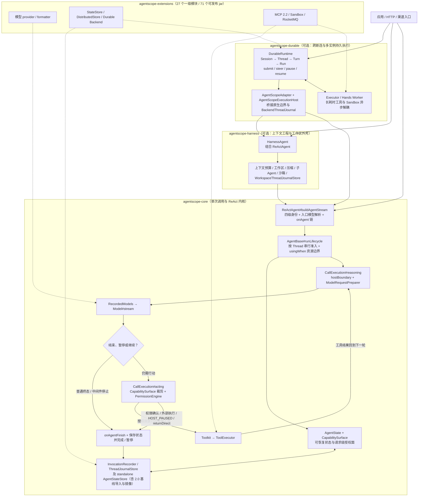
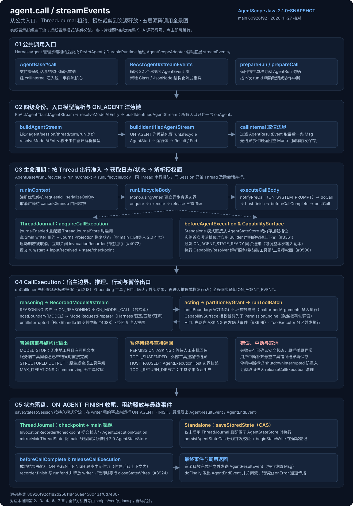
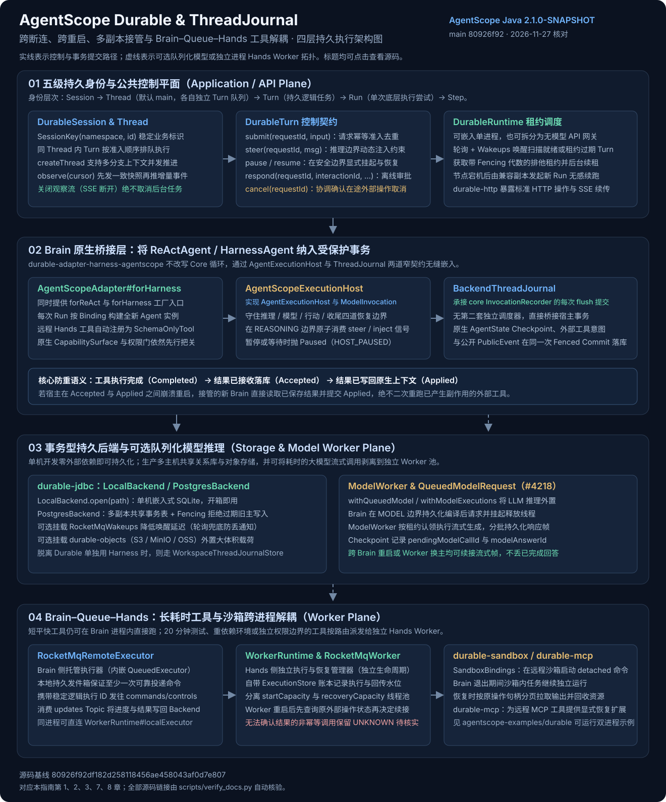

# AgentScope Java 源码阅读指南

> **源码版本：`2.1.0-SNAPSHOT`**。全文框架说明与图片统一对齐官方 **main [`80926f92df182d258118456ae458043af0d7e807`](https://github.com/agentscope-ai/agentscope-java/commit/80926f92df182d258118456ae458043af0d7e807)**，核对日期 **2026-11-27**。
> 框架仓库：[agentscope-ai/agentscope-java](https://github.com/agentscope-ai/agentscope-java)。版本来自该提交根 `pom.xml` 的 `<revision>`；源码链接固定到完整 SHA，后续 main 移动不会使本次说明的定位漂移。
> [基线与核对记录](SOURCE_BASELINE.md) 列出源码入口、模块计数口径和复验方法。历史版本（`v2.0.3`、`v2.0.4`、`v2.0.5`、`v2.1.0-BETA1`）仅用于解释演进与升级差异，不能代替当前实现。
> customer_work 实战保持独立的历史快照 **`17007e4a`（依赖 `2.0.3`）**，不表示该应用已升级到 `2.1.0-SNAPSHOT`。框架路径相对 agentscope-java 根目录；实战路径相对 customer_work 根目录。

## 一、这份指南怎么读

AgentScope Java 基于 Java 17 与 Project Reactor（`Mono` / `Flux`）构建 Agent。当前主干形成了清晰的**三层核心边界（Core → Harness → Durable）**与外围扩展生态：

- **`agentscope-core`**：ReAct 循环、消息与状态、原生 `ThreadJournal` 日志（`core/journal/`）、工具与按需检索（`ToolSearchMiddleware`）、模型抽象与请求级选型、Middleware（8 个扩展点）、请求级授权面（`CapabilitySurface`）+ 权限引擎以及动作观测。当前有 **22 个直接子包**。
- **`agentscope-harness`**：组合 `ReActAgent`，装配工作区、文件系统、沙箱、子 Agent、上下文预算、压缩、`WorkspaceThreadJournalStore` 与确定性验证能力。
- **`agentscope-durable`**：构建在 Core/Harness 之上的**可嵌入持久执行层**（取代已移除的原 `agentscope-service`）。围绕 `Session → Thread → Turn → Run` 四级身份提供跨客户端断连、进程重启与节点漂移的任务编排，支持 `submit / steer / pause / resume / cancel / respond`、队列化模型调用（`ModelWorker`）以及 **Brain–Queue–Hands** 远程长耗时工具解耦。
- **`agentscope-extensions`**：**27 个一级 Maven 模块**（包含 starters 聚合与 6 个 `-durable-*` 基础设施扩展），递归有 **72 个 jar 模块，其中 71 个允许发布**；覆盖模型、存储、RAG、长期记忆、渠道、协议、沙箱、Durable 基础设施、评测和 14 个 starter。聚合 POM 与不发布的端到端测试模块单独计数，见第 8 章。

阅读顺序建议从数据进入单次执行，再看上下文工程与跨进程持久执行：

```text
1 模块地图 → 2 消息、状态与 ThreadJournal → 3 ReAct 主循环
→ 4 工具系统 → 5 模型层 → 6 Middleware 与事件流
→ 7 Harness 工程化外壳 → 8 扩展生态与 Durable 持久执行 → 9 历史应用映射 → 10 避坑与版本演进
```

“主链相关”不等于“每次调用都执行”：没有工具调用就不会执行工具，未配置 `ThreadJournalStore` 的裸 `ReActAgent` 仍可走 standalone `AgentStateStore` 路径，Durable 运行时与外部扩展均按依赖和配置按需启用。

## 二、章节目录

| 章 | 文件 | 主要问题 |
|---|---|---|
| 1 | [模块全景与依赖拓扑](01-模块全景与依赖拓扑.md) | 7 个顶层 Maven 模块、Core/Harness/Durable 三层边界与 22 个 core 包怎么分工？ |
| 2 | [消息与状态模型](02-消息与状态模型.md) | 10 种 `ContentBlock`、`AgentState`、`ThreadJournal` 与 `AgentStateStore` 各承担什么职责？ |
| 3 | [ReAct 主循环](03-ReAct主循环.md) | 公共入口如何进入推理/行动，`CapabilitySurface`、`AgentExecutionHost`、暂停、取消与落盘如何协同？ |
| 4 | [工具系统](04-工具系统.md) | 工具授权与请求视图、`ToolSearchMiddleware`、Schema、拦截器、进度与 MCP 2.2.0 如何连接？ |
| 5 | [模型层](05-模型层.md) | 按请求选模型（`modelId`）、`DocumentBlock`、协议转换、SSE、缓存和 10 个 SPI provider 如何工作？ |
| 6 | [Middleware 与事件流](06-Middleware与事件流.md) | 8 个扩展点与 `ActivePointsResolver` 如何运行，32 种流式事件在哪里发布与观测？ |
| 7 | [Harness 工程化外壳](07-Harness工程化外壳.md) | `WorkspaceThreadJournalStore`、上下文预算、沙箱、子 Agent、压缩和验证如何组合？ |
| 8 | [扩展生态](08-扩展生态.md) | 71 个可发布 jar 的能力矩阵是什么，`agentscope-durable` 的 Brain–Queue–Hands 如何运作？ |
| 9 | [customer_work 场景全景映射](09-customer_work场景全景映射.md) | 17 个历史业务场景如何使用框架，与当前 main 有哪些兼容边界？ |
| 10 | [避坑清单](10-避坑清单.md) | 历史问题在当前源码中的状态，以及 `v2.0.4` / `v2.0.5` / `v2.1.0-BETA1` / `main` 如何对照升级？ |

## 三、全局架构图

实线表示应用入口、组合关系或执行流；虚线表示可插拔接口实现。单次调用细节见第 3 章，Durable 持久执行见第 8 章，依赖拓扑见第 1 章。



下面两张 SVG 全景图分别展开**单次 `agent.call` 的五层微观调用链**与 **Durable 跨进程持久执行（含 `ThreadJournal` 与 Brain–Queue–Hands）架构**。图片与正文共享同一个固定 main SHA（`80926f92`），点击图内方法或类名可直接跳到对应源码声明行：





## 四、customer_work 实战的使用边界

[customer_work](https://github.com/liulangjietou/customer_work/tree/17007e4a) 是业务集成对照材料。本指南保留 `17007e4a` 快照中的客服、RAG、模型路由、子 Agent、人工确认等场景；第 9 章应用侧调用图依据该快照，框架侧解释依据本次 main。

| 应用模块 | 职责与框架关系 |
|---|---|
| `customer-work-starter` | 业务 Agent 装配、模型与工具接入、会话和记忆等可复用基础设施 |
| `customer-work-app-server` | 用户对话入口，经 starter 编排应用能力 |
| `customer-channel` | 消息渠道与官方 Web starter 接入 |
| `customer-admin-server` | 管理、工作区对话与 Agent 配置，包含独立的运行时装配 |
| `customer-work-gateway` | 应用路由，不承担 ReAct 执行职责 |

阅读实战时先确认应用依赖版本；本文并未把该历史应用迁移到新的 `ThreadJournal`、`CapabilitySurface`、`HarnessContextBuilder` 或 `DurableRuntime` 接口。

## 五、框架自带的对照学习材料

- `agentscope-examples/documentation/src/main/java/io/agentscope/examples/documentation2/`：17 个直接子包，包括 `agui`、`copilotkit`、`judge`、`harness`、`middleware`、`model`、`state`、`tool` 等，与官方文档和能力示例对应。
- `agentscope-examples/pom.xml`：当前聚合 **7 个子模块**——`documentation`、`jev`、新增的 **`durable`**（含 `integrated` 单体恢复与 `brain-hands` 分布式工具 Worker 两组可运行示例），以及 `paw` / `chat` / `dataagent` / `codingagent` 四个完整应用。
- `docs/dev/zh/docs/` 与 `docs/v2/zh/docs/`：官方中文文档；其中 `docs/dev/zh/docs/harness/durable.md`、`building-blocks/middleware.md`、`building-blocks/permission-system.md` 对应 2.1 开发线，最终行为一律以同一 SHA 的 Java 实现为准。
- 根目录 `SKILL.md`：框架约定与 Reactor 使用限制。
- `docs/v2/zh/docs/others/release-notes.md`：当前已收录 `2.0.5`（163 项修复回合）、`2.0.4`、`2.0.3` 等维护分支发布说明；2.0.x 维护线与 `2.1.0-SNAPSHOT` 开发主干的关系见第 10 章 10.4。
